<div align="center">

<a href="https://evolink.ai/gemini-omni?utm_source=github&utm_medium=banner&utm_campaign=awesome-gemini-omni-guide-api-and-prompt&utm_content=readme_banner"></a>

[](LICENSE)
[](https://evolink.ai/gemini-omni-1-2-flash?utm_source=github&utm_medium=badge&utm_campaign=awesome-gemini-omni-guide-api-and-prompt&utm_content=model_try)

[](README.md) [](README_es.md) [](README_pt.md) [](README_ja.md) [](README_ko.md) [](README_de.md) [](README_fr.md) [](README_tr.md) [](README_zh-TW.md) [](README_zh-CN.md) [](README_ru.md)

</div>

# Gemini Omni 1.2 Flash Guide & Prompt Library

## 🍌 Introduction
**A guide to Gemini Omni 1.2 Flash, with a preserved library of Gemini Omni family prompts, editing demos, comparisons, and community videos.** The guide helps creators and developers choose a task and understand its input and output limits.

> [!NOTE]
> The legacy prompt cases, comparisons, and community gallery are historical Gemini Omni family material. Their original prompts, sources, and media are retained; they are not presented as Gemini Omni 1.2 Flash results or benchmarks.

<a id="omni-1-2-guide"></a>
## 🆕 Gemini Omni 1.2 Flash

Google lists Gemini Omni 1.2 Flash as GA, released on **November 5, 2026**. Its main changes from 1.1 are generation up to **15 seconds** on applicable routes and **standalone video upscaling**. Read the [Google model specification](https://docs.cloud.google.com/gemini-enterprise-agent-platform/models/gemini/omni-1-2-flash) and [EvoLink's November 5 announcement](https://evolink.ai/changelog?utm_source=github&utm_medium=readme&utm_campaign=awesome-gemini-omni-guide-api-and-prompt&utm_content=release_source#2026-11-05-gemini-omni-1-2-flash).

- Text, image, and video inputs; video output with synchronized speech, music, and sound effects. Audio-file input and sound editing are not supported.
- Native **360p / 720p** output; **1080p / 4K is upscaled**, not native 4K. The documented output is 24 fps, in 16:9 or 9:16.
- On EvoLink, choose text-to-video, image-to-video with a single first frame, or reference-to-video with reference images and up to one reference video for a **15-second** generation. With a first-and-last-frame pair or two to three reference videos, use **3–10 seconds**.
- Extension appends **3–10 seconds**; this value is the added duration, not the total finished length.

### Choose an EvoLink task

Each task links to its own request contract. Read the [full parameter docs](https://evolink.ai/docs/en/api-manual/video-series/gemini-omni-1.2-flash/gemini-omni-1.2-flash-overview?utm_source=github&utm_medium=readme&utm_campaign=awesome-gemini-omni-guide-api-and-prompt&utm_content=parameter_overview) before changing routes.

| Task | When to use it | Route-specific limits |
| :--- | :--- | :--- |
| [Read text-to-video docs](https://evolink.ai/docs/en/api-manual/video-series/gemini-omni-1.2-flash/gemini-omni-1.2-flash-text-to-video?utm_source=github&utm_medium=readme&utm_campaign=awesome-gemini-omni-guide-api-and-prompt&utm_content=route_text) | Create a shot from a text prompt. | 3–15 seconds. |
| [Read image-to-video docs](https://evolink.ai/docs/en/api-manual/video-series/gemini-omni-1.2-flash/gemini-omni-1.2-flash-image-to-video?utm_source=github&utm_medium=readme&utm_campaign=awesome-gemini-omni-guide-api-and-prompt&utm_content=route_image) | Animate one first frame, or connect first and last frames. | One image: 3–15 seconds; two images: 3–10 seconds. |
| [Read reference-to-video docs](https://evolink.ai/docs/en/api-manual/video-series/gemini-omni-1.2-flash/gemini-omni-1.2-flash-reference-to-video?utm_source=github&utm_medium=readme&utm_campaign=awesome-gemini-omni-guide-api-and-prompt&utm_content=route_reference) | Guide a new shot with image/video references. | Up to 10 images and 3 reference videos; above 10 seconds, at most 1 reference video. |
| [Read video-edit docs](https://evolink.ai/docs/en/api-manual/video-series/gemini-omni-1.2-flash/gemini-omni-1.2-flash-video-edit?utm_source=github&utm_medium=readme&utm_campaign=awesome-gemini-omni-guide-api-and-prompt&utm_content=route_edit) | Change an existing clip using a prompt. | One input video up to 15 seconds; optional reference images; quality defaults to `auto`. |
| [Read video-extend docs](https://evolink.ai/docs/en/api-manual/video-series/gemini-omni-1.2-flash/gemini-omni-1.2-flash-video-extend?utm_source=github&utm_medium=readme&utm_campaign=awesome-gemini-omni-guide-api-and-prompt&utm_content=route_extend) | Continue the end of a clip. | One input video up to 30 seconds; append 3–10 seconds. |
| [Read video-upscale docs](https://evolink.ai/docs/en/api-manual/video-series/gemini-omni-1.2-flash/gemini-omni-1.2-flash-video-upscale?utm_source=github&utm_medium=readme&utm_campaign=awesome-gemini-omni-guide-api-and-prompt&utm_content=route_upscale) | Increase the resolution of a selected finished clip. | Input up to 15 seconds in a supported standard size; no prompt. See the platform distinction below. |

### Platform and version distinctions

- **References:** [AI Studio's usage guide](https://aistudio.google.com/docs/omni) allows up to 6 images, while Google Cloud and EvoLink document up to 10. Reference-video limits also depend on output length; use the contract for the selected platform.
- **Upscaling:** Google Cloud documents 360p→720p/1080p and 720p→1080p/4K, and excludes 1080p→4K. EvoLink's documentation also lists 1080p→4K. Confirm that extra pair with the selected platform; it is not a shared cross-platform guarantee. Read [Google's upscaling constraints](https://docs.cloud.google.com/gemini-enterprise-agent-platform/models/video/upscale-videos).
- **Conversation state:** Google's Interactions API supports conversational editing. EvoLink's asynchronous video tasks use their own request contract; do not transfer `previous_interaction_id` or other Google-only parameters to them.
- **Migration:** [Google's model page](https://aistudio.google.com/docs/models/gemini-omni-flash) schedules Gemini API's 1.1 stable ID to route to 1.2 on December 3, 2026. This does not establish migration of EvoLink's 1.1 routes. Select the explicit 1.2 task instead of treating the old generic ID as an alias.
- **Cost:** The EvoLink model page displays token-based pricing; a token rate is not a fixed price per second or per finished clip. Check the current route, resolution, and actual usage before estimating a job.

Sources checked: **November 6, 2026**.

<a id="quick-start"></a>
## ⚡ Quick Start

[Try Gemini Omni 1.2 Flash in your browser](https://evolink.ai/gemini-omni-1-2-flash?utm_source=github&utm_medium=quickstart&utm_campaign=awesome-gemini-omni-guide-api-and-prompt&utm_content=browser_try) or [read the current task documentation](https://evolink.ai/docs/en/api-manual/video-series/gemini-omni-1.2-flash/gemini-omni-1.2-flash-overview?utm_source=github&utm_medium=quickstart&utm_campaign=awesome-gemini-omni-guide-api-and-prompt&utm_content=task_docs).

Choose text-to-video, image-to-video, references, editing, extension, or upscaling in the task table above. Follow the selected task's current documentation for its inputs, limits, and result workflow.

## 📑 Menu
- [Gemini Omni 1.2 Flash guide](#omni-1-2-guide)
- [Quick Start](#quick-start)
- [Gemini Omni 1.2 official demos](#omni12-demos)
- [Gemini Omni 1.2 Community Demo Wall](#omni12-community-demos)
- [🎯 Prompt Ingredients](#-prompt-ingredients)
- [✂️ Edit](#️-edit)
  - [🔄 Element Replacement](#-element-replacement)
    - [Case 1: Butterfly to Bee](#case-1-butterfly-to-bee)
    - [Case 2: Bee to Fireflies](#case-2-bee-to-fireflies)
    - [Case 3-5: Spaceships & Astronaut Series](#case-3-5-spaceships--astronaut-series)
    - [Case 6: Train 1896 Transform (by @emollick)](#case-6-train-1896-transform-by-emollick)
    - [Case 7: Remove Person from Video (by @arrakis_ai)](#case-7-remove-person-from-video-by-arrakis_ai)
    - [Case 8: Invisible Violin](#case-8-invisible-violin)
    - [Case 9: Location Change via World Knowledge (by @venturetwins)](#case-9-location-change-via-world-knowledge-by-venturetwins)
    - [Case 10: Animation to Live Action (by @arrakis_ai)](#case-10-animation-to-live-action-by-arrakis_ai)
  - [🎬 Base Scene](#-base-scene)
    - [Case 1: Violinist Base Shot](#case-1-violinist-base-shot)
  - [📷 Camera Direction](#-camera-direction)
    - [Case 1: Over-the-Shoulder Angle](#case-1-over-the-shoulder-angle)
    - [Case 2: Camera Tilt Shoes to Medium Shot](#case-2-camera-tilt-shoes-to-medium-shot)
    - [Case 3: Travel Selfie Hyperlapse (by @ZaraIrahh)](#case-3-travel-selfie-hyperlapse-by-zarairahh)
    - [Case 4: Fashion Drone Shot (by @ariaxawan)](#case-4-fashion-drone-shot-by-ariaxawan)
    - [Case 5: Top View to 360 Rotation (by @npaka123)](#case-5-top-view-to-360-rotation-by-npaka123)
    - [Case 6: Omnizoom — Diving Into a Photo (by @alexanderchen)](#case-6-omnizoom--diving-into-a-photo-by-alexanderchen)
  - [🎬 Action & Sync](#-action--sync)
    - [Case 1: Animal Toy Sound](#case-1-animal-toy-sound)
    - [Case 2: Apartments Lights Sync](#case-2-apartments-lights-sync)
    - [Case 3: Marble Chain Reaction](#case-3-marble-chain-reaction)
    - [Case 4: Building Lights](#case-4-building-lights)
    - [Case 5: Boxing Fight Realistic (by @RuzainaMeer)](#case-5-boxing-fight-realistic-by-ruzainameer)
- [🎨 Advanced Multi-Modal](#-advanced-multi-modal)
  - [🪞 Artistic Style](#-artistic-style)
    - [Case 1-3: Mirror Series](#case-1-3-mirror-series)
    - [Case 4: Animation Ads One Shot (by @DenneyDara)](#case-4-animation-ads-one-shot-by-denneydara)
    - [Case 5: Line Drawing Isolation (by @alexanderchen)](#case-5-line-drawing-isolation-by-alexanderchen)
  - [✨ Visual Effects](#-visual-effects)
    - [Case 1: Hand Hole Super Zoom](#case-1-hand-hole-super-zoom)
    - [Case 2: Skateboard Motion Effects](#case-2-skateboard-motion-effects)
    - [Case 3: AR HUD Overlay (by @jerrod_lew)](#case-3-ar-hud-overlay-by-jerrod_lew)
  - [🔗 Cross-Modal](#-cross-modal)
    - [Case 1: Transport to New Environment](#case-1-transport-to-new-environment)
    - [Case 2: Birds Shape With Audio](#case-2-birds-shape-with-audio)
    - [Case 3: Slide to Motion (by @yoshifujidesign)](#case-3-slide-to-motion-by-yoshifujidesign)
    - [Case 4: Isometric Cooking Character with Reference Image (by @kumiko_shiraki)](#case-4-isometric-cooking-character-with-reference-image-by-kumiko_shiraki)
    - [Case 5: ChatGPT Instruction Image as Input (by @Majin_AppSheet)](#case-5-chatgpt-instruction-image-as-input-by-majin_appsheet)
    - [Case 6: ChatGPT Illustration to Omni Animation (by @mmmiyama_D)](#case-6-chatgpt-illustration-to-omni-animation-by-mmmiyama_d)
  - [📋 Storyboard](#-storyboard)
    - [Case 1: Luxury Cosmetic Commercial (by @aiwithaly)](#case-1-luxury-cosmetic-commercial-by-aiwithaly)
    - [Case 2: Show Me in This Story](#case-2-show-me-in-this-story)
    - [Case 3: 3x3 Split Screen (by @alexanderchen)](#case-3-3x3-split-screen-by-alexanderchen)
    - [Case 4: Action Replay from Different Angles (by @jerrod_lew)](#case-4-action-replay-from-different-angles-by-jerrod_lew)
    - [Case 5: Split Screen Video (by @jerrod_lew)](#case-5-split-screen-video-by-jerrod_lew)
  - [🔤 Text Rendering](#-text-rendering)
    - [Case 1: Alphabet Items Sequence](#case-1-alphabet-items-sequence)
    - [Case 2: Word-by-Word Text Sync](#case-2-word-by-word-text-sync)
    - [Case 3: Text Rendering AI News (by @chrisfirst)](#case-3-text-rendering-ai-news-by-chrisfirst)
    - [Case 4: Font Fashion Show (by @HBCoop_)](#case-4-font-fashion-show-by-hbcoop_)
- [⚖️ Comparison](#️-comparison)
  - [Case 1: Seedance 2.0 vs Gemini Omni Flash (by @JSFILMZ0412)](#case-1-seedance-20-vs-gemini-omni-flash-by-jsfilmz0412)
  - [Case 2: Gemini Omni vs Seedance 2.0 Action Scenes (by @CuriousRefuge)](#case-2-gemini-omni-vs-seedance-20-action-scenes-by-curiousrefuge)
- [🧪 Evaluation](#-evaluation)
  - [Case 1: Gemini Omni Quality Evaluation (by @kenichiota0711)](#case-1-gemini-omni-quality-evaluation-by-kenichiota0711)
- [🌐 Community Gallery](#-community-gallery)
- [Related repositories](#related-repositories)
- [🙏 Acknowledge](#-acknowledge)

<a id="omni12-demos"></a>
## 🎬 Gemini Omni 1.2 Demos

Eight official demonstrations published by Google on **November 5, 2026**. Read the [original launch article](https://blog.google/innovation-and-ai/technology/developers-tools/introducing-gemini-omni-1-2-flash/); select a poster to watch Google's original video.

<table>
<tr>
<td width="50%" valign="top">

<a id="omni12-demo-1"></a>
**[15-Second Virtual Try-On](https://storage.googleapis.com/gweb-uniblog-publish-prod/original_videos/ECom_Try_On_Demo.mp4)**

[](https://storage.googleapis.com/gweb-uniblog-publish-prod/original_videos/ECom_Try_On_Demo.mp4)

One model photo and three outfits guide a 15-second try-on montage.

</td>
<td width="50%" valign="top">

<a id="omni12-demo-2"></a>
**[Layered Typography Animation](https://storage.googleapis.com/gweb-uniblog-publish-prod/original_videos/Typographic_Motion_Graphics_Demo.mp4)**

[](https://storage.googleapis.com/gweb-uniblog-publish-prod/original_videos/Typographic_Motion_Graphics_Demo.mp4)

An animated poster assembles materials and lettering; Google shows 1.1 and 1.2 outputs.

</td>
</tr>
<tr>
<td width="50%" valign="top">

<a id="omni12-demo-3"></a>
**[Conversational Background Changes](https://storage.googleapis.com/gweb-uniblog-publish-prod/original_videos/Video_Background_Editing_Demo.mp4)**

[](https://storage.googleapis.com/gweb-uniblog-publish-prod/original_videos/Video_Background_Editing_Demo.mp4)

Successive conversations replace a clip's background while retaining its two armored characters.

</td>
<td width="50%" valign="top">

<a id="omni12-demo-4"></a>
**[Continuous Pantheon Flythrough](https://storage.googleapis.com/gweb-uniblog-publish-prod/original_videos/Pantheon_Tour_Demo_FuU0KUh.mp4)**

[](https://storage.googleapis.com/gweb-uniblog-publish-prod/original_videos/Pantheon_Tour_Demo_FuU0KUh.mp4)

Two architecture photos guide a continuous camera flight through the Pantheon's dome.

</td>
</tr>
<tr>
<td width="50%" valign="top">

<a id="omni12-demo-5"></a>
**[15-Second Beehive Explainer](https://storage.googleapis.com/gweb-uniblog-publish-prod/original_videos/Bee_Hive_Live_Infographic_Demo_ninuxtc.mp4)**

[](https://storage.googleapis.com/gweb-uniblog-publish-prod/original_videos/Bee_Hive_Live_Infographic_Demo_ninuxtc.mp4)

One style frame becomes a four-shot, 15-second illustrated beehive explainer.

</td>
<td width="50%" valign="top">

<a id="omni12-demo-6"></a>
**[Octopus-to-Dancer Motion Transfer](https://storage.googleapis.com/gweb-uniblog-publish-prod/original_videos/Unexpected_Motion_Tracking_Demo_QRzpS2T.mp4)**

[](https://storage.googleapis.com/gweb-uniblog-publish-prod/original_videos/Unexpected_Motion_Tracking_Demo_QRzpS2T.mp4)

A follow-up edit transfers an octopus's fluid motion to a dancer's gown.

</td>
</tr>
<tr>
<td width="50%" valign="top">

<a id="omni12-demo-7"></a>
**[First-to-Last-Frame Ramen Shop](https://storage.googleapis.com/gweb-uniblog-publish-prod/original_videos/Ramen_Bar_Demo_jeWGtqx.mp4)**

[](https://storage.googleapis.com/gweb-uniblog-publish-prod/original_videos/Ramen_Bar_Demo_jeWGtqx.mp4)

First and last frames connect a ramen-shop exterior and interior; Google's comparison includes visible inconsistencies.

</td>
<td width="50%" valign="top">

<a id="omni12-demo-8"></a>
**[Continuous Island Zoom-Out](https://storage.googleapis.com/gweb-uniblog-publish-prod/original_videos/Castaway_Crash_Zoom_Out_Demo.mp4)**

[](https://storage.googleapis.com/gweb-uniblog-publish-prod/original_videos/Castaway_Crash_Zoom_Out_Demo.mp4)

A ten-second shot pulls from a shoreline close-up to a wide island view.

</td>
</tr>
</table>

<a id="omni12-community-demos"></a>
## 🎥 Gemini Omni 1.2 Community Demo Wall

Eighteen Gemini Omni 1.2 Flash examples from creators and tool teams. Select a preview to watch the original video. The title links to the author’s post or write-up, with the prompt where the author shared it.

<table>
<tr>
<td width="50%" valign="top">

<a id="omni12-community-1"></a>
**[Beat-Synced Streetwear Changes](https://x.com/HarshithLucky3/status/2118401265273360530)** · HarshithLucky3

[](https://video-s.twimg.com/amplify_video/2118400792348770305/vid/avc1/640x360/y-KZwoASoz81lFXx.mp4?tag=29)

A street-style walk uses clap cues for rapid outfit changes. The creator shares the prompt.

</td>
<td width="50%" valign="top">

<a id="omni12-community-2"></a>
**[Mixed-Style Birthday Party](https://x.com/ash_twtz/status/2118393918794707053)** · ash_twtz

[](https://video-s.twimg.com/amplify_video/2118393860493905920/vid/avc1/640x360/W2r1uWl7T7aS8Bms.mp4?tag=29)

Characters in stop motion, 3D, comics and anime share one birthday scene.

</td>
</tr>
<tr>
<td width="50%" valign="top">

<a id="omni12-community-3"></a>
**[Timecoded Water Bottle Ad](https://weel.co.jp/media/tech/gemini-omni-1-2-flash/)** · WEEL

[](https://www.youtube.com/watch?v=u6P7rxZlSQI)

WEEL tests a 15-second product ad with three timed beats. The article includes the prompt.

</td>
<td width="50%" valign="top">

<a id="omni12-community-4"></a>
**[Perfume Reveal Between Two Frames](https://blog.segmind.com/gemini-omni-1-2-flash-is-here-generate-and-edit-15-second-videos/)** · Segmind

[](https://segmind-resources.s3.amazonaws.com/blog/gemini-omni-12-flash/i2v-fl10.mp4)

Two reference frames guide a 10-second perfume reveal from a dark studio to sunlit flowers. The article includes the prompt.

</td>
</tr>
<tr>
<td width="50%" valign="top">

<a id="omni12-community-5"></a>
**[Ceramic Artist and Reference Vase](https://blog.segmind.com/gemini-omni-1-2-flash-is-here-generate-and-edit-15-second-videos/)** · Segmind

[](https://segmind-resources.s3.amazonaws.com/blog/gemini-omni-12-flash/ref10.mp4)

Separate references guide the artist and the vase in a spoken product shot. The article includes the prompt.

</td>
<td width="50%" valign="top">

<a id="omni12-community-6"></a>
**[Three-Voice Polish Dinner Scene](https://promptif.fr/gemini-omni-1-2-flash-test/)** · Promptif

[](https://promptif.fr/wp-content/uploads/2026/11/omni12-cc251d82201c7f7e2cbd2d57b6e9715b.mp4)

A Polish holiday dinner tests turn-taking and lip sync with three speakers.

</td>
</tr>
<tr>
<td width="50%" valign="top">

<a id="omni12-community-7"></a>
**[Gameplay with a Facecam](https://x.com/rovvmut_/status/2118752554746270169)** · rovvmut_

[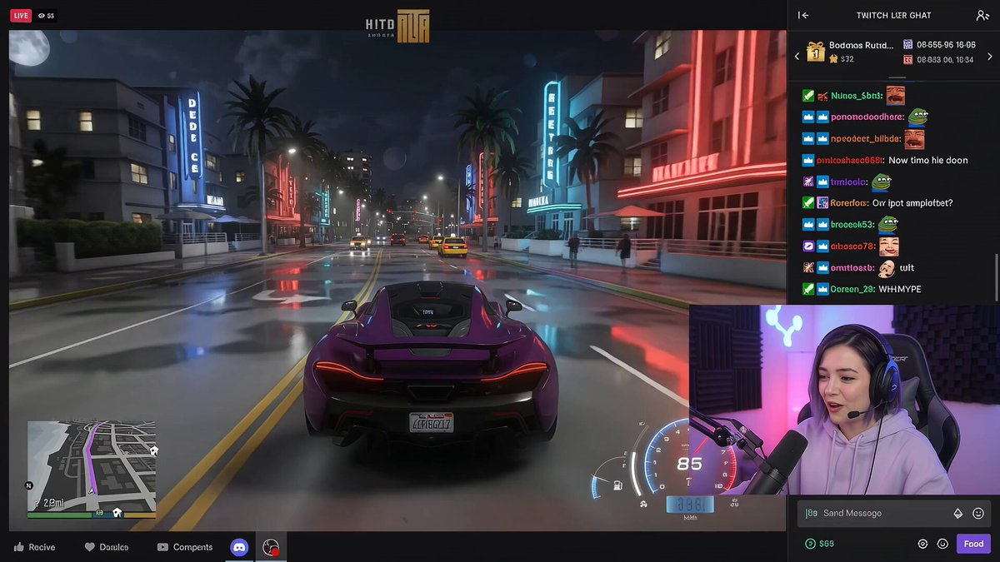](https://video.twimg.com/amplify_video/2118752493798825984/vid/avc1/640x360/ABYvurfZ5k_VXKKA.mp4?tag=29)

The creator prompts a game-stream layout with a driving scene, a corner facecam and English commentary. The post includes the prompt.

</td>
<td width="50%" valign="top">

<a id="omni12-community-8"></a>
**[Locked-Camera Construction Hyperlapse](https://x.com/alecwilcock/status/2118716313275142188)** · alecwilcock

[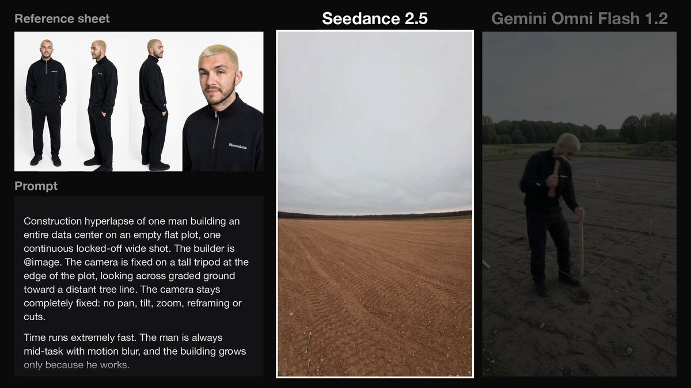](https://video.twimg.com/amplify_video/2118715983812497409/vid/avc1/640x360/rLsfCIZnQmAvu0SI.mp4?tag=29)

The creator compares Omni 1.2 Flash and Seedance 2.5 on a data-center construction time-lapse. The post includes the shared prompt.

</td>
</tr>
<tr>
<td width="50%" valign="top">

<a id="omni12-community-9"></a>
**[Same Prompt, No Dialogue](https://x.com/husky__create/status/2118637071887953952)** · husky__create

**Omni 1.2 Flash**

[](https://video-s.twimg.com/amplify_video/2118637038430015488/vid/avc1/640x360/goYQmD8hpI3NIsS5.mp4?tag=16)

**Omni 1.1 Flash**

[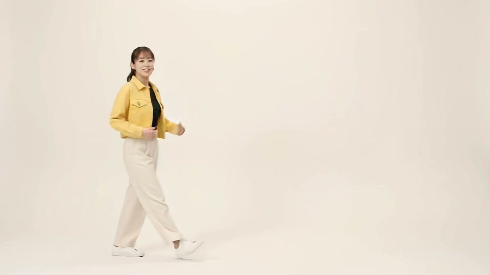](https://video-s.twimg.com/amplify_video/2118637056083787776/vid/avc1/640x360/srtblIdulfmUfOeA.mp4?tag=16)

The creator compares Omni 1.2 Flash and 1.1 Flash using the same prompt with a no-dialogue instruction. Both outputs are included.

</td>
<td width="50%" valign="top">

<a id="omni12-community-10"></a>
**[Still Collage in Motion](https://x.com/mmmiyama_D/status/2118467997870465516)** · mmmiyama_D

[](https://video-s.twimg.com/amplify_video/2118467980497747968/vid/avc1/480x852/7oxu6hnjA__basp0.mp4?tag=16)

The creator animates a still collage from the quoted post with Omni 1.2 Flash.

</td>
</tr>
<tr>
<td width="50%" valign="top">

<a id="omni12-community-11"></a>
**[App Explainer Prompt A/B](https://www.segmind.com/@himanshu/gemini-omni-1-2-flash-prompts)** · Himanshu Goel

**One-sentence brief**

[](https://segmind-resources.s3.amazonaws.com/blog/gemini-omni-prompts-ex1_vague.mp4)

**Timed shot list**

[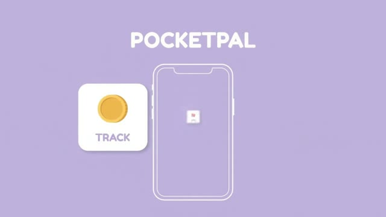](https://segmind-resources.s3.amazonaws.com/blog/gemini-omni-prompts-ex1_structured.mp4)

An eight-second budgeting-app explainer made with two prompts. Goel compares a one-sentence brief with a timed shot list using the same model, seed, duration, and resolution.

</td>
<td width="50%" valign="top">

<a id="omni12-community-12"></a>
**[Fox Baker Clip Extension](https://www.segmind.com/@himanshu/gemini-omni-1-2-flash-prompts)** · Himanshu Goel

**8-second source clip**

[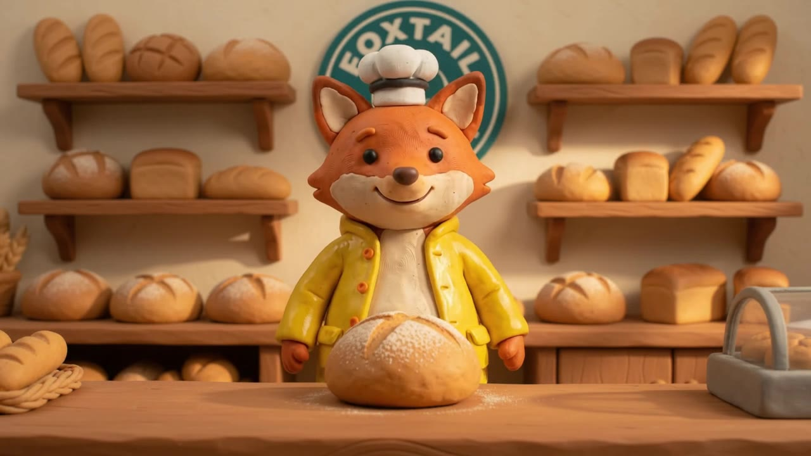](https://segmind-resources.s3.amazonaws.com/blog/gemini-omni-prompts-ex3_ref.mp4)

**13-second extended clip**

[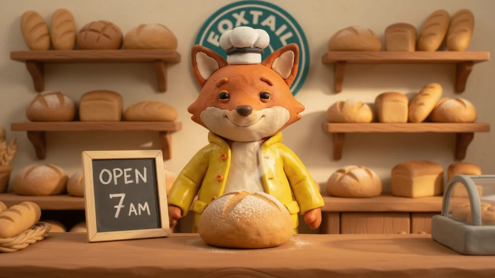](https://segmind-resources.s3.amazonaws.com/blog/gemini-omni-prompts-ex5_extend.mp4)

Goel extends an eight-second clay fox bakery clip by five seconds. The 13-second result adds a chalkboard with the shop’s hours. The write-up shows the reference images and prompts.

</td>
</tr>
<tr>
<td width="50%" valign="top">

<a id="omni12-community-13"></a>
**[Mug Clip Editing in Chat](https://www.aiformortals.co/blog/gemini-omni-flash-1-2-tested#gemini-omni-video-editing-three-rounds-of-chat-edits)** · Pat Simmons

**After the background edit**

[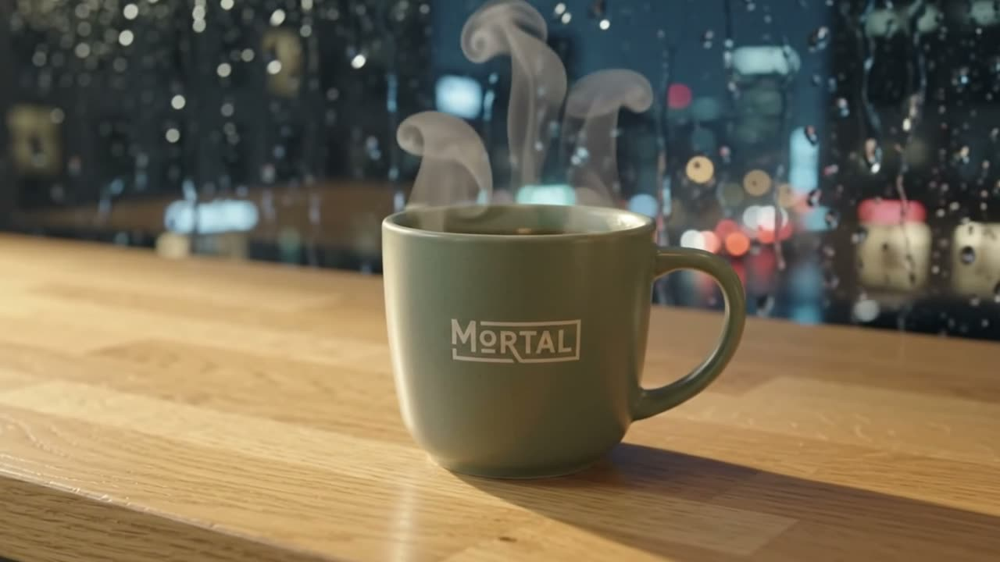](https://uzgqbjufkfadoprvamcs.supabase.co/storage/v1/object/public/daily-img/gemini-omni-flash-1-2-tested/t3-edit1-background.mp4)

**After the pacing request**

[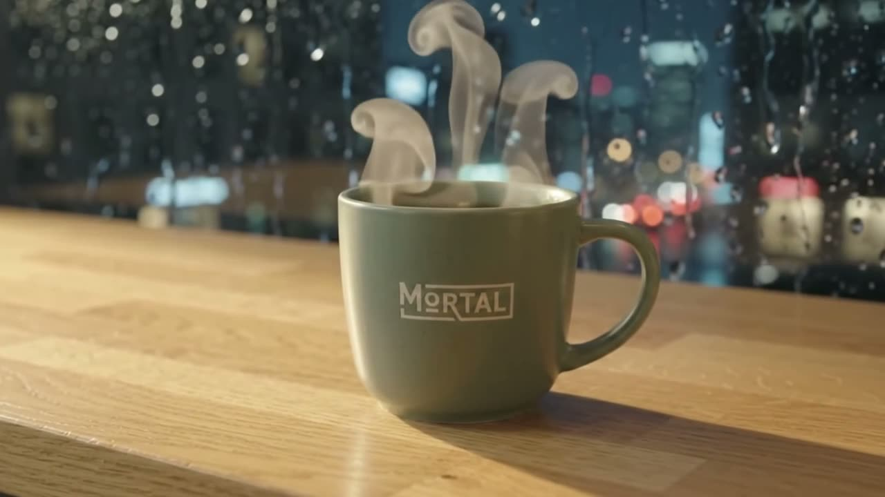](https://uzgqbjufkfadoprvamcs.supabase.co/storage/v1/object/public/daily-img/gemini-omni-flash-1-2-tested/t3-edit3-pacing.mp4)

The rainy-window background edit worked in Simmons’s Gemini app test. The next two requests, for warmer lighting and a faster camera move, produced no visible changes according to his write-up.

</td>
<td width="50%" valign="top">

<a id="omni12-community-14"></a>
**[Talking Soy Sauce Mascot in Flow](https://note.com/pharma_i_cist/n/n227466896971)** · 濱口貴光

[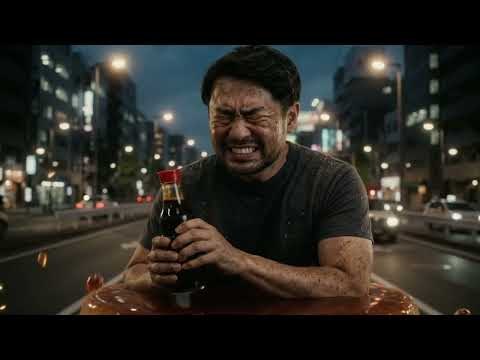](https://www.youtube.com/watch?v=SNDK6KC5atU)

Hamaguchi uploads a character reference image, adds a custom Japanese voice, and generates the talking mascot in Google Flow. The write-up shows the setup and the original result.

</td>
</tr>
<tr>
<td width="50%" valign="top">

<a id="omni12-community-15"></a>
**[Hurdle Jump at 360p and 720p](https://x.com/nakaaki04/status/2120471927878025580)** · nakaaki04

[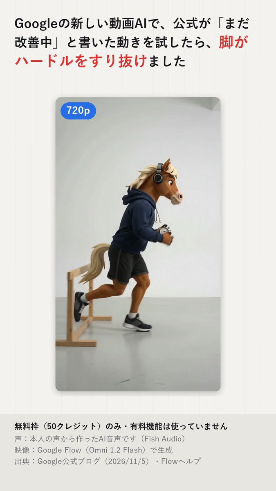](https://video.twimg.com/amplify_video/2120471854968369152/vid/avc1/480x852/9KTUc0EcXqsr-q66.mp4?tag=16)

In a three-clip Flow test, the creator tries a camera move around the character and repeats a hurdle prompt at 360p and 720p. The walkthrough highlights a leg passing through the hurdle in the 720p take.

</td>
<td width="50%" valign="top">

<a id="omni12-community-16"></a>
**[Astronaut Motion Reference Comparison](https://x.com/cellcogai/status/2120170343859966025)** · cellcogai

[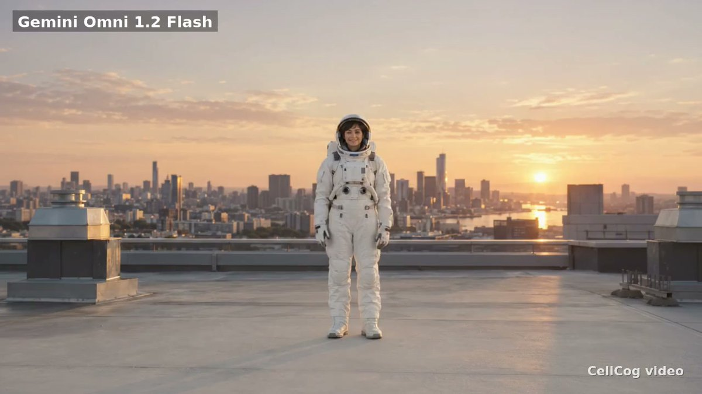](https://video.twimg.com/ext_tw_video/2120169872483065856/pu/vid/avc1/640x360/MQ_iaATV6JRsycnX.mp4?tag=12)

CellCog compares a rooftop astronaut copying a reference move in Omni 1.2, Seedance 2.5, and Kling 4.0. The team splits the reference into three clips for Omni and Seedance, and gives Kling the full clip. The original video labels each result.

</td>
</tr>
<tr>
<td width="50%" valign="top">

<a id="omni12-community-17"></a>
**[From Laughter to Tears](https://x.com/ACampbellCinema/status/2120168688124862920)** · ACampbellCinema

[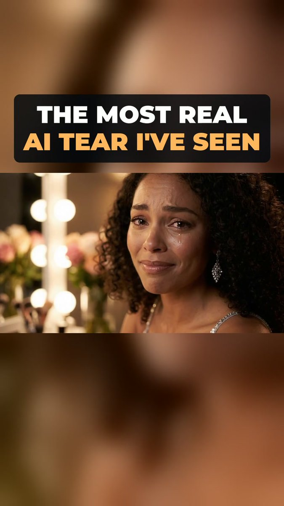](https://video.twimg.com/amplify_video/2120167861247225856/vid/avc1/480x852/MOtZjYAYnb42jIfD.mp4?tag=14)

Campbell compares Omni Flash 1.2 and 1.1 on an emotional close-up. The breakdown follows the shift from laughter to tears and ends with the two versions shown side by side.

</td>
<td width="50%" valign="top">

<a id="omni12-community-18"></a>
**[Bicycle Ride Through Sunflowers](https://x.com/EtherealxArt/status/2120154511901954472)** · EtherealxArt

[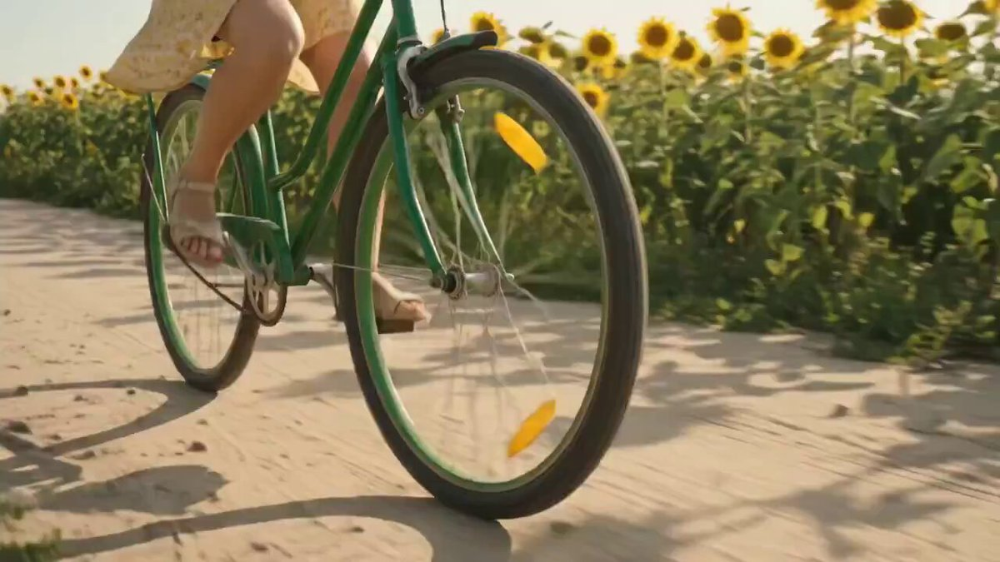](https://video.twimg.com/amplify_video/2119871561221947393/vid/avc1/640x360/mnbbtEViiNZpNX5D.mp4)

A Flow showcase follows a cyclist through a sunflower field. The creator highlights the bicycle motion, and the video shows it from several angles, including close-ups of the wheel and handlebars.

</td>
</tr>
</table>

## 🎯 Prompt Ingredients
Gemini Omni has strong **world understanding** — it draws on real-world knowledge of history, science, and culture. You don't need to over-explain every detail. Instead, express your creative intent in natural language and let Omni's reasoning fill in the rest.
When creating a new video from scratch, mix these dimensions to control the output:
| Dimension | What to specify | Example |
| :--- | :--- | :--- |
| **Shot Framing & Motion** | Wide-angle, medium, or close-up. Camera trajectory: gentle glide, sudden rush, static lock, dolly zoom, etc. | `A close-up tracking shot smoothly pushing in` |
| **Style** | Overall visual art direction | `Vintage monochrome hologram`, `3D voxel art`, `colored crayon aesthetic` |
| **Lighting** | Scene mood and light setup | `Warm champagne lighting`, `dim overhead gym lights` |
| **Location** | Environment and background | `Small underground gym`, `futuristic neon cityscape` |
| **Action** | Subject behavior and movement | `The person touches the mirror`, `a marble rolling fast on a chain reaction track` |
> [!TIP]
> **Iterative Editing:** Omni supports multi-turn conversation editing. It preserves what works and only modifies what you ask — no need to re-describe the entire scene each time. Just say what to change next.

> [!TIP]
> **[Preserve Unchanged Areas](https://x.com/tanabe_fragm/status/2058103447006896406) (by [@tanabe_fragm](https://x.com/tanabe_fragm)):** When editing video, add phrases like "Don't change anything else" or "Keep everything else the same" to your prompt. This significantly reduces unwanted changes to parts of the video you didn't intend to modify.
>
> https://github.com/user-attachments/assets/285ee7d8-7dfe-4304-a9a4-648026073b80

## ✂️ Edit

### 🔄 Element Replacement

<a id="case-1-butterfly-to-bee"></a>
### Case 1: Butterfly to Bee `🎬 Video→Video`

<table>
<tr>
<td width="300">

**Input:**

https://github.com/user-attachments/assets/8feb4d7b-825d-4a4a-bd9d-900754cf5d38

</td>
<td width="300">

**Output:**

https://github.com/user-attachments/assets/60f31f6d-895e-4048-b477-9a46a5d20b90

</td>
</tr>
</table>

**Prompt:**

```
Change the butterfly to a bee.
```

---

<a id="case-2-bee-to-fireflies"></a>
### Case 2: Bee to Fireflies `🎬 Video→Video`

<table>
<tr>
<td width="300">

**Input:**

https://github.com/user-attachments/assets/60f31f6d-895e-4048-b477-9a46a5d20b90

</td>
<td width="300">

**Output:**

https://github.com/user-attachments/assets/76fc8e97-c7d1-40bc-9e79-bd6705aa8267

</td>
</tr>
</table>

**Prompt:**

```
Change the bee into a small swarm of fireflies.
```

---

<a id="case-3-5-spaceships--astronaut-series"></a>
### Case 3-5: Spaceships & Astronaut Series `🎬 Video→Video`

<table>
<tr>
<td colspan="3">

**Input:**

https://github.com/user-attachments/assets/26ea7e43-9787-4096-82f9-e10543229bec

</td>
</tr>
<tr>
<td width="300">

https://github.com/user-attachments/assets/dd9ae5b1-0205-45ac-a651-258af1c4f12c

### Case 3: Spaceships to White Origami

</td>
<td width="300">

https://github.com/user-attachments/assets/78ef5301-b759-4dda-9995-3ee0d259a7b1

### Case 4: Astronaut to Sea Anemone

</td>
<td width="300">

https://github.com/user-attachments/assets/0cbadb19-8a5b-4a2c-9093-e3a84f3dd988

### Case 5: Small Ships to Stingrays

</td>
</tr>
</table>

**Prompts:**

```
Case 3: Change the ships to be made from white origami paper.
```

```
Case 4: Change the astronaut to a sea anemone.
```

```
Case 5: Change the small ships to stingrays.
```

---

<a id="case-6-train-1896-transform-by-emollick"></a>
### Case 6: [Train 1896 Transform](https://x.com/emollick/status/2057874739817808223) (by [@emollick](https://x.com/emollick)) `🎬 Video→Video`

https://github.com/user-attachments/assets/275cc90e-adaa-48ff-9ff8-1e96ea29d44f

**Prompt:**

```
I took the famous "train" movie from 1896 & made it a bullet train, LEGO, added a time traveler, a centipede, muppets...
```

---

<a id="case-7-remove-person-from-video-by-arrakis_ai"></a>
### Case 7: [Remove Person from Video](https://x.com/arrakis_ai/status/2057939231755178439) (by [@arrakis_ai](https://x.com/arrakis_ai)) `🎬 Video→Video`

https://github.com/user-attachments/assets/72379fb2-ac30-4d1e-a6b4-143052f8f061

**Prompt:**

```
Remove the person from this video perfectly.
```

---

<a id="case-8-invisible-violin"></a>
### Case 8: Invisible Violin `🎬 Video→Video`

<table>
<tr>
<td width="300">

**Input:**

https://github.com/user-attachments/assets/88176743-d17e-48fe-89f3-528fe60df7fd

</td>
<td width="300">

**Output:**

https://github.com/user-attachments/assets/ac6457aa-158c-4a0b-852f-ce1f3367bc3f

</td>
</tr>
</table>

**Prompt:**

```
Make the violin invisible
```

---

<a id="case-9-location-change-via-world-knowledge-by-venturetwins"></a>
### Case 9: [Location Change via World Knowledge](https://x.com/venturetwins/status/2058235415883313361) (by [@venturetwins](https://x.com/venturetwins)) `🎬 Video→Video`

https://github.com/user-attachments/assets/daa90750-fc7b-49ea-b85d-364411159663

**Prompt:**

```
Re-shoot this video in [location] based on the screenshot from Google Maps.
```

> Uploaded a Waymo ride video, then asked Omni to re-shoot in different locations using Google Maps screenshots. The model leverages its world knowledge to seamlessly change environments.

---

<a id="case-10-animation-to-live-action-by-arrakis_ai"></a>
### Case 10: [Animation to Live Action](https://x.com/arrakis_ai/status/2058488373057302797) (by [@arrakis_ai](https://x.com/arrakis_ai)) `🎬 Video→Video`

https://github.com/user-attachments/assets/3c6be2a9-3e67-4deb-8ccd-fb493b715f65

**Prompt:**

```
Turn this animation into live action.
```

### 🎬 Base Scene

<a id="case-1-violinist-base-shot"></a>
### Case 1: Violinist Base Shot `🔤 Text→Video`

https://github.com/user-attachments/assets/93de5898-88ee-4bfc-a36f-19d8aa99dfc1

**Prompt:**

```
A video of a violinist playing a song.
```

### 📷 Camera Direction

<a id="case-1-over-the-shoulder-angle"></a>
### Case 1: Over-the-Shoulder Angle `🎬 Video→Video`

<table>
<tr>
<td width="300">

**Input:**

https://github.com/user-attachments/assets/ac6457aa-158c-4a0b-852f-ce1f3367bc3f

</td>
<td width="300">

**Output:**

https://github.com/user-attachments/assets/71aa1c8d-0287-4591-b239-68322919293d

</td>
</tr>
</table>

**Prompt:**

```
Change the camera angle to be over the violinist's shoulder.
```

---

<a id="case-2-camera-tilt-shoes-to-medium-shot"></a>
### Case 2: Camera Tilt Shoes to Medium Shot `🎬 Video→Video`

<table>
<tr>
<td width="300">

**Input:**

https://github.com/user-attachments/assets/19dbc1ae-1e9e-4b7b-9069-e979fffe3651

</td>
<td width="300">

**Output:**

https://github.com/user-attachments/assets/c0ccbda0-4fd0-42be-8620-db7a67a5347d

</td>
</tr>
</table>

**Prompt:**

```
Change the camera angle, a close-up on his shoes, quickly tilting up to medium shot, then widening.
```

---

<a id="case-3-travel-selfie-hyperlapse-by-zarairahh"></a>
### Case 3: [Travel Selfie Hyperlapse](https://x.com/ZaraIrahh/status/2057775215749349520) (by [@ZaraIrahh](https://x.com/ZaraIrahh)) `🔤 Text→Video`

https://github.com/user-attachments/assets/31fa5a56-6113-4376-873b-5e40d26803f1

**Prompt:**

```
Create a 10-second cinematic hyper-lapse selfie travel video of the uploaded female character across 20 world-famous destinations in 2026. Hard cuts every 0.5 seconds synced to the beat. Handheld selfie-stick camera, wide-angle lens, close selfie framing, energetic travel-vlogger style, vibrant cinematic colors, realistic lighting, dynamic motion blur, natural crowds, and clear landmarks in every shot.
```

---

<a id="case-4-fashion-drone-shot-by-ariaxawan"></a>
### Case 4: [Fashion Drone Shot](https://x.com/ariaxawan/status/2057794715744084042) (by [@ariaxawan](https://x.com/ariaxawan)) `🔤 Text→Video`

https://github.com/user-attachments/assets/b199a5ab-e008-4a72-aa03-094bc6d573e6

**Prompt:**

```
A 10 second ultra cinematic hyper realistic FPV fashion drone shot filmed in a single continuous take inside a futuristic luxury tunnel. Single continuous take, aggressive FPV motion, ultra smooth cinematic flight path, luxury high-fashion editorial atmosphere.
```

---

<a id="case-5-top-view-to-360-rotation-by-npaka123"></a>
### Case 5: [Top View to 360 Rotation](https://x.com/npaka123/status/2058033145845575735) (by [@npaka123](https://x.com/npaka123)) `🖼️ Image→Video`

https://github.com/user-attachments/assets/1ad202cb-a485-4b7a-9c8c-d4fea4a3b6d5

**Prompt:**

```
この教室の中央から黒板を見ているファーストパーソンなゲーム視点。360度カメラを回転。教室の黒板右側の窓の外は廊下、黒板左側の窓の外は校庭。
```

---

<a id="case-6-omnizoom--diving-into-a-photo-by-alexanderchen"></a>
### Case 6: [Omnizoom — Diving Into a Photo](https://x.com/alexanderchen/status/2058330610574221672) (by [@alexanderchen](https://x.com/alexanderchen)) `🖼️ Image→Video`

https://github.com/user-attachments/assets/9fd3ad2a-6e4a-4ac0-ab29-48f1c303b95f

**Prompt:**

```
Omnizoom — diving into a photo.
```

### 🎬 Action & Sync

<a id="case-1-animal-toy-sound"></a>
### Case 1: Animal Toy Sound `🎬 Video→Video`

https://github.com/user-attachments/assets/fbf377d7-1b39-43af-92e6-665792d05de0

**Prompt:**

```
When the finger in <video> touches the animal toy play the sound the animal makes
```

---

<a id="case-2-apartments-lights-sync"></a>
### Case 2: Apartments Lights Sync `🎬+🎵 Video+Audio→Video`

<table>
<tr>
<td width="300">

**Input:**

https://github.com/user-attachments/assets/6fa879c3-5ee8-4ff1-bbe9-6648d750277d

</td>
<td width="300">

**Output:**

https://github.com/user-attachments/assets/3f010e2a-a471-4b0d-8782-c4c5547cd2a5

</td>
</tr>
</table>

**Prompt:**

```
The lights of the apartments start turning on in sync with the music.
```

---

<a id="case-3-marble-chain-reaction"></a>
### Case 3: Marble Chain Reaction `🔤 Text→Video`

https://github.com/user-attachments/assets/1ece8df7-f29a-4ebd-ad68-9c910f811590

**Prompt:**

```
A marble rolling fast on a chain reaction style track, continuous smooth shot
```

---

<a id="case-4-building-lights"></a>
### Case 4: Building Lights `🎬+🎵 Video+Audio→Video`

<table>
<tr>
<td width="300">

**Input:**

https://github.com/user-attachments/assets/efbc0d8d-b64a-4ef9-afe6-fed4a8b66102

</td>
<td width="300">

**Output:**

https://github.com/user-attachments/assets/51727436-1fc2-426b-afaa-86bb63cfba0f

</td>
</tr>
</table>

**Prompt:**

```
The lights of the buildings start turning on in sync with the music.
```

---

<a id="case-5-boxing-fight-realistic-by-ruzainameer"></a>
### Case 5: [Boxing Fight Realistic](https://x.com/RuzainaMeer/status/2057785474446741728) (by [@RuzainaMeer](https://x.com/RuzainaMeer)) `🔤 Text→Video`

https://github.com/user-attachments/assets/6796bf78-8bad-441c-889d-30621ee62cd7

**Prompt:**

```
Ultra-realistic 10-second boxing fight between two women inside a small underground gym. Both fighters look naturally athletic with realistic skin texture, sweat, bruises, and detailed facial expressions. The fight feels raw and authentic, like real professional sparring footage. The camera moves handheld around the ring at close range, capturing fast punches, defensive movement, realistic footwork, and heavy breathing.
```

## 🎨 Advanced Multi-Modal

### 🪞 Artistic Style

<a id="case-1-3-mirror-series"></a>
### Case 1-3: Mirror Series `🎬 Video→Video`

<table>
<tr>
<td width="300">

https://github.com/user-attachments/assets/747cdc6b-f5fa-4482-b745-2839551e9ba2

### Case 1: Mirror Liquid Metal Ripple

</td>
<td width="300">

https://github.com/user-attachments/assets/36ea02a2-3716-44aa-9bc2-a5cc1480d0bf

### Case 2: Mirror Line Art

</td>
<td width="300">

https://github.com/user-attachments/assets/dbca6772-dd7a-4418-a0e6-a39796a91c97

### Case 3: Mirror Puppet

</td>
</tr>
</table>

**Prompts:**

```
Case 1: When the person touches the mirror, make the mirror ripple beautifully like liquid, and the person's arm turns into reflective mirror material
```

```
Case 2: When the person touches the mirror, the person transforms into a detailed monochrome line art drawing
```

```
Case 3: When the person touches the mirror, the person suddenly transforms into a cute felted stuffed puppet version with large googley eyes and glasses
```

---

<a id="case-4-animation-ads-one-shot-by-denneydara"></a>
### Case 4: [Animation Ads One Shot](https://x.com/DenneyDara/status/2057844409639551380) (by [@DenneyDara](https://x.com/DenneyDara)) `🔤 Text→Video`

https://github.com/user-attachments/assets/edacf1c5-94db-4687-8eaa-f87ebf5fabee

**Prompt:**

```
Make a Pixar-style video of an aloe leaf that is walking through the forest that talks about how good nature makes it feel. Have it say, "Organic and healthy ingredients make me feel so good."
```

---

<a id="case-5-line-drawing-isolation-by-alexanderchen"></a>
### Case 5: [Line Drawing Isolation](https://x.com/alexanderchen/status/2057925025915666673) (by [@alexanderchen](https://x.com/alexanderchen)) `🎬 Video→Video`

https://github.com/user-attachments/assets/787813c0-2e20-4999-8383-fd76a9b21f91

**Prompt:**

```
Extract the key object in this video. Render a video showing that object as a black diagram-style line art drawing on solid 100% white background, nothing else in background. Keep the motion and sound exactly as is.
```

### ✨ Visual Effects

<a id="case-1-hand-hole-super-zoom"></a>
### Case 1: Hand Hole Super Zoom `🎬 Video→Video`

https://github.com/user-attachments/assets/06683ef4-16e0-47b0-93ec-c6222560ee13

**Prompt:**

```
Make it look like the weird shape of my hand hole super zooms and magnifies the ground it's looking at in sharper quality.
```

---

<a id="case-2-skateboard-motion-effects"></a>
### Case 2: Skateboard Motion Effects `🎬 Video→Video`

https://github.com/user-attachments/assets/44c120a2-38a7-43d7-89fa-a23d0842078c

**Prompt:**

```
Edit this keeping everything the same. Add animated motion effects coming out of the skateboard.
```

---

<a id="case-3-ar-hud-overlay-by-jerrod_lew"></a>
### Case 3: [AR HUD Overlay](https://x.com/jerrod_lew/status/2058337271947079977) (by [@jerrod_lew](https://x.com/jerrod_lew)) `🎬 Video→Video`

https://github.com/user-attachments/assets/04b11cd7-d345-4172-b6e5-38301e73bb77

**Prompt:**

```
Create a virtual HUD and UI overlay for this recorded phone video, like an AR glasses experience with secondary screens.
```

### 🔗 Cross-Modal

<a id="case-1-transport-to-new-environment"></a>
### Case 1: Transport to New Environment `🎬+🖼️ Video+Image→Video`

<table>
<tr>
<td width="300">

**Input:**

https://github.com/user-attachments/assets/93de5898-88ee-4bfc-a36f-19d8aa99dfc1

</td>
<td width="300">

**Output:**

https://github.com/user-attachments/assets/88176743-d17e-48fe-89f3-528fe60df7fd

</td>
</tr>
</table>

**Prompt:**

```
Transport the violinist to the image environment
```

---

<a id="case-2-birds-shape-with-audio"></a>
### Case 2: Birds Shape With Audio `🎬+🖼️+🎵 Multi-Modal`

<table>
<tr>
<td width="300">

**Input Video:**

https://github.com/user-attachments/assets/66946870-b366-4981-90b3-c9a35aca69b1

**Input Image:**


**Input Audio:**

https://github.com/user-attachments/assets/6d79cd06-7805-493c-9f27-6985a3da1866

</td>
<td width="300">

**Output:**

https://github.com/user-attachments/assets/a94efea9-14ac-47c2-ab5f-9492400fdc3a

</td>
</tr>
</table>

**Prompt:**

```
The birds from <video> loosely form the imperfect shape of a bird based on <image>. They move to the music from <audio> and dissipate as they fly
```

---

<a id="case-3-slide-to-motion-by-yoshifujidesign"></a>
### Case 3: [Slide to Motion](https://x.com/yoshifujidesign/status/2058032203175731293) (by [@yoshifujidesign](https://x.com/yoshifujidesign)) `🖼️ Image→Video`

https://github.com/user-attachments/assets/f07a861b-cd0d-4894-8ef1-b74520c7cbd7

**Prompt:**

```
GPT image2でスライド作成 → Gemini Omniでモーション。画面遷移もさせられるし、イラストの動かし方も自然。
```

---

<a id="case-4-isometric-cooking-character-with-reference-image-by-kumiko_shiraki"></a>
### Case 4: [Isometric Cooking Character with Reference Image](https://x.com/kumiko_shiraki/status/2058337185099546885) (by [@kumiko_shiraki](https://x.com/kumiko_shiraki)) `🖼️ Image→Video`

https://github.com/user-attachments/assets/d5e9b97e-cefa-4cd8-bf70-4e633020f092

**Prompt:**

```
Narrow down reference images and add negative prompts to get closer to your ideal output.
```

> Technique: When the generated video doesn't match your vision, (1) narrow down reference images, and (2) add negative prompts to suppress unwanted elements.

---

<a id="case-5-chatgpt-instruction-image-as-input-by-majin_appsheet"></a>
### Case 5: [ChatGPT Instruction Image as Input](https://x.com/Majin_AppSheet/status/2058191091070058846) (by [@Majin_AppSheet](https://x.com/Majin_AppSheet)) `🖼️ Image→Video`

<table>
<tr>
<td width="300">

**Input (instruction images from ChatGPT):**


</td>
<td width="300">

**Output:**

https://github.com/user-attachments/assets/578d6968-c6dd-417a-b6fe-100468851f3d

</td>
</tr>
</table>

> Workflow: Generate instruction/storyboard images in ChatGPT, then feed them directly to Gemini Omni as visual prompts.

---

<a id="case-6-chatgpt-illustration-to-omni-animation-by-mmmiyama_d"></a>
### Case 6: [ChatGPT Illustration to Omni Animation](https://x.com/mmmiyama_D/status/2058654389326516656) (by [@mmmiyama_D](https://x.com/mmmiyama_D)) `🖼️ Image→Video`

<table>
<tr>
<td width="280">

https://github.com/user-attachments/assets/5759f07e-6b2a-4b7d-bb36-52e960a6559e

</td>
<td width="280">

https://github.com/user-attachments/assets/b4fea213-9a0e-46c9-8a6e-9e98b566ffab

</td>
<td width="280">

https://github.com/user-attachments/assets/289e5378-60ad-472b-ba51-da710da81270

</td>
</tr>
</table>

> Workflow: Generate illustration diagrams with ChatGPT image generation → animate them with Gemini Omni. Text rendering can be improved by adding specific prompts to suppress text corruption.

### 📋 Storyboard

<a id="case-1-luxury-cosmetic-commercial-by-aiwithaly"></a>
### Case 1: [Luxury Cosmetic Commercial](https://x.com/aiwithaly/status/2057806821138858314) (by [@aiwithaly](https://x.com/aiwithaly)) `🔤 Text→Video`

https://github.com/user-attachments/assets/6d003859-eb77-4466-9f70-5a76a2269667

**Prompt:**

```
Create a cinematic 10-second ultra-realistic luxury cosmetic commercial in a high-end skincare advertisement style. Use warm champagne lighting, glossy beauty-film aesthetic, shallow depth of field, macro beauty cinematography, smooth cinematic camera movement. 10 scenes from macro serum droplets to final payoff shot.
```

---

<a id="case-2-show-me-in-this-story"></a>
### Case 2: Show Me in This Story `🖼️ Image→Video`

<table>
<tr>
<td width="300">

**Input:**


</td>
<td width="300">

**Output:**

https://github.com/user-attachments/assets/8429423d-9b72-4cb6-9e8c-985818f160a7

</td>
</tr>
</table>

**Prompt:**

```
Show me in this story. Follow the story exactly in order starting top left. Entire story in 10 seconds. Cinematic
```

---

<a id="case-3-3x3-split-screen-by-alexanderchen"></a>
### Case 3: [3x3 Split Screen](https://x.com/alexanderchen/status/2057861567396368841) (by [@alexanderchen](https://x.com/alexanderchen)) `🎬 Video→Video`

https://github.com/user-attachments/assets/587fc95e-526f-4d8d-94c8-feefe34edba9

**Prompt:**

```
Generate a 3x3 split screen video based on different details you see here. Make each cell different, varying the perspective, composition, zoom, angle, camera movement (some static, some moving). Make some of the cells extreme close-ups with detailed textures. Keep it photorealistic, handheld, raw. Only natural sounds.
```

---

<a id="case-4-action-replay-from-different-angles-by-jerrod_lew"></a>
### Case 4: [Action Replay from Different Angles](https://x.com/jerrod_lew/status/2057838324140953773) (by [@jerrod_lew](https://x.com/jerrod_lew)) `🎬 Video→Video`

https://github.com/user-attachments/assets/a1179492-74bd-488c-b594-6bc023269c10

**Prompt:**

```
Gemini Omni can create action replays from different angles. I referenced a video clip with agent instructions to generate replays.
```

---

<a id="case-5-split-screen-video-by-jerrod_lew"></a>
### Case 5: [Split Screen Video](https://x.com/jerrod_lew/status/2057944349846249975) (by [@jerrod_lew](https://x.com/jerrod_lew)) `🎬 Video→Video`

https://github.com/user-attachments/assets/8755d95d-a9b2-4f7c-a56d-bfbbcc47f80e

**Prompt:**

```
Use a reference video and ask the agent for a split screen video.
```

### 🔤 Text Rendering

<a id="case-1-alphabet-items-sequence"></a>
### Case 1: Alphabet Items Sequence `🔤 Text→Video`

https://github.com/user-attachments/assets/f7693ec2-ac70-4ac8-813f-8fcb46d90d3d

**Prompt:**

```
The video shows items of the alphabet. An unusual item starting with each letter is shown sitting on a table. All 26 letters must be represented by 26 items with matching lower thirds displaying the letter. Only one item and lower third at a time. Rapid fire, roughly 9 frames per item at 24FPS. Last frame is a slip of paper "THE END".
```

---

<a id="case-2-word-by-word-text-sync"></a>
### Case 2: Word-by-Word Text Sync `🔤 Text→Video`

https://github.com/user-attachments/assets/03620abc-bcb2-4011-a52b-ce13409853c4

**Prompt:**

```
word by word, one word on the screen at a time: did, you, know, that, this, model, can, do, pretty, good, text!? each word appears with a different animated style, perfect pacing to a rhythm, sizzle reel.
```

---

<a id="case-3-text-rendering-ai-news-by-chrisfirst"></a>
### Case 3: [Text Rendering AI News](https://x.com/chrisfirst/status/2057863432469361098) (by [@chrisfirst](https://x.com/chrisfirst)) `🔤 Text→Video`

https://github.com/user-attachments/assets/e7d23502-1ca0-4f47-be76-47ff05390508

**Prompt:**

```
Static shot we see them turn the page 3 times. Every flip we see content on both left and right side of book pages. Each contains a big news story around AI for the year of 2025. Include images and crystal clear text.
```

---

<a id="case-4-font-fashion-show-by-hbcoop_"></a>
### Case 4: [Font Fashion Show](https://x.com/HBCoop_/status/2057856570558452142) (by [@HBCoop_](https://x.com/HBCoop_)) `🔤 Text→Video`

https://github.com/user-attachments/assets/395d767c-7d8e-4367-941b-0190da9a0284

**Prompt:**

```
Create a 10-second avant-garde fashion editorial where every outfit is inspired by a specific Google Font personality. Each second introduces a new model styled around fonts like Playfair Display, Bebas Neue, Orbitron, Pacifico, Rubik Mono One, and Cormorant Garamond. Font names appear integrated into the environment using their exact typography style. High-fashion runway cinematography with bold lighting, mirrored sets, and surreal motion.
```

## ⚖️ Comparison

<a id="case-1-seedance-20-vs-gemini-omni-flash-by-jsfilmz0412"></a>
### Case 1: [Seedance 2.0 vs Gemini Omni Flash](https://x.com/JSFILMZ0412/status/2057926749598736635) (by [@JSFILMZ0412](https://x.com/JSFILMZ0412)) `⚖️ Comparison`

https://github.com/user-attachments/assets/a03e70b5-99c0-4ad8-b26b-9aed6e037f02

> Seedance 2.0 Fast vs Gemini Omni Flash — style transfer, motion quality, and censorship comparison.

---

<a id="case-2-gemini-omni-vs-seedance-20-action-scenes-by-curiousrefuge"></a>
### Case 2: [Gemini Omni vs Seedance 2.0 Action Scenes](https://x.com/CuriousRefuge/status/2057929340562907451) (by [@CuriousRefuge](https://x.com/CuriousRefuge)) `⚖️ Comparison`

https://github.com/user-attachments/assets/33e09b7d-2357-481d-8536-dab39e75524b

> Gemini Omni video editing model vs Seedance 2.0 — big action scenes comparison.

## 🧪 Evaluation

<a id="case-1-gemini-omni-quality-evaluation-by-kenichiota0711"></a>
### Case 1: [Gemini Omni Quality Evaluation](https://x.com/kenichiota0711/status/2057820346850660769) (by [@kenichiota0711](https://x.com/kenichiota0711)) `🧪 Evaluation`

https://github.com/user-attachments/assets/a9adf476-fac9-4ea2-b5ea-90a50192ccfb

> ほぼ理想的なアウトプットで感動。わずかに揺れる花と髪、まばたきの表現、ノートに書く動作の滑らかさ。

## 🌐 Community Gallery

Creative experiments and showcases from the community. These cases demonstrate the breadth of what's possible with Gemini Omni.

<table>
<tr>
<td width="50%" valign="top">

**[Concept-Driven Educational Video](https://x.com/VORTEX_Promos/status/2058083405204459621)** — by [@VORTEX_Promos](https://x.com/VORTEX_Promos)

https://github.com/user-attachments/assets/ca450aec-a6c8-455f-973d-087bfb3da742

</td>
<td width="50%" valign="top">

**[Showcase](https://x.com/paji_a/status/2058070248436445600)** — by [@paji_a](https://x.com/paji_a)

https://github.com/user-attachments/assets/8ecfe4b0-6de7-47f0-9b83-3dc736512e54

</td>
</tr>
<tr>
<td width="50%" valign="top">

**[Nano Banana for Video — Consistency Test](https://x.com/WolfRiccardo/status/2058296266270945483)** — by [@WolfRiccardo](https://x.com/WolfRiccardo)

https://github.com/user-attachments/assets/0cabc195-8a2b-47e6-a649-d95b15003964

</td>
<td width="50%" valign="top">

**[Presenting Isometric Character](https://x.com/kumiko_shiraki/status/2058699566938194382)** — by [@kumiko_shiraki](https://x.com/kumiko_shiraki)

https://github.com/user-attachments/assets/d38627cd-6f23-4ea3-8a95-7cd831229364

</td>
</tr>
<tr>
<td width="50%" valign="top">

**[One-Sentence Cinematic Zen](https://x.com/Dheepanratnam/status/2058372209681342806)** — by [@Dheepanratnam](https://x.com/Dheepanratnam)

https://github.com/user-attachments/assets/d33d9c9d-a68f-4e01-bf1e-c4c8ee60c8ee

</td>
<td width="50%" valign="top">

**[Character Transformation — Glamorous to Everyday](https://x.com/HBCoop_/status/2058221428780970398)** — by [@HBCoop_](https://x.com/HBCoop_)

https://github.com/user-attachments/assets/239ca343-cb71-4254-8478-d8947d6c33aa

</td>
</tr>
<tr>
<td width="50%" valign="top">

**[Waymo to India](https://x.com/iHarnoorSingh/status/2058352557819621617)** — by [@iHarnoorSingh](https://x.com/iHarnoorSingh)

https://github.com/user-attachments/assets/7d23ad1f-63bf-4a3c-ab94-09e8f26c570e

</td>
<td width="50%" valign="top">

**[The Letter Never Sent — Short Film](https://x.com/Strength04_X/status/2058367252299452851)** — by [@Strength04_X](https://x.com/Strength04_X)

https://github.com/user-attachments/assets/df8dcb7c-c918-4fc2-b952-0cb2bcdddfee

</td>
</tr>
</table>

<a id="related-repositories"></a>
## 🔗 Related Repositories

- [Explore the EvoLink video model API guide](https://github.com/EvoLinkAI/awesome-ai-video-models-api-guide).
- [Use the EvoLink Media MCP repository](https://github.com/EvoLinkAI/evolink-media-mcp).
- [Read about Seedance 2.5 on EvoLink](https://evolink.ai/launch/seedance-2-5?utm_source=github&utm_medium=readme&utm_campaign=awesome-gemini-omni-guide-api-and-prompt&utm_content=related_seedance).

## 🙏 Acknowledge

This repository was inspired by excellent open prompt collections and community-shared examples.

Thanks to Google DeepMind for publishing official Gemini Omni demos and prompt guides that made these case studies possible.

**Community Contributors:**

[@emollick](https://x.com/emollick), [@jerrod_lew](https://x.com/jerrod_lew), [@arrakis_ai](https://x.com/arrakis_ai), [@npaka123](https://x.com/npaka123), [@yoshifujidesign](https://x.com/yoshifujidesign), [@chrisfirst](https://x.com/chrisfirst), [@DenneyDara](https://x.com/DenneyDara), [@ZaraIrahh](https://x.com/ZaraIrahh), [@alexanderchen](https://x.com/alexanderchen), [@ariaxawan](https://x.com/ariaxawan), [@RuzainaMeer](https://x.com/RuzainaMeer), [@aiwithaly](https://x.com/aiwithaly), [@HBCoop_](https://x.com/HBCoop_), [@JSFILMZ0412](https://x.com/JSFILMZ0412), [@CuriousRefuge](https://x.com/CuriousRefuge), [@kenichiota0711](https://x.com/kenichiota0711), [@tanabe_fragm](https://x.com/tanabe_fragm), [@venturetwins](https://x.com/venturetwins), [@kumiko_shiraki](https://x.com/kumiko_shiraki), [@Majin_AppSheet](https://x.com/Majin_AppSheet), [@mmmiyama_D](https://x.com/mmmiyama_D), [@VORTEX_Promos](https://x.com/VORTEX_Promos), [@paji_a](https://x.com/paji_a), [@WolfRiccardo](https://x.com/WolfRiccardo), [@Dheepanratnam](https://x.com/Dheepanratnam), [@iHarnoorSingh](https://x.com/iHarnoorSingh), [@Strength04_X](https://x.com/Strength04_X)

*If anything needs to be corrected, please contact us and we will update it.*

If you have more interesting prompt cases to share, feel free to reach out and help us expand the Evolink prompt library.

[](https://www.star-history.com/#EvoLinkAI/awesome-gemini-omni-guide-api-and-prompt&Date)
