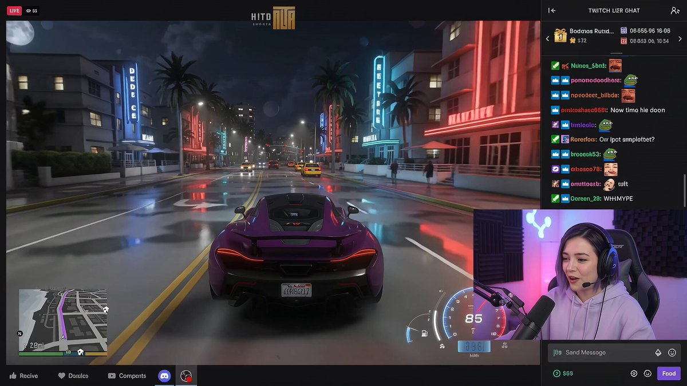
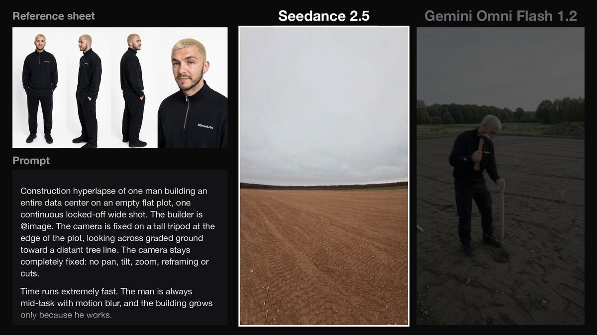
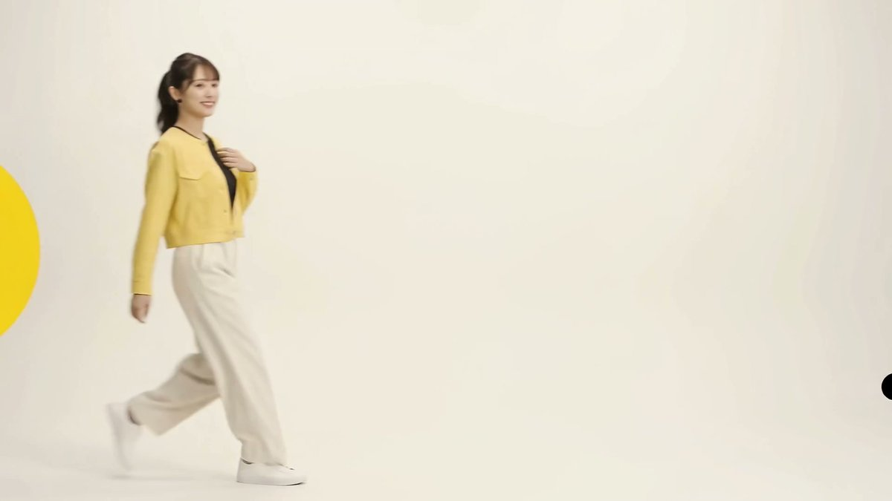
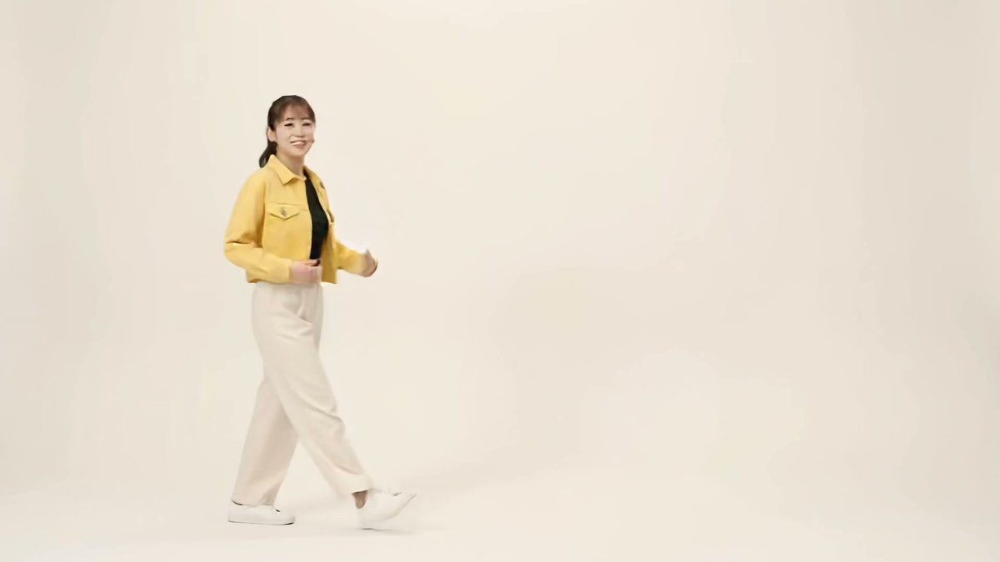

<div align="center">

<a href="https://evolink.ai/gemini-omni?utm_source=github&utm_medium=banner&utm_campaign=awesome-gemini-omni-guide-api-and-prompt&utm_content=readme_banner"></a>

[](LICENSE)
[](https://evolink.ai/gemini-omni-1-2-flash?utm_source=github&utm_medium=badge&utm_campaign=awesome-gemini-omni-guide-api-and-prompt&utm_content=model_try)

[](README.md) [](README_es.md) [](README_pt.md) [](README_ja.md) [](README_ko.md) [](README_de.md) [](README_fr.md) [](README_tr.md) [](README_zh-TW.md) [](README_zh-CN.md) [](README_ru.md)

</div>

# Gemini Omni 1.2 Flash ガイド・プロンプト集

## 🍌 はじめに
**Gemini Omni 1.2 Flash のガイドと、Gemini Omni ファミリーのプロンプト、編集デモ、比較、コミュニティ動画を保存したライブラリです。** クリエイターや開発者がタスクを選び、入力と出力の制限を理解できるようにまとめています。

> [!NOTE]
> 従来のプロンプト事例、比較、コミュニティギャラリーは、過去の Gemini Omni ファミリーに関する資料です。元のプロンプト、出典、メディアを保持しており、Gemini Omni 1.2 Flash の生成結果やベンチマークとして紹介するものではありません。

<a id="omni-1-2-guide"></a>
## 🆕 Gemini Omni 1.2 Flash

Google は Gemini Omni 1.2 Flash を **2026年11月5日**公開の GA モデルとして掲載しています。1.1 からの主な変更点は、対応するルートでの最長 **15秒**の生成と、**独立した動画アップスケール**です。[Google のモデル仕様を読む](https://docs.cloud.google.com/gemini-enterprise-agent-platform/models/gemini/omni-1-2-flash)、[EvoLink の11月5日の発表を読む](https://evolink.ai/changelog?utm_source=github&utm_medium=readme&utm_campaign=awesome-gemini-omni-guide-api-and-prompt&utm_content=release_source#2026-11-05-gemini-omni-1-2-flash)。

- テキスト、画像、動画を入力でき、音声、音楽、効果音が同期した動画を出力します。音声ファイルの入力と音声編集には対応していません。
- ネイティブ出力は **360p / 720p** です。**1080p / 4K はアップスケール出力**であり、ネイティブ 4K ではありません。仕様上の出力は 24 fps、アスペクト比は 16:9 または 9:16 です。
- EvoLink で **15秒**の動画を生成するには、テキストからの動画生成、先頭フレーム画像1枚からの生成、または参照画像と最大1本の参照動画を使う生成を選びます。先頭・最終フレームの両方を指定する場合や、参照動画を2〜3本使う場合は **3〜10秒**です。
- 動画の延長では **3〜10秒**を追加します。この値は追加する長さであり、完成動画全体の長さではありません。

### EvoLink のタスクを選ぶ

各タスクのリンクから、そのタスクのリクエスト仕様を確認できます。ルートを変更する前に、[全パラメーターの概要を読む](https://evolink.ai/docs/en/api-manual/video-series/gemini-omni-1.2-flash/gemini-omni-1.2-flash-overview?utm_source=github&utm_medium=readme&utm_campaign=awesome-gemini-omni-guide-api-and-prompt&utm_content=parameter_overview)。

| タスク | 用途 | ルート固有の制限 |
| :--- | :--- | :--- |
| [テキスト動画生成のドキュメントを読む](https://evolink.ai/docs/en/api-manual/video-series/gemini-omni-1.2-flash/gemini-omni-1.2-flash-text-to-video?utm_source=github&utm_medium=readme&utm_campaign=awesome-gemini-omni-guide-api-and-prompt&utm_content=route_text) | テキストのプロンプトからショットを生成します。 | 3〜15秒。 |
| [画像動画生成のドキュメントを読む](https://evolink.ai/docs/en/api-manual/video-series/gemini-omni-1.2-flash/gemini-omni-1.2-flash-image-to-video?utm_source=github&utm_medium=readme&utm_campaign=awesome-gemini-omni-guide-api-and-prompt&utm_content=route_image) | 先頭フレーム1枚に動きを付けるか、先頭・最終フレームをつなぎます。 | 画像1枚：3〜15秒。画像2枚：3〜10秒。 |
| [参照動画生成のドキュメントを読む](https://evolink.ai/docs/en/api-manual/video-series/gemini-omni-1.2-flash/gemini-omni-1.2-flash-reference-to-video?utm_source=github&utm_medium=readme&utm_campaign=awesome-gemini-omni-guide-api-and-prompt&utm_content=route_reference) | 画像や動画の参照素材を使って、新しいショットを生成します。 | 最大10枚の画像と3本の参照動画。出力が10秒を超える場合、参照動画は最大1本。 |
| [動画編集のドキュメントを読む](https://evolink.ai/docs/en/api-manual/video-series/gemini-omni-1.2-flash/gemini-omni-1.2-flash-video-edit?utm_source=github&utm_medium=readme&utm_campaign=awesome-gemini-omni-guide-api-and-prompt&utm_content=route_edit) | プロンプトで既存のクリップを変更します。 | 入力動画1本、最長15秒。参照画像は任意。画質の既定値は `auto`。 |
| [動画延長のドキュメントを読む](https://evolink.ai/docs/en/api-manual/video-series/gemini-omni-1.2-flash/gemini-omni-1.2-flash-video-extend?utm_source=github&utm_medium=readme&utm_campaign=awesome-gemini-omni-guide-api-and-prompt&utm_content=route_extend) | クリップの末尾から続きを生成します。 | 入力動画1本、最長30秒。3〜10秒を追加。 |
| [動画アップスケールのドキュメントを読む](https://evolink.ai/docs/en/api-manual/video-series/gemini-omni-1.2-flash/gemini-omni-1.2-flash-video-upscale?utm_source=github&utm_medium=readme&utm_campaign=awesome-gemini-omni-guide-api-and-prompt&utm_content=route_upscale) | 選んだ完成クリップの解像度を上げます。 | 対応する標準サイズの入力動画、最長15秒。プロンプトは不要。以下のプラットフォーム間の違いを確認してください。 |

### プラットフォームとバージョンの違い

- **参照素材：** [AI Studio の利用ガイドを読む](https://aistudio.google.com/docs/omni)。AI Studio は最大6枚の画像を許可していますが、Google Cloud と EvoLink のドキュメントでは最大10枚です。参照動画の制限も出力の長さによって異なるため、利用するプラットフォームの仕様に従ってください。
- **アップスケール：** Google Cloud は 360p→720p/1080p と 720p→1080p/4K を記載し、1080p→4K を対象外としています。EvoLink のドキュメントには 1080p→4K も記載されています。この追加の組み合わせは利用先で確認してください。プラットフォーム共通の保証ではありません。[Google のアップスケール制約を読む](https://docs.cloud.google.com/gemini-enterprise-agent-platform/models/video/upscale-videos)。
- **会話状態：** Google の Interactions API は会話形式の編集に対応します。EvoLink の非同期動画タスクには独自のリクエスト仕様があるため、`previous_interaction_id` などの Google 専用パラメーターをそのまま渡さないでください。
- **移行：** [Google のモデルページを読む](https://aistudio.google.com/docs/models/gemini-omni-flash)。Gemini API の 1.1 stable ID は、2026年12月3日に 1.2 へのルーティングに切り替わる予定です。これは EvoLink の 1.1 ルートの移行を示すものではありません。古い汎用 ID を別名として扱わず、明示的な 1.2 タスクを選んでください。
- **費用：** EvoLink のモデルページにはトークン単位の料金が掲載されています。トークン単価は、1秒あたり、または完成クリップ1本あたりの固定価格ではありません。費用を見積もる前に、現在のルート、解像度、実際の使用量を確認してください。

出典確認日：**2026年11月6日**。

<a id="quick-start"></a>
## ⚡ クイックスタート

[ブラウザーで Gemini Omni 1.2 Flash を試す](https://evolink.ai/gemini-omni-1-2-flash?utm_source=github&utm_medium=quickstart&utm_campaign=awesome-gemini-omni-guide-api-and-prompt&utm_content=browser_try)、または[タスクの最新ドキュメントを読む](https://evolink.ai/docs/en/api-manual/video-series/gemini-omni-1.2-flash/gemini-omni-1.2-flash-overview?utm_source=github&utm_medium=quickstart&utm_campaign=awesome-gemini-omni-guide-api-and-prompt&utm_content=task_docs)。

上のタスク表から、テキストからの動画生成、画像からの動画生成、参照素材、編集、延長、アップスケールを選びます。入力、制限、結果を取得するまでの流れは、選択したタスクの最新ドキュメントに従ってください。

## 📑 メニュー
- [Gemini Omni 1.2 Flash ガイド](#omni-1-2-guide)
- [クイックスタート](#quick-start)
- [Gemini Omni 1.2 公式デモ](#omni12-demos)
- [Gemini Omni 1.2 コミュニティデモ集](#omni12-community-demos)
- [🎯 プロンプトの構成要素](#-プロンプトの構成要素)
- [✂️ 編集](#️-編集)
  - [🔄 要素の置き換え](#-要素の置き換え)
    - [ケース1: 蝶からハチへ](#ケース1-蝶からハチへ)
    - [ケース2: ハチからホタルへ](#ケース2-ハチからホタルへ)
    - [ケース3-5: 宇宙船＆宇宙飛行士シリーズ](#ケース3-5-宇宙船宇宙飛行士シリーズ)
    - [ケース6: 1896年の列車変換 (by @emollick)](#ケース6-1896年の列車変換-by-emollick)
    - [ケース7: 動画から人物を削除 (by @arrakis_ai)](#ケース7-動画から人物を削除-by-arrakis_ai)
    - [ケース8: 透明なバイオリン](#ケース8-透明なバイオリン)
    - [ケース9: 世界知識を活用したロケーション変更 (by @venturetwins)](#ケース9-世界知識を活用したロケーション変更-by-venturetwins)
    - [ケース10: アニメを実写化 (by @arrakis_ai)](#ケース10-アニメを実写化-by-arrakis_ai)
  - [🎬 ベースシーン](#-ベースシーン)
    - [ケース1: バイオリニスト ベースショット](#ケース1-バイオリニスト-ベースショット)
  - [📷 カメラ演出](#-カメラ演出)
    - [ケース1: 肩越しアングル](#ケース1-肩越しアングル)
    - [ケース2: カメラティルト 靴からミディアムショットへ](#ケース2-カメラティルト-靴からミディアムショットへ)
    - [ケース3: トラベルセルフィー ハイパーラプス (by @ZaraIrahh)](#ケース3-トラベルセルフィー-ハイパーラプス-by-zarairahh)
    - [ケース4: ファッション ドローンショット (by @ariaxawan)](#ケース4-ファッション-ドローンショット-by-ariaxawan)
    - [ケース5: 上面図から360度回転 (by @npaka123)](#ケース5-上面図から360度回転-by-npaka123)
    - [ケース6: Omnizoom — 写真の中へダイブ (by @alexanderchen)](#ケース6-omnizoom--写真の中へダイブ-by-alexanderchen)
  - [🎬 アクション＆同期](#-アクション同期)
    - [ケース1: 動物おもちゃの鳴き声](#ケース1-動物おもちゃの鳴き声)
    - [ケース2: アパートの照明同期](#ケース2-アパートの照明同期)
    - [ケース3: ビー玉チェーンリアクション](#ケース3-ビー玉チェーンリアクション)
    - [ケース4: ビルの照明](#ケース4-ビルの照明)
    - [ケース5: ボクシング リアルファイト (by @RuzainaMeer)](#ケース5-ボクシング-リアルファイト-by-ruzainameer)
- [🎨 高度なマルチモーダル](#-高度なマルチモーダル)
  - [🪞 アーティスティックスタイル](#-アーティスティックスタイル)
    - [ケース1-3: ミラーシリーズ](#ケース1-3-ミラーシリーズ)
    - [ケース4: アニメーション広告 ワンショット (by @DenneyDara)](#ケース4-アニメーション広告-ワンショット-by-denneydara)
    - [ケース5: 線画アイソレーション (by @alexanderchen)](#ケース5-線画アイソレーション-by-alexanderchen)
  - [✨ ビジュアルエフェクト](#-ビジュアルエフェクト)
    - [ケース1: 手の穴スーパーズーム](#ケース1-手の穴スーパーズーム)
    - [ケース2: スケートボード モーションエフェクト](#ケース2-スケートボード-モーションエフェクト)
    - [ケース3: AR HUD オーバーレイ (by @jerrod_lew)](#ケース3-ar-hud-オーバーレイ-by-jerrod_lew)
  - [🔗 クロスモーダル](#-クロスモーダル)
    - [ケース1: 新しい環境への移動](#ケース1-新しい環境への移動)
    - [ケース2: 鳥の形とオーディオ](#ケース2-鳥の形とオーディオ)
    - [ケース3: スライドからモーション (by @yoshifujidesign)](#ケース3-スライドからモーション-by-yoshifujidesign)
    - [ケース4: 料理上手なアイソメ人 + 参考画像 (by @kumiko_shiraki)](#ケース4-料理上手なアイソメ人--参考画像-by-kumiko_shiraki)
    - [ケース5: ChatGPT 指示書画像を入力に (by @Majin_AppSheet)](#ケース5-chatgpt-指示書画像を入力に-by-majin_appsheet)
    - [ケース6: ChatGPT イラスト → Omni でアニメ化 (by @mmmiyama_D)](#ケース6-chatgpt-イラスト--omni-でアニメ化-by-mmmiyama_d)
  - [📋 ストーリーボード](#-ストーリーボード)
    - [ケース1: 高級コスメCM (by @aiwithaly)](#ケース1-高級コスメcm-by-aiwithaly)
    - [ケース2: この物語に登場させて](#ケース2-この物語に登場させて)
    - [ケース3: 3x3 分割画面 (by @alexanderchen)](#ケース3-3x3-分割画面-by-alexanderchen)
    - [ケース4: 異なるアングルからのアクションリプレイ (by @jerrod_lew)](#ケース4-異なるアングルからのアクションリプレイ-by-jerrod_lew)
    - [ケース5: 分割画面動画 (by @jerrod_lew)](#ケース5-分割画面動画-by-jerrod_lew)
  - [🔤 テキストレンダリング](#-テキストレンダリング)
    - [ケース1: アルファベットアイテムシーケンス](#ケース1-アルファベットアイテムシーケンス)
    - [ケース2: 単語ごとのテキスト同期](#ケース2-単語ごとのテキスト同期)
    - [ケース3: テキストレンダリング AIニュース (by @chrisfirst)](#ケース3-テキストレンダリング-aiニュース-by-chrisfirst)
    - [ケース4: フォント ファッションショー (by @HBCoop_)](#ケース4-フォント-ファッションショー-by-hbcoop_)
- [⚖️ 比較](#️-比較)
  - [ケース1: Seedance 2.0 vs Gemini Omni Flash (by @JSFILMZ0412)](#ケース1-seedance-20-vs-gemini-omni-flash-by-jsfilmz0412)
  - [ケース2: Gemini Omni vs Seedance 2.0 アクションシーン (by @CuriousRefuge)](#ケース2-gemini-omni-vs-seedance-20-アクションシーン-by-curiousrefuge)
- [🧪 評価](#-評価)
  - [ケース1: Gemini Omni 品質評価 (by @kenichiota0711)](#ケース1-gemini-omni-品質評価-by-kenichiota0711)
- [🌐 コミュニティギャラリー](#-コミュニティギャラリー)
- [関連リポジトリ](#related-repositories)
- [🙏 謝辞](#-謝辞)

<a id="omni12-demos"></a>
## 🎬 Gemini Omni 1.2 デモ

Google が **2026年11月5日**に公開した8件の公式デモです。[元の発表記事](https://blog.google/innovation-and-ai/technology/developers-tools/introducing-gemini-omni-1-2-flash/)をご覧ください。プレビュー画像を選ぶと、Google の元動画を視聴できます。

<table>
<tr>
<td width="50%" valign="top">

<a id="omni12-demo-1"></a>
**[15秒のバーチャル試着](https://storage.googleapis.com/gweb-uniblog-publish-prod/original_videos/ECom_Try_On_Demo.mp4)**

[](https://storage.googleapis.com/gweb-uniblog-publish-prod/original_videos/ECom_Try_On_Demo.mp4)

モデルの写真1枚と3着の衣装をもとに、15秒の試着モンタージュを生成します。

</td>
<td width="50%" valign="top">

<a id="omni12-demo-2"></a>
**[レイヤーごとのタイポグラフィアニメーション](https://storage.googleapis.com/gweb-uniblog-publish-prod/original_videos/Typographic_Motion_Graphics_Demo.mp4)**

[](https://storage.googleapis.com/gweb-uniblog-publish-prod/original_videos/Typographic_Motion_Graphics_Demo.mp4)

素材や文字が組み上がるアニメーションポスターです。Google は 1.1 と 1.2 の出力を示しています。

</td>
</tr>
<tr>
<td width="50%" valign="top">

<a id="omni12-demo-3"></a>
**[対話による背景の差し替え](https://storage.googleapis.com/gweb-uniblog-publish-prod/original_videos/Video_Background_Editing_Demo.mp4)**

[](https://storage.googleapis.com/gweb-uniblog-publish-prod/original_videos/Video_Background_Editing_Demo.mp4)

対話を重ねてクリップの背景を差し替えながら、鎧を着た2人のキャラクターを維持します。

</td>
<td width="50%" valign="top">

<a id="omni12-demo-4"></a>
**[パンテオンを巡る連続カメラ飛行](https://storage.googleapis.com/gweb-uniblog-publish-prod/original_videos/Pantheon_Tour_Demo_FuU0KUh.mp4)**

[](https://storage.googleapis.com/gweb-uniblog-publish-prod/original_videos/Pantheon_Tour_Demo_FuU0KUh.mp4)

2枚の建築写真をもとに、パンテオンのドームを通る連続したカメラ飛行を生成します。

</td>
</tr>
<tr>
<td width="50%" valign="top">

<a id="omni12-demo-5"></a>
**[15秒のハチの巣解説動画](https://storage.googleapis.com/gweb-uniblog-publish-prod/original_videos/Bee_Hive_Live_Infographic_Demo_ninuxtc.mp4)**

[](https://storage.googleapis.com/gweb-uniblog-publish-prod/original_videos/Bee_Hive_Live_Infographic_Demo_ninuxtc.mp4)

スタイルの参考画像1枚から、4ショットで構成された15秒のイラスト調ハチの巣解説動画を作ります。

</td>
<td width="50%" valign="top">

<a id="omni12-demo-6"></a>
**[タコからダンサーへのモーション転送](https://storage.googleapis.com/gweb-uniblog-publish-prod/original_videos/Unexpected_Motion_Tracking_Demo_QRzpS2T.mp4)**

[](https://storage.googleapis.com/gweb-uniblog-publish-prod/original_videos/Unexpected_Motion_Tracking_Demo_QRzpS2T.mp4)

追加の編集で、タコの流れるような動きをダンサーのドレスに移します。

</td>
</tr>
<tr>
<td width="50%" valign="top">

<a id="omni12-demo-7"></a>
**[始点・終点フレームでつなぐラーメン店](https://storage.googleapis.com/gweb-uniblog-publish-prod/original_videos/Ramen_Bar_Demo_jeWGtqx.mp4)**

[](https://storage.googleapis.com/gweb-uniblog-publish-prod/original_videos/Ramen_Bar_Demo_jeWGtqx.mp4)

始点と終点のフレームで、ラーメン店の外観と内観をつなぎます。Google の比較には、目で確認できる不整合も含まれます。

</td>
<td width="50%" valign="top">

<a id="omni12-demo-8"></a>
**[島を映す連続ズームアウト](https://storage.googleapis.com/gweb-uniblog-publish-prod/original_videos/Castaway_Crash_Zoom_Out_Demo.mp4)**

[](https://storage.googleapis.com/gweb-uniblog-publish-prod/original_videos/Castaway_Crash_Zoom_Out_Demo.mp4)

10秒のショットで、海岸のクローズアップから島を広く見渡す構図まで引いていきます。

</td>
</tr>
</table>

<a id="omni12-community-demos"></a>
## 🎥 Gemini Omni 1.2 コミュニティデモ集

クリエイターやツール開発チームが公開した Gemini Omni 1.2 Flash の作例を10件紹介します。プレビューから元の動画を再生できます。タイトルからは作者の投稿や記事に移動でき、プロンプトが公開されている場合はそこで確認できます。

<table>
<tr>
<td width="50%" valign="top">

<a id="omni12-community-1"></a>
**[ビートに合わせたストリートウェアの早着替え](https://x.com/HarshithLucky3/status/2118401265273360530)** · HarshithLucky3

[](https://video-s.twimg.com/amplify_video/2118400792348770305/vid/avc1/640x360/y-KZwoASoz81lFXx.mp4?tag=29)

ストリート風のウォーキングで、手拍子を合図に衣装が次々と切り替わります。作者がプロンプトを公開しています。

</td>
<td width="50%" valign="top">

<a id="omni12-community-2"></a>
**[異なる表現が集まる誕生日パーティー](https://x.com/ash_twtz/status/2118393918794707053)** · ash_twtz

[](https://video-s.twimg.com/amplify_video/2118393860493905920/vid/avc1/640x360/W2r1uWl7T7aS8Bms.mp4?tag=29)

ストップモーション、3D、コミック、アニメ風のキャラクターが、同じ誕生日のシーンに登場します。

</td>
</tr>
<tr>
<td width="50%" valign="top">

<a id="omni12-community-3"></a>
**[タイムコードで構成するボトル広告](https://weel.co.jp/media/tech/gemini-omni-1-2-flash/)** · WEEL

[](https://www.youtube.com/watch?v=u6P7rxZlSQI)

WEEL が、タイミングを指定した3つの演出を組み込んだ15秒の商品広告を試しています。記事にプロンプトが掲載されています。

</td>
<td width="50%" valign="top">

<a id="omni12-community-4"></a>
**[首尾のフレームでつなぐ香水の演出](https://blog.segmind.com/gemini-omni-1-2-flash-is-here-generate-and-edit-15-second-videos/)** · Segmind

[](https://segmind-resources.s3.amazonaws.com/blog/gemini-omni-12-flash/i2v-fl10.mp4)

2枚の参照フレームを使い、暗いスタジオから陽の当たる花へ移る10秒の香水映像を作ります。記事にプロンプトが掲載されています。

</td>
</tr>
<tr>
<td width="50%" valign="top">

<a id="omni12-community-5"></a>
**[陶芸家と参照画像の花瓶](https://blog.segmind.com/gemini-omni-1-2-flash-is-here-generate-and-edit-15-second-videos/)** · Segmind

[](https://segmind-resources.s3.amazonaws.com/blog/gemini-omni-12-flash/ref10.mp4)

陶芸家と花瓶に別々の参照素材を使い、語りを含む商品紹介のショットを作ります。記事にプロンプトが掲載されています。

</td>
<td width="50%" valign="top">

<a id="omni12-community-6"></a>
**[ポーランドの食卓で交わす3人の会話](https://promptif.fr/gemini-omni-1-2-flash-test/)** · Promptif

[](https://promptif.fr/wp-content/uploads/2026/11/omni12-cc251d82201c7f7e2cbd2d57b6e9715b.mp4)

ポーランドの祝日の食卓を舞台に、3人が順番に話す流れとリップシンクを試しています。

</td>
</tr>
<tr>
<td width="50%" valign="top">

<a id="omni12-community-7"></a>
**[顔出し小窓付きのゲーム配信風映像](https://x.com/rovvmut_/status/2118752554746270169)** · rovvmut_

[](https://video.twimg.com/amplify_video/2118752493798825984/vid/avc1/640x360/ABYvurfZ5k_VXKKA.mp4?tag=29)

作者はプロンプトで、運転シーン、画面の隅に表示する顔出し映像、英語の実況を組み合わせたゲーム配信風の画面構成を指定しています。投稿にプロンプトが掲載されています。

</td>
<td width="50%" valign="top">

<a id="omni12-community-8"></a>
**[固定カメラ視点の建設タイムラプス](https://x.com/alecwilcock/status/2118716313275142188)** · alecwilcock

[](https://video.twimg.com/amplify_video/2118715983812497409/vid/avc1/640x360/rLsfCIZnQmAvu0SI.mp4?tag=29)

データセンターの建設を描くタイムラプスで、作者が Omni 1.2 Flash と Seedance 2.5 を比較しています。投稿には両モデルに使ったプロンプトが掲載されています。

</td>
</tr>
<tr>
<td width="50%" valign="top">

<a id="omni12-community-9"></a>
**[同じプロンプトでセリフなしの比較](https://x.com/husky__create/status/2118637071887953952)** · husky__create

**Omni 1.2 Flash**

[](https://video-s.twimg.com/amplify_video/2118637038430015488/vid/avc1/640x360/goYQmD8hpI3NIsS5.mp4?tag=16)

**Omni 1.1 Flash**

[](https://video-s.twimg.com/amplify_video/2118637056083787776/vid/avc1/640x360/srtblIdulfmUfOeA.mp4?tag=16)

作者はセリフを入れないよう指示した同一のプロンプトで、Omni 1.2 Flash と 1.1 Flash を比較しています。両方の出力を掲載しています。

</td>
<td width="50%" valign="top">

<a id="omni12-community-10"></a>
**[静止コラージュに動きをつける](https://x.com/mmmiyama_D/status/2118467997870465516)** · mmmiyama_D

[](https://video-s.twimg.com/amplify_video/2118467980497747968/vid/avc1/480x852/7oxu6hnjA__basp0.mp4?tag=16)

作者は引用元の投稿にある静止コラージュを、Omni 1.2 Flash で動かしています。

</td>
</tr>
</table>

## 🎯 プロンプトの構成要素
Gemini Omniは強力な**世界理解**能力を持っています。歴史、科学、文化に関する現実世界の知識を活用します。すべての詳細を過度に説明する必要はありません。自然言語でクリエイティブな意図を表現すれば、Omniの推論が残りを補完します。
ゼロから新しい動画を作成する際は、以下の要素を組み合わせて出力を制御します：
| 要素 | 指定する内容 | 例 |
| :--- | :--- | :--- |
| **ショットフレーミング＆モーション** | 広角、ミディアム、クローズアップ。カメラの軌道：ゆるやかなグライド、突然のラッシュ、静止ロック、ドリーズームなど。 | `A close-up tracking shot smoothly pushing in` |
| **スタイル** | 全体的なビジュアルアートディレクション | `Vintage monochrome hologram`, `3D voxel art`, `colored crayon aesthetic` |
| **ライティング** | シーンのムードと照明設定 | `Warm champagne lighting`, `dim overhead gym lights` |
| **ロケーション** | 環境と背景 | `Small underground gym`, `futuristic neon cityscape` |
| **アクション** | 被写体の動作と動き | `The person touches the mirror`, `a marble rolling fast on a chain reaction track` |
> [!TIP]
> **反復編集：** Omniはマルチターン会話編集をサポートしています。うまくいっている部分はそのまま保持し、指示された部分のみを変更します。毎回シーン全体を再記述する必要はありません。次に変更したい内容を伝えるだけです。

> [!TIP]
> **[変更しない領域を保持する](https://x.com/tanabe_fragm/status/2058103447006896406)（[@tanabe_fragm](https://x.com/tanabe_fragm) さん）：** 動画を編集する際、プロンプトに「この部分以外は変更しないで」「それ以外は何も変えないで」といった表現を加えることで、意図しない部分への変更を大幅に抑えることができます。
>
> https://github.com/user-attachments/assets/285ee7d8-7dfe-4304-a9a4-648026073b80

## ✂️ 編集

### 🔄 要素の置き換え

<a id="ケース1-蝶からハチへ"></a>
### ケース1: 蝶からハチへ `🎬 Video→Video`

<table>
<tr>
<td width="300">

**入力：**

https://github.com/user-attachments/assets/8feb4d7b-825d-4a4a-bd9d-900754cf5d38

</td>
<td width="300">

**出力：**

https://github.com/user-attachments/assets/60f31f6d-895e-4048-b477-9a46a5d20b90

</td>
</tr>
</table>

**プロンプト：**

```
Change the butterfly to a bee.
```

---

<a id="ケース2-ハチからホタルへ"></a>
### ケース2: ハチからホタルへ `🎬 Video→Video`

<table>
<tr>
<td width="300">

**入力：**

https://github.com/user-attachments/assets/60f31f6d-895e-4048-b477-9a46a5d20b90

</td>
<td width="300">

**出力：**

https://github.com/user-attachments/assets/76fc8e97-c7d1-40bc-9e79-bd6705aa8267

</td>
</tr>
</table>

**プロンプト：**

```
Change the bee into a small swarm of fireflies.
```

---

<a id="ケース3-5-宇宙船宇宙飛行士シリーズ"></a>
### ケース3-5: 宇宙船＆宇宙飛行士シリーズ `🎬 Video→Video`

<table>
<tr>
<td colspan="3">

**入力：**

https://github.com/user-attachments/assets/26ea7e43-9787-4096-82f9-e10543229bec

</td>
</tr>
<tr>
<td width="300">

https://github.com/user-attachments/assets/dd9ae5b1-0205-45ac-a651-258af1c4f12c

### ケース3: 宇宙船を白い折り紙に

</td>
<td width="300">

https://github.com/user-attachments/assets/78ef5301-b759-4dda-9995-3ee0d259a7b1

### ケース4: 宇宙飛行士をイソギンチャクに

</td>
<td width="300">

https://github.com/user-attachments/assets/0cbadb19-8a5b-4a2c-9093-e3a84f3dd988

### ケース5: 小型船をエイに

</td>
</tr>
</table>

**プロンプト：**

```
Case 3: Change the ships to be made from white origami paper.
```

```
Case 4: Change the astronaut to a sea anemone.
```

```
Case 5: Change the small ships to stingrays.
```

---

<a id="ケース6-1896年の列車変換-by-emollick"></a>
### ケース6: [1896年の列車変換](https://x.com/emollick/status/2057874739817808223) (by [@emollick](https://x.com/emollick)) `🎬 Video→Video`

https://github.com/user-attachments/assets/275cc90e-adaa-48ff-9ff8-1e96ea29d44f

**プロンプト：**

```
I took the famous "train" movie from 1896 & made it a bullet train, LEGO, added a time traveler, a centipede, muppets...
```

---

<a id="ケース7-動画から人物を削除-by-arrakis_ai"></a>
### ケース7: [動画から人物を削除](https://x.com/arrakis_ai/status/2057939231755178439) (by [@arrakis_ai](https://x.com/arrakis_ai)) `🎬 Video→Video`

https://github.com/user-attachments/assets/72379fb2-ac30-4d1e-a6b4-143052f8f061

**プロンプト：**

```
Remove the person from this video perfectly.
```

---

<a id="ケース8-透明なバイオリン"></a>
### ケース8: 透明なバイオリン `🎬 Video→Video`

<table>
<tr>
<td width="300">

**入力：**

https://github.com/user-attachments/assets/88176743-d17e-48fe-89f3-528fe60df7fd

</td>
<td width="300">

**出力：**

https://github.com/user-attachments/assets/ac6457aa-158c-4a0b-852f-ce1f3367bc3f

</td>
</tr>
</table>

**プロンプト：**

```
Make the violin invisible
```

---

<a id="ケース9-世界知識を活用したロケーション変更-by-venturetwins"></a>
### ケース9: [世界知識を活用したロケーション変更](https://x.com/venturetwins/status/2058235415883313361) (by [@venturetwins](https://x.com/venturetwins)) `🎬 Video→Video`

https://github.com/user-attachments/assets/daa90750-fc7b-49ea-b85d-364411159663

**プロンプト：**

```
Re-shoot this video in [location] based on the screenshot from Google Maps.
```

> Waymoの乗車動画をアップロードし、Google Maps のスクリーンショットを使って異なるロケーションで再撮影するよう Omni に指示。モデルは世界知識を活用して環境をシームレスに切り替えます。

---

<a id="ケース10-アニメを実写化-by-arrakis_ai"></a>
### ケース10: [アニメを実写化](https://x.com/arrakis_ai/status/2058488373057302797) (by [@arrakis_ai](https://x.com/arrakis_ai)) `🎬 Video→Video`

https://github.com/user-attachments/assets/3c6be2a9-3e67-4deb-8ccd-fb493b715f65

**プロンプト：**

```
Turn this animation into live action.
```

### 🎬 ベースシーン

<a id="ケース1-バイオリニスト-ベースショット"></a>
### ケース1: バイオリニスト ベースショット `🔤 Text→Video`

https://github.com/user-attachments/assets/93de5898-88ee-4bfc-a36f-19d8aa99dfc1

**プロンプト：**

```
A video of a violinist playing a song.
```

### 📷 カメラ演出

<a id="ケース1-肩越しアングル"></a>
### ケース1: 肩越しアングル `🎬 Video→Video`

<table>
<tr>
<td width="300">

**入力：**

https://github.com/user-attachments/assets/ac6457aa-158c-4a0b-852f-ce1f3367bc3f

</td>
<td width="300">

**出力：**

https://github.com/user-attachments/assets/71aa1c8d-0287-4591-b239-68322919293d

</td>
</tr>
</table>

**プロンプト：**

```
Change the camera angle to be over the violinist's shoulder.
```

---

<a id="ケース2-カメラティルト-靴からミディアムショットへ"></a>
### ケース2: カメラティルト 靴からミディアムショットへ `🎬 Video→Video`

<table>
<tr>
<td width="300">

**入力：**

https://github.com/user-attachments/assets/19dbc1ae-1e9e-4b7b-9069-e979fffe3651

</td>
<td width="300">

**出力：**

https://github.com/user-attachments/assets/c0ccbda0-4fd0-42be-8620-db7a67a5347d

</td>
</tr>
</table>

**プロンプト：**

```
Change the camera angle, a close-up on his shoes, quickly tilting up to medium shot, then widening.
```

---

<a id="ケース3-トラベルセルフィー-ハイパーラプス-by-zarairahh"></a>
### ケース3: [トラベルセルフィー ハイパーラプス](https://x.com/ZaraIrahh/status/2057775215749349520) (by [@ZaraIrahh](https://x.com/ZaraIrahh)) `🔤 Text→Video`

https://github.com/user-attachments/assets/31fa5a56-6113-4376-873b-5e40d26803f1

**プロンプト：**

```
Create a 10-second cinematic hyper-lapse selfie travel video of the uploaded female character across 20 world-famous destinations in 2026. Hard cuts every 0.5 seconds synced to the beat. Handheld selfie-stick camera, wide-angle lens, close selfie framing, energetic travel-vlogger style, vibrant cinematic colors, realistic lighting, dynamic motion blur, natural crowds, and clear landmarks in every shot.
```

---

<a id="ケース4-ファッション-ドローンショット-by-ariaxawan"></a>
### ケース4: [ファッション ドローンショット](https://x.com/ariaxawan/status/2057794715744084042) (by [@ariaxawan](https://x.com/ariaxawan)) `🔤 Text→Video`

https://github.com/user-attachments/assets/b199a5ab-e008-4a72-aa03-094bc6d573e6

**プロンプト：**

```
A 10 second ultra cinematic hyper realistic FPV fashion drone shot filmed in a single continuous take inside a futuristic luxury tunnel. Single continuous take, aggressive FPV motion, ultra smooth cinematic flight path, luxury high-fashion editorial atmosphere.
```

---

<a id="ケース5-上面図から360度回転-by-npaka123"></a>
### ケース5: [上面図から360度回転](https://x.com/npaka123/status/2058033145845575735) (by [@npaka123](https://x.com/npaka123)) `🖼️ Image→Video`

https://github.com/user-attachments/assets/1ad202cb-a485-4b7a-9c8c-d4fea4a3b6d5

**プロンプト：**

```
この教室の中央から黒板を見ているファーストパーソンなゲーム視点。360度カメラを回転。教室の黒板右側の窓の外は廊下、黒板左側の窓の外は校庭。
```

---

<a id="ケース6-omnizoom--写真の中へダイブ-by-alexanderchen"></a>
### ケース6: [Omnizoom — 写真の中へダイブ](https://x.com/alexanderchen/status/2058330610574221672) (by [@alexanderchen](https://x.com/alexanderchen)) `🖼️ Image→Video`

https://github.com/user-attachments/assets/9fd3ad2a-6e4a-4ac0-ab29-48f1c303b95f

**プロンプト：**

```
Omnizoom — diving into a photo.
```

### 🎬 アクション＆同期

<a id="ケース1-動物おもちゃの鳴き声"></a>
### ケース1: 動物おもちゃの鳴き声 `🎬 Video→Video`

https://github.com/user-attachments/assets/fbf377d7-1b39-43af-92e6-665792d05de0

**プロンプト：**

```
When the finger in <video> touches the animal toy play the sound the animal makes
```

---

<a id="ケース2-アパートの照明同期"></a>
### ケース2: アパートの照明同期 `🎬+🎵 Video+Audio→Video`

<table>
<tr>
<td width="300">

**入力：**

https://github.com/user-attachments/assets/6fa879c3-5ee8-4ff1-bbe9-6648d750277d

</td>
<td width="300">

**出力：**

https://github.com/user-attachments/assets/3f010e2a-a471-4b0d-8782-c4c5547cd2a5

</td>
</tr>
</table>

**プロンプト：**

```
The lights of the apartments start turning on in sync with the music.
```

---

<a id="ケース3-ビー玉チェーンリアクション"></a>
### ケース3: ビー玉チェーンリアクション `🔤 Text→Video`

https://github.com/user-attachments/assets/1ece8df7-f29a-4ebd-ad68-9c910f811590

**プロンプト：**

```
A marble rolling fast on a chain reaction style track, continuous smooth shot
```

---

<a id="ケース4-ビルの照明"></a>
### ケース4: ビルの照明 `🎬+🎵 Video+Audio→Video`

<table>
<tr>
<td width="300">

**入力：**

https://github.com/user-attachments/assets/efbc0d8d-b64a-4ef9-afe6-fed4a8b66102

</td>
<td width="300">

**出力：**

https://github.com/user-attachments/assets/51727436-1fc2-426b-afaa-86bb63cfba0f

</td>
</tr>
</table>

**プロンプト：**

```
The lights of the buildings start turning on in sync with the music.
```

---

<a id="ケース5-ボクシング-リアルファイト-by-ruzainameer"></a>
### ケース5: [ボクシング リアルファイト](https://x.com/RuzainaMeer/status/2057785474446741728) (by [@RuzainaMeer](https://x.com/RuzainaMeer)) `🔤 Text→Video`

https://github.com/user-attachments/assets/6796bf78-8bad-441c-889d-30621ee62cd7

**プロンプト：**

```
Ultra-realistic 10-second boxing fight between two women inside a small underground gym. Both fighters look naturally athletic with realistic skin texture, sweat, bruises, and detailed facial expressions. The fight feels raw and authentic, like real professional sparring footage. The camera moves handheld around the ring at close range, capturing fast punches, defensive movement, realistic footwork, and heavy breathing.
```

## 🎨 高度なマルチモーダル

### 🪞 アーティスティックスタイル

<a id="ケース1-3-ミラーシリーズ"></a>
### ケース1-3: ミラーシリーズ `🎬 Video→Video`

<table>
<tr>
<td width="300">

https://github.com/user-attachments/assets/747cdc6b-f5fa-4482-b745-2839551e9ba2

### ケース1: ミラー リキッドメタルリップル

</td>
<td width="300">

https://github.com/user-attachments/assets/36ea02a2-3716-44aa-9bc2-a5cc1480d0bf

### ケース2: ミラー ラインアート

</td>
<td width="300">

https://github.com/user-attachments/assets/dbca6772-dd7a-4418-a0e6-a39796a91c97

### ケース3: ミラー パペット

</td>
</tr>
</table>

**プロンプト：**

```
Case 1: When the person touches the mirror, make the mirror ripple beautifully like liquid, and the person's arm turns into reflective mirror material
```

```
Case 2: When the person touches the mirror, the person transforms into a detailed monochrome line art drawing
```

```
Case 3: When the person touches the mirror, the person suddenly transforms into a cute felted stuffed puppet version with large googley eyes and glasses
```

---

<a id="ケース4-アニメーション広告-ワンショット-by-denneydara"></a>
### ケース4: [アニメーション広告 ワンショット](https://x.com/DenneyDara/status/2057844409639551380) (by [@DenneyDara](https://x.com/DenneyDara)) `🔤 Text→Video`

https://github.com/user-attachments/assets/edacf1c5-94db-4687-8eaa-f87ebf5fabee

**プロンプト：**

```
Make a Pixar-style video of an aloe leaf that is walking through the forest that talks about how good nature makes it feel. Have it say, "Organic and healthy ingredients make me feel so good."
```

---

<a id="ケース5-線画アイソレーション-by-alexanderchen"></a>
### ケース5: [線画アイソレーション](https://x.com/alexanderchen/status/2057925025915666673) (by [@alexanderchen](https://x.com/alexanderchen)) `🎬 Video→Video`

https://github.com/user-attachments/assets/787813c0-2e20-4999-8383-fd76a9b21f91

**プロンプト：**

```
Extract the key object in this video. Render a video showing that object as a black diagram-style line art drawing on solid 100% white background, nothing else in background. Keep the motion and sound exactly as is.
```

### ✨ ビジュアルエフェクト

<a id="ケース1-手の穴スーパーズーム"></a>
### ケース1: 手の穴スーパーズーム `🎬 Video→Video`

https://github.com/user-attachments/assets/06683ef4-16e0-47b0-93ec-c6222560ee13

**プロンプト：**

```
Make it look like the weird shape of my hand hole super zooms and magnifies the ground it's looking at in sharper quality.
```

---

<a id="ケース2-スケートボード-モーションエフェクト"></a>
### ケース2: スケートボード モーションエフェクト `🎬 Video→Video`

https://github.com/user-attachments/assets/44c120a2-38a7-43d7-89fa-a23d0842078c

**プロンプト：**

```
Edit this keeping everything the same. Add animated motion effects coming out of the skateboard.
```

---

<a id="ケース3-ar-hud-オーバーレイ-by-jerrod_lew"></a>
### ケース3: [AR HUD オーバーレイ](https://x.com/jerrod_lew/status/2058337271947079977) (by [@jerrod_lew](https://x.com/jerrod_lew)) `🎬 Video→Video`

https://github.com/user-attachments/assets/04b11cd7-d345-4172-b6e5-38301e73bb77

**プロンプト：**

```
Create a virtual HUD and UI overlay for this recorded phone video, like an AR glasses experience with secondary screens.
```

### 🔗 クロスモーダル

<a id="ケース1-新しい環境への移動"></a>
### ケース1: 新しい環境への移動 `🎬+🖼️ Video+Image→Video`

<table>
<tr>
<td width="300">

**入力：**

https://github.com/user-attachments/assets/93de5898-88ee-4bfc-a36f-19d8aa99dfc1

</td>
<td width="300">

**出力：**

https://github.com/user-attachments/assets/88176743-d17e-48fe-89f3-528fe60df7fd

</td>
</tr>
</table>

**プロンプト：**

```
Transport the violinist to the image environment
```

---

<a id="ケース2-鳥の形とオーディオ"></a>
### ケース2: 鳥の形とオーディオ `🎬+🖼️+🎵 Multi-Modal`

<table>
<tr>
<td width="300">

**入力動画：**

https://github.com/user-attachments/assets/66946870-b366-4981-90b3-c9a35aca69b1

**入力画像：**


**入力オーディオ：**

https://github.com/user-attachments/assets/6d79cd06-7805-493c-9f27-6985a3da1866

</td>
<td width="300">

**出力：**

https://github.com/user-attachments/assets/a94efea9-14ac-47c2-ab5f-9492400fdc3a

</td>
</tr>
</table>

**プロンプト：**

```
The birds from <video> loosely form the imperfect shape of a bird based on <image>. They move to the music from <audio> and dissipate as they fly
```

---

<a id="ケース3-スライドからモーション-by-yoshifujidesign"></a>
### ケース3: [スライドからモーション](https://x.com/yoshifujidesign/status/2058032203175731293) (by [@yoshifujidesign](https://x.com/yoshifujidesign)) `🖼️ Image→Video`

https://github.com/user-attachments/assets/f07a861b-cd0d-4894-8ef1-b74520c7cbd7

**プロンプト：**

```
GPT image2でスライド作成 → Gemini Omniでモーション。画面遷移もさせられるし、イラストの動かし方も自然。
```

---

<a id="ケース4-料理上手なアイソメ人--参考画像-by-kumiko_shiraki"></a>
### ケース4: [料理上手なアイソメ人 + 参考画像](https://x.com/kumiko_shiraki/status/2058337185099546885) (by [@kumiko_shiraki](https://x.com/kumiko_shiraki)) `🖼️ Image→Video`

https://github.com/user-attachments/assets/d5e9b97e-cefa-4cd8-bf70-4e633020f092

**プロンプト：**

```
Narrow down reference images and add negative prompts to get closer to your ideal output.
```

> テクニック：生成された動画がイメージと合わないときは、①参照画像を絞り、②ネガティブプロンプトを入れることで理想の出力に近づきます。

---

<a id="ケース5-chatgpt-指示書画像を入力に-by-majin_appsheet"></a>
### ケース5: [ChatGPT 指示書画像を入力に](https://x.com/Majin_AppSheet/status/2058191091070058846) (by [@Majin_AppSheet](https://x.com/Majin_AppSheet)) `🖼️ Image→Video`

<table>
<tr>
<td width="300">

**入力（ChatGPT で作成した指示書画像）：**


</td>
<td width="300">

**出力：**

https://github.com/user-attachments/assets/578d6968-c6dd-417a-b6fe-100468851f3d

</td>
</tr>
</table>

> ワークフロー：ChatGPT で指示書／絵コンテ画像を生成し、それをそのまま Gemini Omni にビジュアルプロンプトとして渡します。

---

<a id="ケース6-chatgpt-イラスト--omni-でアニメ化-by-mmmiyama_d"></a>
### ケース6: [ChatGPT イラスト → Omni でアニメ化](https://x.com/mmmiyama_D/status/2058654389326516656) (by [@mmmiyama_D](https://x.com/mmmiyama_D)) `🖼️ Image→Video`

<table>
<tr>
<td width="280">

https://github.com/user-attachments/assets/5759f07e-6b2a-4b7d-bb36-52e960a6559e

</td>
<td width="280">

https://github.com/user-attachments/assets/b4fea213-9a0e-46c9-8a6e-9e98b566ffab

</td>
<td width="280">

https://github.com/user-attachments/assets/289e5378-60ad-472b-ba51-da710da81270

</td>
</tr>
</table>

> ワークフロー：ChatGPT の画像生成で図解イラストを作成 → Gemini Omni でアニメーション化。文字化けを抑えるプロンプトを加えることで、テキストレンダリングの精度を高められます。

### 📋 ストーリーボード

<a id="ケース1-高級コスメcm-by-aiwithaly"></a>
### ケース1: [高級コスメCM](https://x.com/aiwithaly/status/2057806821138858314) (by [@aiwithaly](https://x.com/aiwithaly)) `🔤 Text→Video`

https://github.com/user-attachments/assets/6d003859-eb77-4466-9f70-5a76a2269667

**プロンプト：**

```
Create a cinematic 10-second ultra-realistic luxury cosmetic commercial in a high-end skincare advertisement style. Use warm champagne lighting, glossy beauty-film aesthetic, shallow depth of field, macro beauty cinematography, smooth cinematic camera movement. 10 scenes from macro serum droplets to final payoff shot.
```

---

<a id="ケース2-この物語に登場させて"></a>
### ケース2: この物語に登場させて `🖼️ Image→Video`

<table>
<tr>
<td width="300">

**入力：**


</td>
<td width="300">

**出力：**

https://github.com/user-attachments/assets/8429423d-9b72-4cb6-9e8c-985818f160a7

</td>
</tr>
</table>

**プロンプト：**

```
Show me in this story. Follow the story exactly in order starting top left. Entire story in 10 seconds. Cinematic
```

---

<a id="ケース3-3x3-分割画面-by-alexanderchen"></a>
### ケース3: [3x3 分割画面](https://x.com/alexanderchen/status/2057861567396368841) (by [@alexanderchen](https://x.com/alexanderchen)) `🎬 Video→Video`

https://github.com/user-attachments/assets/587fc95e-526f-4d8d-94c8-feefe34edba9

**プロンプト：**

```
Generate a 3x3 split screen video based on different details you see here. Make each cell different, varying the perspective, composition, zoom, angle, camera movement (some static, some moving). Make some of the cells extreme close-ups with detailed textures. Keep it photorealistic, handheld, raw. Only natural sounds.
```

---

<a id="ケース4-異なるアングルからのアクションリプレイ-by-jerrod_lew"></a>
### ケース4: [異なるアングルからのアクションリプレイ](https://x.com/jerrod_lew/status/2057838324140953773) (by [@jerrod_lew](https://x.com/jerrod_lew)) `🎬 Video→Video`

https://github.com/user-attachments/assets/a1179492-74bd-488c-b594-6bc023269c10

**プロンプト：**

```
Gemini Omni can create action replays from different angles. I referenced a video clip with agent instructions to generate replays.
```

---

<a id="ケース5-分割画面動画-by-jerrod_lew"></a>
### ケース5: [分割画面動画](https://x.com/jerrod_lew/status/2057944349846249975) (by [@jerrod_lew](https://x.com/jerrod_lew)) `🎬 Video→Video`

https://github.com/user-attachments/assets/8755d95d-a9b2-4f7c-a56d-bfbbcc47f80e

**プロンプト：**

```
Use a reference video and ask the agent for a split screen video.
```

### 🔤 テキストレンダリング

<a id="ケース1-アルファベットアイテムシーケンス"></a>
### ケース1: アルファベットアイテムシーケンス `🔤 Text→Video`

https://github.com/user-attachments/assets/f7693ec2-ac70-4ac8-813f-8fcb46d90d3d

**プロンプト：**

```
The video shows items of the alphabet. An unusual item starting with each letter is shown sitting on a table. All 26 letters must be represented by 26 items with matching lower thirds displaying the letter. Only one item and lower third at a time. Rapid fire, roughly 9 frames per item at 24FPS. Last frame is a slip of paper "THE END".
```

---

<a id="ケース2-単語ごとのテキスト同期"></a>
### ケース2: 単語ごとのテキスト同期 `🔤 Text→Video`

https://github.com/user-attachments/assets/03620abc-bcb2-4011-a52b-ce13409853c4

**プロンプト：**

```
word by word, one word on the screen at a time: did, you, know, that, this, model, can, do, pretty, good, text!? each word appears with a different animated style, perfect pacing to a rhythm, sizzle reel.
```

---

<a id="ケース3-テキストレンダリング-aiニュース-by-chrisfirst"></a>
### ケース3: [テキストレンダリング AIニュース](https://x.com/chrisfirst/status/2057863432469361098) (by [@chrisfirst](https://x.com/chrisfirst)) `🔤 Text→Video`

https://github.com/user-attachments/assets/e7d23502-1ca0-4f47-be76-47ff05390508

**プロンプト：**

```
Static shot we see them turn the page 3 times. Every flip we see content on both left and right side of book pages. Each contains a big news story around AI for the year of 2025. Include images and crystal clear text.
```

---

<a id="ケース4-フォント-ファッションショー-by-hbcoop_"></a>
### ケース4: [フォント ファッションショー](https://x.com/HBCoop_/status/2057856570558452142) (by [@HBCoop_](https://x.com/HBCoop_)) `🔤 Text→Video`

https://github.com/user-attachments/assets/395d767c-7d8e-4367-941b-0190da9a0284

**プロンプト：**

```
Create a 10-second avant-garde fashion editorial where every outfit is inspired by a specific Google Font personality. Each second introduces a new model styled around fonts like Playfair Display, Bebas Neue, Orbitron, Pacifico, Rubik Mono One, and Cormorant Garamond. Font names appear integrated into the environment using their exact typography style. High-fashion runway cinematography with bold lighting, mirrored sets, and surreal motion.
```

## ⚖️ 比較

<a id="ケース1-seedance-20-vs-gemini-omni-flash-by-jsfilmz0412"></a>
### ケース1: [Seedance 2.0 vs Gemini Omni Flash](https://x.com/JSFILMZ0412/status/2057926749598736635) (by [@JSFILMZ0412](https://x.com/JSFILMZ0412)) `⚖️ Comparison`

https://github.com/user-attachments/assets/a03e70b5-99c0-4ad8-b26b-9aed6e037f02

> Seedance 2.0 Fast vs Gemini Omni Flash — スタイル転送、モーション品質、検閲の比較。

---

<a id="ケース2-gemini-omni-vs-seedance-20-アクションシーン-by-curiousrefuge"></a>
### ケース2: [Gemini Omni vs Seedance 2.0 アクションシーン](https://x.com/CuriousRefuge/status/2057929340562907451) (by [@CuriousRefuge](https://x.com/CuriousRefuge)) `⚖️ Comparison`

https://github.com/user-attachments/assets/33e09b7d-2357-481d-8536-dab39e75524b

> Gemini Omni動画編集モデル vs Seedance 2.0 — 大規模アクションシーンの比較。

## 🧪 評価

<a id="ケース1-gemini-omni-品質評価-by-kenichiota0711"></a>
### ケース1: [Gemini Omni 品質評価](https://x.com/kenichiota0711/status/2057820346850660769) (by [@kenichiota0711](https://x.com/kenichiota0711)) `🧪 Evaluation`

https://github.com/user-attachments/assets/a9adf476-fac9-4ea2-b5ea-90a50192ccfb

> ほぼ理想的なアウトプットで感動。わずかに揺れる花と髪、まばたきの表現、ノートに書く動作の滑らかさ。

## 🌐 コミュニティギャラリー

コミュニティから集まったクリエイティブな実験とショーケース。これらのケースは Gemini Omni の可能性の広がりを示しています。

<table>
<tr>
<td width="50%" valign="top">

**[コンセプト主導の教育動画](https://x.com/VORTEX_Promos/status/2058083405204459621)** — by [@VORTEX_Promos](https://x.com/VORTEX_Promos)

https://github.com/user-attachments/assets/ca450aec-a6c8-455f-973d-087bfb3da742

</td>
<td width="50%" valign="top">

**[ショーケース](https://x.com/paji_a/status/2058070248436445600)** — by [@paji_a](https://x.com/paji_a)

https://github.com/user-attachments/assets/8ecfe4b0-6de7-47f0-9b83-3dc736512e54

</td>
</tr>
<tr>
<td width="50%" valign="top">

**[動画版 Nano Banana — 一貫性テスト](https://x.com/WolfRiccardo/status/2058296266270945483)** — by [@WolfRiccardo](https://x.com/WolfRiccardo)

https://github.com/user-attachments/assets/0cabc195-8a2b-47e6-a649-d95b15003964

</td>
<td width="50%" valign="top">

**[プレゼンするアイソメ人](https://x.com/kumiko_shiraki/status/2058699566938194382)** — by [@kumiko_shiraki](https://x.com/kumiko_shiraki)

https://github.com/user-attachments/assets/d38627cd-6f23-4ea3-8a95-7cd831229364

</td>
</tr>
<tr>
<td width="50%" valign="top">

**[一文で生まれるシネマティック禅](https://x.com/Dheepanratnam/status/2058372209681342806)** — by [@Dheepanratnam](https://x.com/Dheepanratnam)

https://github.com/user-attachments/assets/d33d9c9d-a68f-4e01-bf1e-c4c8ee60c8ee

</td>
<td width="50%" valign="top">

**[キャラクター変換 — グラマラスから日常へ](https://x.com/HBCoop_/status/2058221428780970398)** — by [@HBCoop_](https://x.com/HBCoop_)

https://github.com/user-attachments/assets/239ca343-cb71-4254-8478-d8947d6c33aa

</td>
</tr>
<tr>
<td width="50%" valign="top">

**[Waymo でインドへ](https://x.com/iHarnoorSingh/status/2058352557819621617)** — by [@iHarnoorSingh](https://x.com/iHarnoorSingh)

https://github.com/user-attachments/assets/7d23ad1f-63bf-4a3c-ab94-09e8f26c570e

</td>
<td width="50%" valign="top">

**[届かなかった手紙 — 短編](https://x.com/Strength04_X/status/2058367252299452851)** — by [@Strength04_X](https://x.com/Strength04_X)

https://github.com/user-attachments/assets/df8dcb7c-c918-4fc2-b952-0cb2bcdddfee

</td>
</tr>
</table>

<a id="related-repositories"></a>
## 🔗 関連リポジトリ

- [EvoLink の動画モデル API ガイドを見る](https://github.com/EvoLinkAI/awesome-ai-video-models-api-guide)。
- [EvoLink Media MCP のリポジトリを利用する](https://github.com/EvoLinkAI/evolink-media-mcp)。
- [EvoLink で Seedance 2.5 を見る](https://evolink.ai/launch/seedance-2-5?utm_source=github&utm_medium=readme&utm_campaign=awesome-gemini-omni-guide-api-and-prompt&utm_content=related_seedance)。

## 🙏 謝辞

本リポジトリは、優れたオープンプロンプトコレクションやコミュニティで共有された事例からインスピレーションを受けています。

これらのケーススタディを可能にした公式Gemini Omniデモとプロンプトガイドを公開してくださったGoogle DeepMindに感謝します。

**コミュニティ貢献者：**

[@emollick](https://x.com/emollick), [@jerrod_lew](https://x.com/jerrod_lew), [@arrakis_ai](https://x.com/arrakis_ai), [@npaka123](https://x.com/npaka123), [@yoshifujidesign](https://x.com/yoshifujidesign), [@chrisfirst](https://x.com/chrisfirst), [@DenneyDara](https://x.com/DenneyDara), [@ZaraIrahh](https://x.com/ZaraIrahh), [@alexanderchen](https://x.com/alexanderchen), [@ariaxawan](https://x.com/ariaxawan), [@RuzainaMeer](https://x.com/RuzainaMeer), [@aiwithaly](https://x.com/aiwithaly), [@HBCoop_](https://x.com/HBCoop_), [@JSFILMZ0412](https://x.com/JSFILMZ0412), [@CuriousRefuge](https://x.com/CuriousRefuge), [@kenichiota0711](https://x.com/kenichiota0711), [@tanabe_fragm](https://x.com/tanabe_fragm), [@venturetwins](https://x.com/venturetwins), [@kumiko_shiraki](https://x.com/kumiko_shiraki), [@Majin_AppSheet](https://x.com/Majin_AppSheet), [@mmmiyama_D](https://x.com/mmmiyama_D), [@VORTEX_Promos](https://x.com/VORTEX_Promos), [@paji_a](https://x.com/paji_a), [@WolfRiccardo](https://x.com/WolfRiccardo), [@Dheepanratnam](https://x.com/Dheepanratnam), [@iHarnoorSingh](https://x.com/iHarnoorSingh), [@Strength04_X](https://x.com/Strength04_X)

*修正が必要な箇所がございましたら、お問い合わせください。速やかに更新いたします。*

さらに興味深いプロンプトケースをお持ちの方は、ぜひご連絡ください。Evolinkプロンプトライブラリの拡充にご協力いただけると幸いです。

[](https://www.star-history.com/#EvoLinkAI/awesome-gemini-omni-guide-api-and-prompt&Date)
