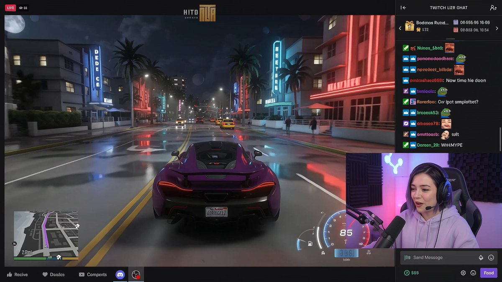
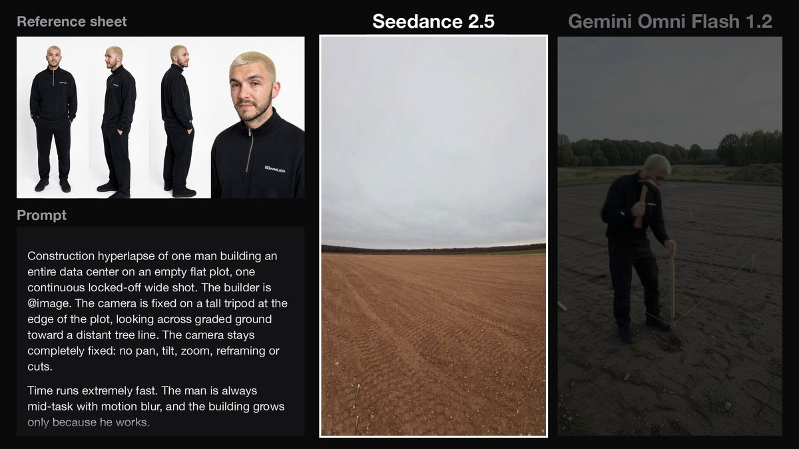
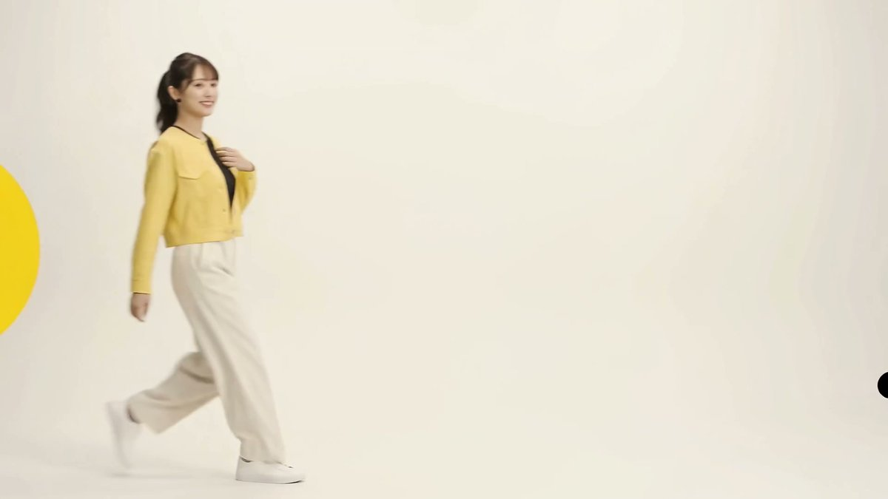
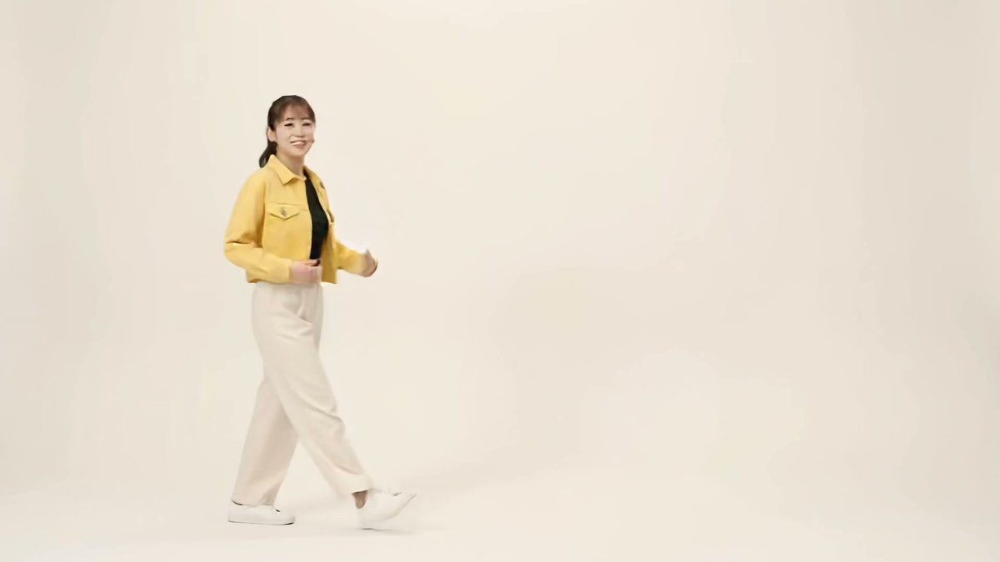
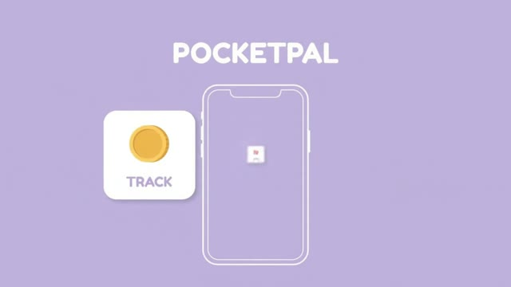
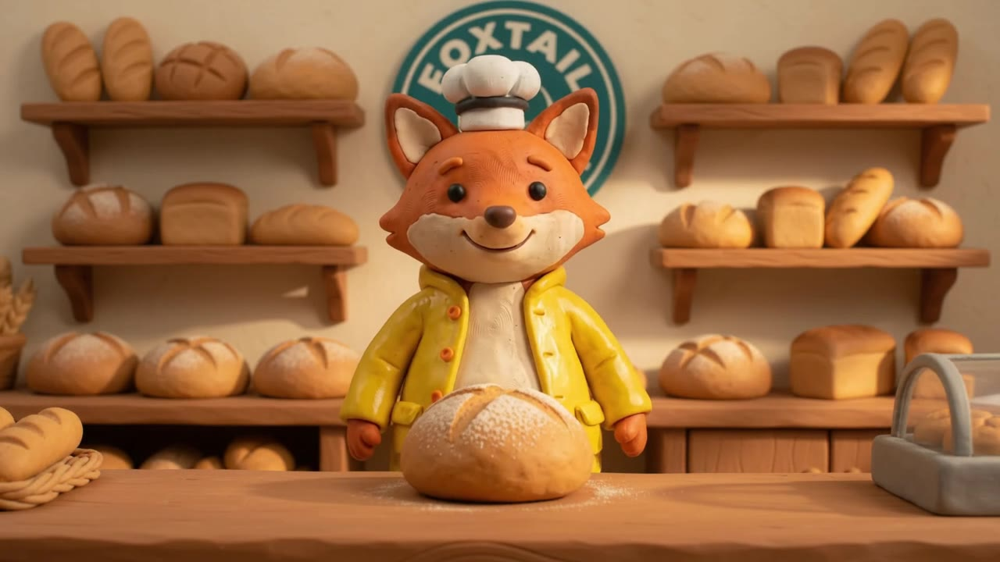
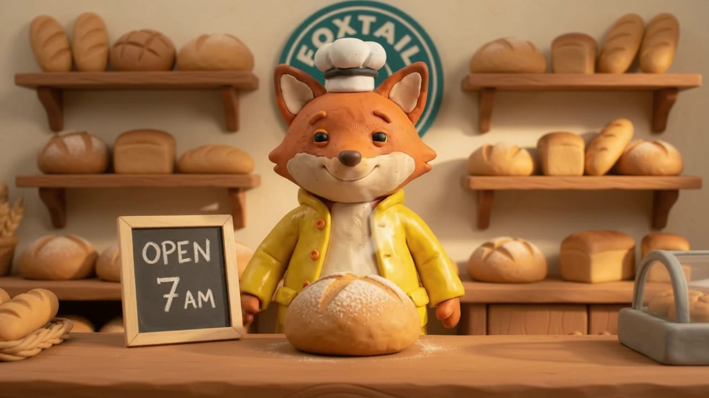
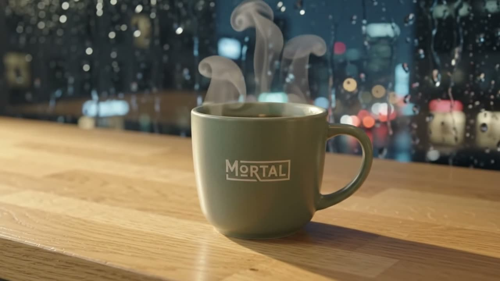
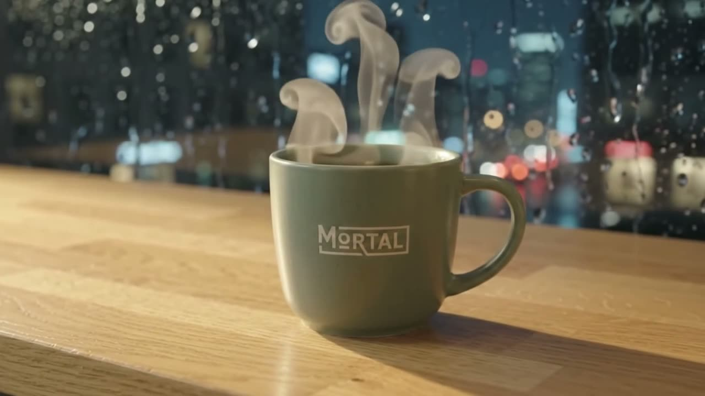
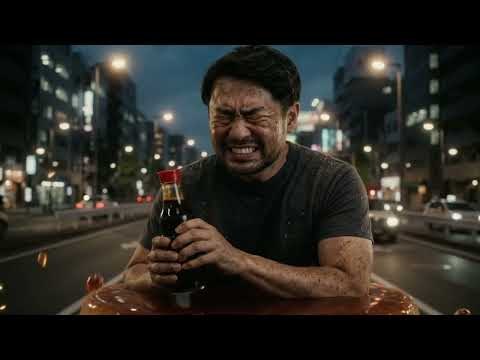

<div align="center">

<a href="https://evolink.ai/gemini-omni?utm_source=github&utm_medium=banner&utm_campaign=awesome-gemini-omni-guide-api-and-prompt&utm_content=readme_banner"></a>

[](LICENSE)
[](https://evolink.ai/gemini-omni-1-2-flash?utm_source=github&utm_medium=badge&utm_campaign=awesome-gemini-omni-guide-api-and-prompt&utm_content=model_try)

[](README.md) [](README_es.md) [](README_pt.md) [](README_ja.md) [](README_ko.md) [](README_de.md) [](README_fr.md) [](README_tr.md) [](README_zh-TW.md) [](README_zh-CN.md) [](README_ru.md)

</div>

# Gemini Omni 1.2 Flash: guia e biblioteca de prompts

## 🍌 Introdução
**Um guia do Gemini Omni 1.2 Flash, com uma biblioteca preservada de prompts, demonstrações de edição, comparações e vídeos da comunidade da família Gemini Omni.** O guia ajuda criadores e desenvolvedores a escolher uma tarefa e entender seus limites de entrada e saída.

> [!NOTE]
> Os casos de prompt legados, as comparações e a galeria da comunidade são materiais históricos da família Gemini Omni. Seus prompts, fontes e mídias originais foram preservados; eles não são apresentados como resultados ou benchmarks do Gemini Omni 1.2 Flash.

<a id="omni-1-2-guide"></a>
## 🆕 Gemini Omni 1.2 Flash

O Google classifica o Gemini Omni 1.2 Flash como disponível para uso geral (GA), com lançamento em **5 de novembro de 2026**. As principais mudanças em relação à versão 1.1 são a geração de até **15 segundos** nas rotas compatíveis e a **ampliação independente de vídeo**. Consulte a [especificação do modelo do Google](https://docs.cloud.google.com/gemini-enterprise-agent-platform/models/gemini/omni-1-2-flash) e o [anúncio da EvoLink de 5 de novembro](https://evolink.ai/changelog?utm_source=github&utm_medium=readme&utm_campaign=awesome-gemini-omni-guide-api-and-prompt&utm_content=release_source#2026-11-05-gemini-omni-1-2-flash).

- Entradas de texto, imagem e vídeo; saída de vídeo com fala, música e efeitos sonoros sincronizados. Arquivos de áudio como entrada e edição de som não são compatíveis.
- Saída nativa em **360p / 720p**; **1080p / 4K é obtido por ampliação**, não é 4K nativo. A saída documentada é de 24 fps, em 16:9 ou 9:16.
- Para gerar **15 segundos** no EvoLink, escolha texto para vídeo, imagem para vídeo com um único quadro inicial ou geração com imagens de referência e, no máximo, um vídeo de referência. Com um par de quadros inicial e final ou dois a três vídeos de referência, use **3–10 segundos**.
- A extensão acrescenta **3–10 segundos**; esse valor é a duração adicionada, não a duração total do vídeo final.

### Escolha uma tarefa da EvoLink

Cada tarefa tem um link para seu próprio contrato de requisição. Consulte a [visão geral completa dos parâmetros](https://evolink.ai/docs/en/api-manual/video-series/gemini-omni-1.2-flash/gemini-omni-1.2-flash-overview?utm_source=github&utm_medium=readme&utm_campaign=awesome-gemini-omni-guide-api-and-prompt&utm_content=parameter_overview) antes de trocar de rota.

| Tarefa | Quando usar | Limites específicos da rota |
| :--- | :--- | :--- |
| [Consulte a documentação de texto para vídeo](https://evolink.ai/docs/en/api-manual/video-series/gemini-omni-1.2-flash/gemini-omni-1.2-flash-text-to-video?utm_source=github&utm_medium=readme&utm_campaign=awesome-gemini-omni-guide-api-and-prompt&utm_content=route_text) | Crie uma tomada a partir de um prompt de texto. | 3–15 segundos. |
| [Consulte a documentação de imagem para vídeo](https://evolink.ai/docs/en/api-manual/video-series/gemini-omni-1.2-flash/gemini-omni-1.2-flash-image-to-video?utm_source=github&utm_medium=readme&utm_campaign=awesome-gemini-omni-guide-api-and-prompt&utm_content=route_image) | Anime um quadro inicial ou conecte os quadros inicial e final. | Uma imagem: 3–15 segundos; duas imagens: 3–10 segundos. |
| [Consulte a documentação de referências para vídeo](https://evolink.ai/docs/en/api-manual/video-series/gemini-omni-1.2-flash/gemini-omni-1.2-flash-reference-to-video?utm_source=github&utm_medium=readme&utm_campaign=awesome-gemini-omni-guide-api-and-prompt&utm_content=route_reference) | Oriente uma nova tomada com referências de imagem ou vídeo. | Até 10 imagens e 3 vídeos de referência; acima de 10 segundos, no máximo 1 vídeo de referência. |
| [Consulte a documentação de edição de vídeo](https://evolink.ai/docs/en/api-manual/video-series/gemini-omni-1.2-flash/gemini-omni-1.2-flash-video-edit?utm_source=github&utm_medium=readme&utm_campaign=awesome-gemini-omni-guide-api-and-prompt&utm_content=route_edit) | Modifique um clipe existente usando um prompt. | Um vídeo de entrada de até 15 segundos; imagens de referência opcionais; a qualidade padrão é `auto`. |
| [Consulte a documentação de extensão de vídeo](https://evolink.ai/docs/en/api-manual/video-series/gemini-omni-1.2-flash/gemini-omni-1.2-flash-video-extend?utm_source=github&utm_medium=readme&utm_campaign=awesome-gemini-omni-guide-api-and-prompt&utm_content=route_extend) | Continue a partir do final de um clipe. | Um vídeo de entrada de até 30 segundos; acréscimo de 3–10 segundos. |
| [Consulte a documentação de ampliação de vídeo](https://evolink.ai/docs/en/api-manual/video-series/gemini-omni-1.2-flash/gemini-omni-1.2-flash-video-upscale?utm_source=github&utm_medium=readme&utm_campaign=awesome-gemini-omni-guide-api-and-prompt&utm_content=route_upscale) | Aumente a resolução de um clipe finalizado e selecionado. | Entrada de até 15 segundos em um tamanho padrão compatível; sem prompt. Consulte a diferença entre plataformas abaixo. |

### Diferenças entre plataformas e versões

- **Referências:** O [guia de uso do AI Studio](https://aistudio.google.com/docs/omni) permite até 6 imagens, enquanto o Google Cloud e a EvoLink documentam até 10. Os limites dos vídeos de referência também dependem da duração da saída; use o contrato da plataforma selecionada.
- **Ampliação:** O Google Cloud documenta 360p→720p/1080p e 720p→1080p/4K e exclui 1080p→4K. A documentação da EvoLink também lista 1080p→4K. Confirme esse par adicional na plataforma selecionada; ele não é uma garantia comum a todas as plataformas. Consulte as [restrições de ampliação do Google](https://docs.cloud.google.com/gemini-enterprise-agent-platform/models/video/upscale-videos).
- **Estado da conversa:** A Interactions API do Google permite edição por conversa. As tarefas assíncronas de vídeo da EvoLink usam seu próprio contrato de requisição; não transfira `previous_interaction_id` nem outros parâmetros exclusivos do Google para elas.
- **Migração:** A [página do modelo do Google](https://aistudio.google.com/docs/models/gemini-omni-flash) prevê que o ID estável da versão 1.1 da Gemini API passe a encaminhar requisições para a versão 1.2 em 3 de dezembro de 2026. Isso não comprova a migração das rotas 1.1 da EvoLink. Selecione a tarefa explícita da versão 1.2 em vez de tratar o antigo ID genérico como um alias.
- **Custo:** A página do modelo na EvoLink exibe preços por token; uma tarifa por token não é um preço fixo por segundo nem por clipe finalizado. Confira a rota atual, a resolução e o uso real antes de estimar o custo de uma tarefa.

Fontes verificadas em **6 de novembro de 2026**.

<a id="quick-start"></a>
## ⚡ Início rápido

[Experimente o Gemini Omni 1.2 Flash no navegador](https://evolink.ai/gemini-omni-1-2-flash?utm_source=github&utm_medium=quickstart&utm_campaign=awesome-gemini-omni-guide-api-and-prompt&utm_content=browser_try) ou [leia a documentação atual das tarefas](https://evolink.ai/docs/en/api-manual/video-series/gemini-omni-1.2-flash/gemini-omni-1.2-flash-overview?utm_source=github&utm_medium=quickstart&utm_campaign=awesome-gemini-omni-guide-api-and-prompt&utm_content=task_docs).

Escolha texto para vídeo, imagem para vídeo, referências, edição, extensão ou ampliação na tabela de tarefas acima. Siga a documentação atual da tarefa escolhida para conhecer suas entradas, seus limites e o fluxo de obtenção do resultado.

## 📑 Menu
- [Guia do Gemini Omni 1.2 Flash](#omni-1-2-guide)
- [Início rápido](#quick-start)
- [Demonstrações oficiais do Gemini Omni 1.2](#omni12-demos)
- [Mural de demonstrações da comunidade do Gemini Omni 1.2](#omni12-community-demos)
- [🎯 Ingredientes do Prompt](#-ingredientes-do-prompt)
- [✂️ Edição](#️-edição)
  - [🔄 Substituição de Elementos](#-substituição-de-elementos)
    - [Caso 1: Borboleta para Abelha](#caso-1-borboleta-para-abelha)
    - [Caso 2: Abelha para Vagalumes](#caso-2-abelha-para-vagalumes)
    - [Casos 3-5: Série Naves Espaciais e Astronauta](#casos-3-5-série-naves-espaciais-e-astronauta)
    - [Caso 6: Transformação do Trem de 1896 (por @emollick)](#caso-6-transformação-do-trem-de-1896-por-emollick)
    - [Caso 7: Remover Pessoa do Vídeo (por @arrakis_ai)](#caso-7-remover-pessoa-do-vídeo-por-arrakis_ai)
    - [Caso 8: Violino Invisível](#caso-8-violino-invisível)
    - [Caso 9: Mudança de Local com Conhecimento de Mundo (por @venturetwins)](#caso-9-mudança-de-local-com-conhecimento-de-mundo-por-venturetwins)
    - [Caso 10: Animação para Ação Real (por @arrakis_ai)](#caso-10-animação-para-ação-real-por-arrakis_ai)
  - [🎬 Cena Base](#-cena-base)
    - [Caso 1: Tomada Base do Violinista](#caso-1-tomada-base-do-violinista)
  - [📷 Direção de Câmera](#-direção-de-câmera)
    - [Caso 1: Ângulo por Cima do Ombro](#caso-1-ângulo-por-cima-do-ombro)
    - [Caso 2: Inclinação da Câmera dos Sapatos ao Plano Médio](#caso-2-inclinação-da-câmera-dos-sapatos-ao-plano-médio)
    - [Caso 3: Hyperlapse de Selfie de Viagem (por @ZaraIrahh)](#caso-3-hyperlapse-de-selfie-de-viagem-por-zarairahh)
    - [Caso 4: Tomada de Drone de Moda (por @ariaxawan)](#caso-4-tomada-de-drone-de-moda-por-ariaxawan)
    - [Caso 5: Vista Superior para Rotação 360 (por @npaka123)](#caso-5-vista-superior-para-rotação-360-por-npaka123)
    - [Caso 6: Omnizoom — Mergulhando em uma Foto (por @alexanderchen)](#caso-6-omnizoom--mergulhando-em-uma-foto-por-alexanderchen)
  - [🎬 Ação e Sincronização](#-ação-e-sincronização)
    - [Caso 1: Som de Brinquedo Animal](#caso-1-som-de-brinquedo-animal)
    - [Caso 2: Sincronização de Luzes dos Apartamentos](#caso-2-sincronização-de-luzes-dos-apartamentos)
    - [Caso 3: Reação em Cadeia com Bolinha de Gude](#caso-3-reação-em-cadeia-com-bolinha-de-gude)
    - [Caso 4: Luzes do Edifício](#caso-4-luzes-do-edifício)
    - [Caso 5: Luta de Boxe Realista (por @RuzainaMeer)](#caso-5-luta-de-boxe-realista-por-ruzainameer)
- [🎨 Multi-Modal Avançado](#-multi-modal-avançado)
  - [🪞 Estilo Artístico](#-estilo-artístico)
    - [Casos 1-3: Série do Espelho](#casos-1-3-série-do-espelho)
    - [Caso 4: Anúncio Animado em Uma Tomada (por @DenneyDara)](#caso-4-anúncio-animado-em-uma-tomada-por-denneydara)
    - [Caso 5: Isolamento de Desenho em Linhas (por @alexanderchen)](#caso-5-isolamento-de-desenho-em-linhas-por-alexanderchen)
  - [✨ Efeitos Visuais](#-efeitos-visuais)
    - [Caso 1: Super Zoom pelo Buraco da Mão](#caso-1-super-zoom-pelo-buraco-da-mão)
    - [Caso 2: Efeitos de Movimento no Skate](#caso-2-efeitos-de-movimento-no-skate)
    - [Caso 3: Sobreposição HUD AR (por @jerrod_lew)](#caso-3-sobreposição-hud-ar-por-jerrod_lew)
  - [🔗 Cross-Modal](#-cross-modal)
    - [Caso 1: Transportar para Novo Ambiente](#caso-1-transportar-para-novo-ambiente)
    - [Caso 2: Forma de Pássaros com Áudio](#caso-2-forma-de-pássaros-com-áudio)
    - [Caso 3: Slide para Movimento (por @yoshifujidesign)](#caso-3-slide-para-movimento-por-yoshifujidesign)
    - [Caso 4: Personagem Isométrico Cozinhando com Imagem de Referência (por @kumiko_shiraki)](#caso-4-personagem-isométrico-cozinhando-com-imagem-de-referência-por-kumiko_shiraki)
    - [Caso 5: Imagem de Instruções do ChatGPT como Entrada (por @Majin_AppSheet)](#caso-5-imagem-de-instruções-do-chatgpt-como-entrada-por-majin_appsheet)
    - [Caso 6: Ilustração ChatGPT para Animação Omni (por @mmmiyama_D)](#caso-6-ilustração-chatgpt-para-animação-omni-por-mmmiyama_d)
  - [📋 Storyboard](#-storyboard)
    - [Caso 1: Comercial de Cosmético de Luxo (por @aiwithaly)](#caso-1-comercial-de-cosmético-de-luxo-por-aiwithaly)
    - [Caso 2: Me Mostre Nesta História](#caso-2-me-mostre-nesta-história)
    - [Caso 3: Tela Dividida 3x3 (por @alexanderchen)](#caso-3-tela-dividida-3x3-por-alexanderchen)
    - [Caso 4: Replay de Ação de Diferentes Ângulos (por @jerrod_lew)](#caso-4-replay-de-ação-de-diferentes-ângulos-por-jerrod_lew)
    - [Caso 5: Vídeo em Tela Dividida (por @jerrod_lew)](#caso-5-vídeo-em-tela-dividida-por-jerrod_lew)
  - [🔤 Renderização de Texto](#-renderização-de-texto)
    - [Caso 1: Sequência de Itens do Alfabeto](#caso-1-sequência-de-itens-do-alfabeto)
    - [Caso 2: Sincronização de Texto Palavra por Palavra](#caso-2-sincronização-de-texto-palavra-por-palavra)
    - [Caso 3: Renderização de Texto com Notícias de IA (por @chrisfirst)](#caso-3-renderização-de-texto-com-notícias-de-ia-por-chrisfirst)
    - [Caso 4: Desfile de Fontes (por @HBCoop_)](#caso-4-desfile-de-fontes-por-hbcoop_)
- [⚖️ Comparação](#️-comparação)
  - [Caso 1: Seedance 2.0 vs Gemini Omni Flash (por @JSFILMZ0412)](#caso-1-seedance-20-vs-gemini-omni-flash-por-jsfilmz0412)
  - [Caso 2: Gemini Omni vs Seedance 2.0 Cenas de Ação (por @CuriousRefuge)](#caso-2-gemini-omni-vs-seedance-20-cenas-de-ação-por-curiousrefuge)
- [🧪 Avaliação](#-avaliação)
  - [Caso 1: Avaliação de Qualidade do Gemini Omni (por @kenichiota0711)](#caso-1-avaliação-de-qualidade-do-gemini-omni-por-kenichiota0711)
- [🌐 Galeria da Comunidade](#-galeria-da-comunidade)
- [Repositórios relacionados](#related-repositories)
- [🙏 Agradecimentos](#-agradecimentos)

<a id="omni12-demos"></a>
## 🎬 Demonstrações do Gemini Omni 1.2

Oito demonstrações oficiais publicadas pelo Google em **5 de novembro de 2026**. Leia o [artigo original de lançamento](https://blog.google/innovation-and-ai/technology/developers-tools/introducing-gemini-omni-1-2-flash/); selecione uma imagem de prévia para assistir ao vídeo original do Google.

<table>
<tr>
<td width="50%" valign="top">

<a id="omni12-demo-1"></a>
**[Prova virtual de roupas em 15 segundos](https://storage.googleapis.com/gweb-uniblog-publish-prod/original_videos/ECom_Try_On_Demo.mp4)**

[](https://storage.googleapis.com/gweb-uniblog-publish-prod/original_videos/ECom_Try_On_Demo.mp4)

Uma foto de modelo e três conjuntos de roupas orientam uma montagem de prova virtual de 15 segundos.

</td>
<td width="50%" valign="top">

<a id="omni12-demo-2"></a>
**[Animação tipográfica em camadas](https://storage.googleapis.com/gweb-uniblog-publish-prod/original_videos/Typographic_Motion_Graphics_Demo.mp4)**

[](https://storage.googleapis.com/gweb-uniblog-publish-prod/original_videos/Typographic_Motion_Graphics_Demo.mp4)

Um pôster animado monta materiais e letras; o Google mostra resultados das versões 1.1 e 1.2.

</td>
</tr>
<tr>
<td width="50%" valign="top">

<a id="omni12-demo-3"></a>
**[Trocas de fundo por conversa](https://storage.googleapis.com/gweb-uniblog-publish-prod/original_videos/Video_Background_Editing_Demo.mp4)**

[](https://storage.googleapis.com/gweb-uniblog-publish-prod/original_videos/Video_Background_Editing_Demo.mp4)

Conversas sucessivas substituem o fundo de um clipe, mantendo seus dois personagens com armaduras.

</td>
<td width="50%" valign="top">

<a id="omni12-demo-4"></a>
**[Voo contínuo pelo Panteão](https://storage.googleapis.com/gweb-uniblog-publish-prod/original_videos/Pantheon_Tour_Demo_FuU0KUh.mp4)**

[](https://storage.googleapis.com/gweb-uniblog-publish-prod/original_videos/Pantheon_Tour_Demo_FuU0KUh.mp4)

Duas fotos de arquitetura orientam um voo contínuo da câmera pela cúpula do Panteão.

</td>
</tr>
<tr>
<td width="50%" valign="top">

<a id="omni12-demo-5"></a>
**[Explicação de uma colmeia em 15 segundos](https://storage.googleapis.com/gweb-uniblog-publish-prod/original_videos/Bee_Hive_Live_Infographic_Demo_ninuxtc.mp4)**

[](https://storage.googleapis.com/gweb-uniblog-publish-prod/original_videos/Bee_Hive_Live_Infographic_Demo_ninuxtc.mp4)

Um quadro de estilo se transforma em uma explicação ilustrada de uma colmeia, com quatro planos e 15 segundos.

</td>
<td width="50%" valign="top">

<a id="omni12-demo-6"></a>
**[Transferência de movimento de polvo para dançarina](https://storage.googleapis.com/gweb-uniblog-publish-prod/original_videos/Unexpected_Motion_Tracking_Demo_QRzpS2T.mp4)**

[](https://storage.googleapis.com/gweb-uniblog-publish-prod/original_videos/Unexpected_Motion_Tracking_Demo_QRzpS2T.mp4)

Uma edição posterior transfere o movimento fluido de um polvo para o vestido de uma dançarina.

</td>
</tr>
<tr>
<td width="50%" valign="top">

<a id="omni12-demo-7"></a>
**[Restaurante de ramen: primeiro e último quadros](https://storage.googleapis.com/gweb-uniblog-publish-prod/original_videos/Ramen_Bar_Demo_jeWGtqx.mp4)**

[](https://storage.googleapis.com/gweb-uniblog-publish-prod/original_videos/Ramen_Bar_Demo_jeWGtqx.mp4)

Os quadros inicial e final conectam o exterior e o interior de um restaurante de ramen; a comparação do Google apresenta inconsistências visíveis.

</td>
<td width="50%" valign="top">

<a id="omni12-demo-8"></a>
**[Zoom de afastamento contínuo de uma ilha](https://storage.googleapis.com/gweb-uniblog-publish-prod/original_videos/Castaway_Crash_Zoom_Out_Demo.mp4)**

[](https://storage.googleapis.com/gweb-uniblog-publish-prod/original_videos/Castaway_Crash_Zoom_Out_Demo.mp4)

Um plano de dez segundos se afasta de um close-up da orla até uma vista ampla da ilha.

</td>
</tr>
</table>

<a id="omni12-community-demos"></a>
## 🎥 Mural de demonstrações da comunidade do Gemini Omni 1.2

Quatorze exemplos do Gemini Omni 1.2 Flash publicados por criadores e equipes que desenvolvem ferramentas. Selecione uma prévia para assistir ao vídeo original. O título leva à publicação ou ao artigo do autor, onde você encontra o prompt quando ele foi compartilhado.

<table>
<tr>
<td width="50%" valign="top">

<a id="omni12-community-1"></a>
**[Trocas de looks de moda urbana no ritmo da batida](https://x.com/HarshithLucky3/status/2118401265273360530)** · HarshithLucky3

[](https://video-s.twimg.com/amplify_video/2118400792348770305/vid/avc1/640x360/y-KZwoASoz81lFXx.mp4?tag=29)

Durante a caminhada em estilo urbano, palmas marcam trocas rápidas de roupa. O criador compartilha o prompt.

</td>
<td width="50%" valign="top">

<a id="omni12-community-2"></a>
**[Festa de aniversário com estilos variados](https://x.com/ash_twtz/status/2118393918794707053)** · ash_twtz

[](https://video-s.twimg.com/amplify_video/2118393860493905920/vid/avc1/640x360/W2r1uWl7T7aS8Bms.mp4?tag=29)

Personagens em stop motion, 3D, quadrinhos e anime dividem a mesma cena de aniversário.

</td>
</tr>
<tr>
<td width="50%" valign="top">

<a id="omni12-community-3"></a>
**[Anúncio de garrafa de água com marcações de tempo](https://weel.co.jp/media/tech/gemini-omni-1-2-flash/)** · WEEL

[](https://www.youtube.com/watch?v=u6P7rxZlSQI)

A WEEL testa um anúncio de produto de 15 segundos, com três momentos cronometrados. O artigo inclui o prompt.

</td>
<td width="50%" valign="top">

<a id="omni12-community-4"></a>
**[Apresentação de perfume entre dois quadros](https://blog.segmind.com/gemini-omni-1-2-flash-is-here-generate-and-edit-15-second-videos/)** · Segmind

[](https://segmind-resources.s3.amazonaws.com/blog/gemini-omni-12-flash/i2v-fl10.mp4)

Dois quadros de referência guiam uma apresentação de perfume de 10 segundos, de um estúdio escuro a flores iluminadas pelo sol. O artigo inclui o prompt.

</td>
</tr>
<tr>
<td width="50%" valign="top">

<a id="omni12-community-5"></a>
**[Ceramista e vaso de referência](https://blog.segmind.com/gemini-omni-1-2-flash-is-here-generate-and-edit-15-second-videos/)** · Segmind

[](https://segmind-resources.s3.amazonaws.com/blog/gemini-omni-12-flash/ref10.mp4)

Referências distintas orientam a representação do ceramista e do vaso em uma tomada de produto com fala. O artigo inclui o prompt.

</td>
<td width="50%" valign="top">

<a id="omni12-community-6"></a>
**[Jantar polonês com três vozes](https://promptif.fr/gemini-omni-1-2-flash-test/)** · Promptif

[](https://promptif.fr/wp-content/uploads/2026/11/omni12-cc251d82201c7f7e2cbd2d57b6e9715b.mp4)

Uma cena de jantar festivo polonês testa a alternância de falas e a sincronia labial de três pessoas.

</td>
</tr>
<tr>
<td width="50%" valign="top">

<a id="omni12-community-7"></a>
**[Gameplay com facecam](https://x.com/rovvmut_/status/2118752554746270169)** · rovvmut_

[](https://video.twimg.com/amplify_video/2118752493798825984/vid/avc1/640x360/ABYvurfZ5k_VXKKA.mp4?tag=29)

O criador usa um prompt para compor o layout de uma transmissão de jogo, com uma cena ao volante, uma facecam no canto e comentários em inglês. A publicação inclui o prompt.

</td>
<td width="50%" valign="top">

<a id="omni12-community-8"></a>
**[Hiperlapso de construção com câmera fixa](https://x.com/alecwilcock/status/2118716313275142188)** · alecwilcock

[](https://video.twimg.com/amplify_video/2118715983812497409/vid/avc1/640x360/rLsfCIZnQmAvu0SI.mp4?tag=29)

O criador compara o Omni 1.2 Flash e o Seedance 2.5 em um time-lapse da construção de um centro de dados. A publicação inclui o prompt usado nos dois modelos.

</td>
</tr>
<tr>
<td width="50%" valign="top">

<a id="omni12-community-9"></a>
**[Mesmo prompt, sem diálogo](https://x.com/husky__create/status/2118637071887953952)** · husky__create

**Omni 1.2 Flash**

[](https://video-s.twimg.com/amplify_video/2118637038430015488/vid/avc1/640x360/goYQmD8hpI3NIsS5.mp4?tag=16)

**Omni 1.1 Flash**

[](https://video-s.twimg.com/amplify_video/2118637056083787776/vid/avc1/640x360/srtblIdulfmUfOeA.mp4?tag=16)

O criador compara o Omni 1.2 Flash e o 1.1 Flash usando o mesmo prompt, que pede uma cena sem diálogo. Os dois resultados estão disponíveis.

</td>
<td width="50%" valign="top">

<a id="omni12-community-10"></a>
**[Colagem estática em movimento](https://x.com/mmmiyama_D/status/2118467997870465516)** · mmmiyama_D

[](https://video-s.twimg.com/amplify_video/2118467980497747968/vid/avc1/480x852/7oxu6hnjA__basp0.mp4?tag=16)

O criador usa o Omni 1.2 Flash para animar uma colagem estática da publicação citada.

</td>
</tr>
<tr>
<td width="50%" valign="top">

<a id="omni12-community-11"></a>
**[Teste A/B de prompts para apresentar um app](https://www.segmind.com/@himanshu/gemini-omni-1-2-flash-prompts)** · Himanshu Goel

**Briefing de uma frase**

[](https://segmind-resources.s3.amazonaws.com/blog/gemini-omni-prompts-ex1_vague.mp4)

**Lista de planos com marcações de tempo**

[](https://segmind-resources.s3.amazonaws.com/blog/gemini-omni-prompts-ex1_structured.mp4)

Goel compara dois prompts para um vídeo de oito segundos sobre um aplicativo de controle do orçamento. Ele usa o mesmo modelo, a mesma seed, duração e resolução para comparar um briefing de uma frase com uma lista de planos com marcações de tempo.

</td>
<td width="50%" valign="top">

<a id="omni12-community-12"></a>
**[Extensão do clipe da raposa padeira](https://www.segmind.com/@himanshu/gemini-omni-1-2-flash-prompts)** · Himanshu Goel

**Clipe original de 8 segundos**

[](https://segmind-resources.s3.amazonaws.com/blog/gemini-omni-prompts-ex3_ref.mp4)

**Clipe estendido de 13 segundos**

[](https://segmind-resources.s3.amazonaws.com/blog/gemini-omni-prompts-ex5_extend.mp4)

Goel acrescenta cinco segundos ao clipe de oito segundos de uma raposa de argila em uma padaria. O resultado de 13 segundos inclui uma lousa com o horário de funcionamento. O artigo mostra as imagens de referência e os prompts.

</td>
</tr>
<tr>
<td width="50%" valign="top">

<a id="omni12-community-13"></a>
**[Edição de um vídeo de caneca pelo chat](https://www.aiformortals.co/blog/gemini-omni-flash-1-2-tested#gemini-omni-video-editing-three-rounds-of-chat-edits)** · Pat Simmons

**Após a edição do fundo**

[](https://uzgqbjufkfadoprvamcs.supabase.co/storage/v1/object/public/daily-img/gemini-omni-flash-1-2-tested/t3-edit1-background.mp4)

**Após o pedido de acelerar o movimento de câmera**

[](https://uzgqbjufkfadoprvamcs.supabase.co/storage/v1/object/public/daily-img/gemini-omni-flash-1-2-tested/t3-edit3-pacing.mp4)

Na avaliação de Simmons com o app Gemini, a edição do fundo para mostrar uma janela molhada pela chuva funcionou. Segundo seu relato, os dois pedidos seguintes, de iluminação mais quente e um movimento de câmera mais rápido, não produziram mudanças visíveis.

</td>
<td width="50%" valign="top">

<a id="omni12-community-14"></a>
**[Mascote falante de molho de soja no Flow](https://note.com/pharma_i_cist/n/n227466896971)** · 濱口貴光

[](https://www.youtube.com/watch?v=SNDK6KC5atU)

Hamaguchi envia uma imagem de referência do personagem, adiciona uma voz personalizada em japonês e gera o mascote falante no Google Flow. O artigo mostra a configuração e o resultado original.

</td>
</tr>
</table>

## 🎯 Ingredientes do Prompt
O Gemini Omni possui forte **compreensão do mundo** — ele se baseia em conhecimento do mundo real sobre história, ciência e cultura. Você não precisa explicar cada detalhe em excesso. Em vez disso, expresse sua intenção criativa em linguagem natural e deixe o raciocínio do Omni preencher o resto.
Ao criar um novo vídeo do zero, combine estas dimensões para controlar o resultado:
| Dimensão | O que especificar | Exemplo |
| :--- | :--- | :--- |
| **Enquadramento e Movimento** | Grande angular, médio ou close-up. Trajetória da câmera: deslize suave, avanço repentino, estático, dolly zoom, etc. | `A close-up tracking shot smoothly pushing in` |
| **Estilo** | Direção de arte visual geral | `Vintage monochrome hologram`, `3D voxel art`, `colored crayon aesthetic` |
| **Iluminação** | Clima da cena e configuração de luz | `Warm champagne lighting`, `dim overhead gym lights` |
| **Locação** | Ambiente e cenário | `Small underground gym`, `futuristic neon cityscape` |
| **Ação** | Comportamento e movimento do sujeito | `The person touches the mirror`, `a marble rolling fast on a chain reaction track` |
> [!TIP]
> **Edição Iterativa:** O Omni suporta edição por conversa multi-turno. Ele preserva o que funciona e modifica apenas o que você pede — não é necessário redescrever a cena inteira a cada vez. Apenas diga o que mudar em seguida.

> [!TIP]
> **[Preservar Áreas Inalteradas](https://x.com/tanabe_fragm/status/2058103447006896406) (por [@tanabe_fragm](https://x.com/tanabe_fragm)):** Ao editar vídeo, adicione frases como "Não mude mais nada" ou "Mantenha o resto igual" ao seu prompt. Isso reduz significativamente alterações indesejadas em partes que você não pretendia modificar.
>
> https://github.com/user-attachments/assets/285ee7d8-7dfe-4304-a9a4-648026073b80

## ✂️ Edição

### 🔄 Substituição de Elementos

<a id="caso-1-borboleta-para-abelha"></a>
### Caso 1: Borboleta para Abelha `🎬 Video→Video`

<table>
<tr>
<td width="300">

**Entrada:**

https://github.com/user-attachments/assets/8feb4d7b-825d-4a4a-bd9d-900754cf5d38

</td>
<td width="300">

**Saída:**

https://github.com/user-attachments/assets/60f31f6d-895e-4048-b477-9a46a5d20b90

</td>
</tr>
</table>

**Prompt:**

```
Change the butterfly to a bee.
```

---

<a id="caso-2-abelha-para-vagalumes"></a>
### Caso 2: Abelha para Vagalumes `🎬 Video→Video`

<table>
<tr>
<td width="300">

**Entrada:**

https://github.com/user-attachments/assets/60f31f6d-895e-4048-b477-9a46a5d20b90

</td>
<td width="300">

**Saída:**

https://github.com/user-attachments/assets/76fc8e97-c7d1-40bc-9e79-bd6705aa8267

</td>
</tr>
</table>

**Prompt:**

```
Change the bee into a small swarm of fireflies.
```

---

<a id="casos-3-5-série-naves-espaciais-e-astronauta"></a>
### Casos 3-5: Série Naves Espaciais e Astronauta `🎬 Video→Video`

<table>
<tr>
<td colspan="3">

**Entrada:**

https://github.com/user-attachments/assets/26ea7e43-9787-4096-82f9-e10543229bec

</td>
</tr>
<tr>
<td width="300">

https://github.com/user-attachments/assets/dd9ae5b1-0205-45ac-a651-258af1c4f12c

### Caso 3: Naves para Origami Branco

</td>
<td width="300">

https://github.com/user-attachments/assets/78ef5301-b759-4dda-9995-3ee0d259a7b1

### Caso 4: Astronauta para Anêmona do Mar

</td>
<td width="300">

https://github.com/user-attachments/assets/0cbadb19-8a5b-4a2c-9093-e3a84f3dd988

### Caso 5: Pequenas Naves para Arraias

</td>
</tr>
</table>

**Prompts:**

```
Case 3: Change the ships to be made from white origami paper.
```

```
Case 4: Change the astronaut to a sea anemone.
```

```
Case 5: Change the small ships to stingrays.
```

---

<a id="caso-6-transformação-do-trem-de-1896-por-emollick"></a>
### Caso 6: [Transformação do Trem de 1896](https://x.com/emollick/status/2057874739817808223) (por [@emollick](https://x.com/emollick)) `🎬 Video→Video`

https://github.com/user-attachments/assets/275cc90e-adaa-48ff-9ff8-1e96ea29d44f

**Prompt:**

```
I took the famous "train" movie from 1896 & made it a bullet train, LEGO, added a time traveler, a centipede, muppets...
```

---

<a id="caso-7-remover-pessoa-do-vídeo-por-arrakis_ai"></a>
### Caso 7: [Remover Pessoa do Vídeo](https://x.com/arrakis_ai/status/2057939231755178439) (por [@arrakis_ai](https://x.com/arrakis_ai)) `🎬 Video→Video`

https://github.com/user-attachments/assets/72379fb2-ac30-4d1e-a6b4-143052f8f061

**Prompt:**

```
Remove the person from this video perfectly.
```

---

<a id="caso-8-violino-invisível"></a>
### Caso 8: Violino Invisível `🎬 Video→Video`

<table>
<tr>
<td width="300">

**Entrada:**

https://github.com/user-attachments/assets/88176743-d17e-48fe-89f3-528fe60df7fd

</td>
<td width="300">

**Saída:**

https://github.com/user-attachments/assets/ac6457aa-158c-4a0b-852f-ce1f3367bc3f

</td>
</tr>
</table>

**Prompt:**

```
Make the violin invisible
```

---

<a id="caso-9-mudança-de-local-com-conhecimento-de-mundo-por-venturetwins"></a>
### Caso 9: [Mudança de Local com Conhecimento de Mundo](https://x.com/venturetwins/status/2058235415883313361) (por [@venturetwins](https://x.com/venturetwins)) `🎬 Video→Video`

https://github.com/user-attachments/assets/daa90750-fc7b-49ea-b85d-364411159663

**Prompt:**

```
Re-shoot this video in [location] based on the screenshot from Google Maps.
```

> Vídeo de uma corrida Waymo carregado, depois pedido ao Omni para regravar em locais diferentes usando screenshots do Google Maps. O modelo aproveita seu conhecimento de mundo para mudar ambientes de forma fluida.

---

<a id="caso-10-animação-para-ação-real-por-arrakis_ai"></a>
### Caso 10: [Animação para Ação Real](https://x.com/arrakis_ai/status/2058488373057302797) (por [@arrakis_ai](https://x.com/arrakis_ai)) `🎬 Video→Video`

https://github.com/user-attachments/assets/3c6be2a9-3e67-4deb-8ccd-fb493b715f65

**Prompt:**

```
Turn this animation into live action.
```

### 🎬 Cena Base

<a id="caso-1-tomada-base-do-violinista"></a>
### Caso 1: Tomada Base do Violinista `🔤 Text→Video`

https://github.com/user-attachments/assets/93de5898-88ee-4bfc-a36f-19d8aa99dfc1

**Prompt:**

```
A video of a violinist playing a song.
```

### 📷 Direção de Câmera

<a id="caso-1-ângulo-por-cima-do-ombro"></a>
### Caso 1: Ângulo por Cima do Ombro `🎬 Video→Video`

<table>
<tr>
<td width="300">

**Entrada:**

https://github.com/user-attachments/assets/ac6457aa-158c-4a0b-852f-ce1f3367bc3f

</td>
<td width="300">

**Saída:**

https://github.com/user-attachments/assets/71aa1c8d-0287-4591-b239-68322919293d

</td>
</tr>
</table>

**Prompt:**

```
Change the camera angle to be over the violinist's shoulder.
```

---

<a id="caso-2-inclinação-da-câmera-dos-sapatos-ao-plano-médio"></a>
### Caso 2: Inclinação da Câmera dos Sapatos ao Plano Médio `🎬 Video→Video`

<table>
<tr>
<td width="300">

**Entrada:**

https://github.com/user-attachments/assets/19dbc1ae-1e9e-4b7b-9069-e979fffe3651

</td>
<td width="300">

**Saída:**

https://github.com/user-attachments/assets/c0ccbda0-4fd0-42be-8620-db7a67a5347d

</td>
</tr>
</table>

**Prompt:**

```
Change the camera angle, a close-up on his shoes, quickly tilting up to medium shot, then widening.
```

---

<a id="caso-3-hyperlapse-de-selfie-de-viagem-por-zarairahh"></a>
### Caso 3: [Hyperlapse de Selfie de Viagem](https://x.com/ZaraIrahh/status/2057775215749349520) (por [@ZaraIrahh](https://x.com/ZaraIrahh)) `🔤 Text→Video`

https://github.com/user-attachments/assets/31fa5a56-6113-4376-873b-5e40d26803f1

**Prompt:**

```
Create a 10-second cinematic hyper-lapse selfie travel video of the uploaded female character across 20 world-famous destinations in 2026. Hard cuts every 0.5 seconds synced to the beat. Handheld selfie-stick camera, wide-angle lens, close selfie framing, energetic travel-vlogger style, vibrant cinematic colors, realistic lighting, dynamic motion blur, natural crowds, and clear landmarks in every shot.
```

---

<a id="caso-4-tomada-de-drone-de-moda-por-ariaxawan"></a>
### Caso 4: [Tomada de Drone de Moda](https://x.com/ariaxawan/status/2057794715744084042) (por [@ariaxawan](https://x.com/ariaxawan)) `🔤 Text→Video`

https://github.com/user-attachments/assets/b199a5ab-e008-4a72-aa03-094bc6d573e6

**Prompt:**

```
A 10 second ultra cinematic hyper realistic FPV fashion drone shot filmed in a single continuous take inside a futuristic luxury tunnel. Single continuous take, aggressive FPV motion, ultra smooth cinematic flight path, luxury high-fashion editorial atmosphere.
```

---

<a id="caso-5-vista-superior-para-rotação-360-por-npaka123"></a>
### Caso 5: [Vista Superior para Rotação 360](https://x.com/npaka123/status/2058033145845575735) (por [@npaka123](https://x.com/npaka123)) `🖼️ Image→Video`

https://github.com/user-attachments/assets/1ad202cb-a485-4b7a-9c8c-d4fea4a3b6d5

**Prompt:**

```
この教室の中央から黒板を見ているファーストパーソンなゲーム視点。360度カメラを回転。教室の黒板右側の窓の外は廊下、黒板左側の窓の外は校庭。
```

---

<a id="caso-6-omnizoom--mergulhando-em-uma-foto-por-alexanderchen"></a>
### Caso 6: [Omnizoom — Mergulhando em uma Foto](https://x.com/alexanderchen/status/2058330610574221672) (por [@alexanderchen](https://x.com/alexanderchen)) `🖼️ Image→Video`

https://github.com/user-attachments/assets/9fd3ad2a-6e4a-4ac0-ab29-48f1c303b95f

**Prompt:**

```
Omnizoom — diving into a photo.
```

### 🎬 Ação e Sincronização

<a id="caso-1-som-de-brinquedo-animal"></a>
### Caso 1: Som de Brinquedo Animal `🎬 Video→Video`

https://github.com/user-attachments/assets/fbf377d7-1b39-43af-92e6-665792d05de0

**Prompt:**

```
When the finger in <video> touches the animal toy play the sound the animal makes
```

---

<a id="caso-2-sincronização-de-luzes-dos-apartamentos"></a>
### Caso 2: Sincronização de Luzes dos Apartamentos `🎬+🎵 Video+Audio→Video`

<table>
<tr>
<td width="300">

**Entrada:**

https://github.com/user-attachments/assets/6fa879c3-5ee8-4ff1-bbe9-6648d750277d

</td>
<td width="300">

**Saída:**

https://github.com/user-attachments/assets/3f010e2a-a471-4b0d-8782-c4c5547cd2a5

</td>
</tr>
</table>

**Prompt:**

```
The lights of the apartments start turning on in sync with the music.
```

---

<a id="caso-3-reação-em-cadeia-com-bolinha-de-gude"></a>
### Caso 3: Reação em Cadeia com Bolinha de Gude `🔤 Text→Video`

https://github.com/user-attachments/assets/1ece8df7-f29a-4ebd-ad68-9c910f811590

**Prompt:**

```
A marble rolling fast on a chain reaction style track, continuous smooth shot
```

---

<a id="caso-4-luzes-do-edifício"></a>
### Caso 4: Luzes do Edifício `🎬+🎵 Video+Audio→Video`

<table>
<tr>
<td width="300">

**Entrada:**

https://github.com/user-attachments/assets/efbc0d8d-b64a-4ef9-afe6-fed4a8b66102

</td>
<td width="300">

**Saída:**

https://github.com/user-attachments/assets/51727436-1fc2-426b-afaa-86bb63cfba0f

</td>
</tr>
</table>

**Prompt:**

```
The lights of the buildings start turning on in sync with the music.
```

---

<a id="caso-5-luta-de-boxe-realista-por-ruzainameer"></a>
### Caso 5: [Luta de Boxe Realista](https://x.com/RuzainaMeer/status/2057785474446741728) (por [@RuzainaMeer](https://x.com/RuzainaMeer)) `🔤 Text→Video`

https://github.com/user-attachments/assets/6796bf78-8bad-441c-889d-30621ee62cd7

**Prompt:**

```
Ultra-realistic 10-second boxing fight between two women inside a small underground gym. Both fighters look naturally athletic with realistic skin texture, sweat, bruises, and detailed facial expressions. The fight feels raw and authentic, like real professional sparring footage. The camera moves handheld around the ring at close range, capturing fast punches, defensive movement, realistic footwork, and heavy breathing.
```

## 🎨 Multi-Modal Avançado

### 🪞 Estilo Artístico

<a id="casos-1-3-série-do-espelho"></a>
### Casos 1-3: Série do Espelho `🎬 Video→Video`

<table>
<tr>
<td width="300">

https://github.com/user-attachments/assets/747cdc6b-f5fa-4482-b745-2839551e9ba2

### Caso 1: Espelho com Ondulação de Metal Líquido

</td>
<td width="300">

https://github.com/user-attachments/assets/36ea02a2-3716-44aa-9bc2-a5cc1480d0bf

### Caso 2: Espelho com Arte em Linhas

</td>
<td width="300">

https://github.com/user-attachments/assets/dbca6772-dd7a-4418-a0e6-a39796a91c97

### Caso 3: Espelho com Fantoche

</td>
</tr>
</table>

**Prompts:**

```
Case 1: When the person touches the mirror, make the mirror ripple beautifully like liquid, and the person's arm turns into reflective mirror material
```

```
Case 2: When the person touches the mirror, the person transforms into a detailed monochrome line art drawing
```

```
Case 3: When the person touches the mirror, the person suddenly transforms into a cute felted stuffed puppet version with large googley eyes and glasses
```

---

<a id="caso-4-anúncio-animado-em-uma-tomada-por-denneydara"></a>
### Caso 4: [Anúncio Animado em Uma Tomada](https://x.com/DenneyDara/status/2057844409639551380) (por [@DenneyDara](https://x.com/DenneyDara)) `🔤 Text→Video`

https://github.com/user-attachments/assets/edacf1c5-94db-4687-8eaa-f87ebf5fabee

**Prompt:**

```
Make a Pixar-style video of an aloe leaf that is walking through the forest that talks about how good nature makes it feel. Have it say, "Organic and healthy ingredients make me feel so good."
```

---

<a id="caso-5-isolamento-de-desenho-em-linhas-por-alexanderchen"></a>
### Caso 5: [Isolamento de Desenho em Linhas](https://x.com/alexanderchen/status/2057925025915666673) (por [@alexanderchen](https://x.com/alexanderchen)) `🎬 Video→Video`

https://github.com/user-attachments/assets/787813c0-2e20-4999-8383-fd76a9b21f91

**Prompt:**

```
Extract the key object in this video. Render a video showing that object as a black diagram-style line art drawing on solid 100% white background, nothing else in background. Keep the motion and sound exactly as is.
```

### ✨ Efeitos Visuais

<a id="caso-1-super-zoom-pelo-buraco-da-mão"></a>
### Caso 1: Super Zoom pelo Buraco da Mão `🎬 Video→Video`

https://github.com/user-attachments/assets/06683ef4-16e0-47b0-93ec-c6222560ee13

**Prompt:**

```
Make it look like the weird shape of my hand hole super zooms and magnifies the ground it's looking at in sharper quality.
```

---

<a id="caso-2-efeitos-de-movimento-no-skate"></a>
### Caso 2: Efeitos de Movimento no Skate `🎬 Video→Video`

https://github.com/user-attachments/assets/44c120a2-38a7-43d7-89fa-a23d0842078c

**Prompt:**

```
Edit this keeping everything the same. Add animated motion effects coming out of the skateboard.
```

---

<a id="caso-3-sobreposição-hud-ar-por-jerrod_lew"></a>
### Caso 3: [Sobreposição HUD AR](https://x.com/jerrod_lew/status/2058337271947079977) (por [@jerrod_lew](https://x.com/jerrod_lew)) `🎬 Video→Video`

https://github.com/user-attachments/assets/04b11cd7-d345-4172-b6e5-38301e73bb77

**Prompt:**

```
Create a virtual HUD and UI overlay for this recorded phone video, like an AR glasses experience with secondary screens.
```

### 🔗 Cross-Modal

<a id="caso-1-transportar-para-novo-ambiente"></a>
### Caso 1: Transportar para Novo Ambiente `🎬+🖼️ Video+Image→Video`

<table>
<tr>
<td width="300">

**Entrada:**

https://github.com/user-attachments/assets/93de5898-88ee-4bfc-a36f-19d8aa99dfc1

</td>
<td width="300">

**Saída:**

https://github.com/user-attachments/assets/88176743-d17e-48fe-89f3-528fe60df7fd

</td>
</tr>
</table>

**Prompt:**

```
Transport the violinist to the image environment
```

---

<a id="caso-2-forma-de-pássaros-com-áudio"></a>
### Caso 2: Forma de Pássaros com Áudio `🎬+🖼️+🎵 Multi-Modal`

<table>
<tr>
<td width="300">

**Vídeo de Entrada:**

https://github.com/user-attachments/assets/66946870-b366-4981-90b3-c9a35aca69b1

**Imagem de Entrada:**


**Áudio de Entrada:**

https://github.com/user-attachments/assets/6d79cd06-7805-493c-9f27-6985a3da1866

</td>
<td width="300">

**Saída:**

https://github.com/user-attachments/assets/a94efea9-14ac-47c2-ab5f-9492400fdc3a

</td>
</tr>
</table>

**Prompt:**

```
The birds from <video> loosely form the imperfect shape of a bird based on <image>. They move to the music from <audio> and dissipate as they fly
```

---

<a id="caso-3-slide-para-movimento-por-yoshifujidesign"></a>
### Caso 3: [Slide para Movimento](https://x.com/yoshifujidesign/status/2058032203175731293) (por [@yoshifujidesign](https://x.com/yoshifujidesign)) `🖼️ Image→Video`

https://github.com/user-attachments/assets/f07a861b-cd0d-4894-8ef1-b74520c7cbd7

**Prompt:**

```
GPT image2でスライド作成 → Gemini Omniでモーション。画面遷移もさせられるし、イラストの動かし方も自然。
```

---

<a id="caso-4-personagem-isométrico-cozinhando-com-imagem-de-referência-por-kumiko_shiraki"></a>
### Caso 4: [Personagem Isométrico Cozinhando com Imagem de Referência](https://x.com/kumiko_shiraki/status/2058337185099546885) (por [@kumiko_shiraki](https://x.com/kumiko_shiraki)) `🖼️ Image→Video`

https://github.com/user-attachments/assets/d5e9b97e-cefa-4cd8-bf70-4e633020f092

**Prompt:**

```
Narrow down reference images and add negative prompts to get closer to your ideal output.
```

> Técnica: Quando o vídeo gerado não corresponde à sua visão, (1) restrinja as imagens de referência, e (2) adicione prompts negativos para suprimir elementos indesejados.

---

<a id="caso-5-imagem-de-instruções-do-chatgpt-como-entrada-por-majin_appsheet"></a>
### Caso 5: [Imagem de Instruções do ChatGPT como Entrada](https://x.com/Majin_AppSheet/status/2058191091070058846) (por [@Majin_AppSheet](https://x.com/Majin_AppSheet)) `🖼️ Image→Video`

<table>
<tr>
<td width="300">

**Entrada (imagens de instrução do ChatGPT):**


</td>
<td width="300">

**Saída:**

https://github.com/user-attachments/assets/578d6968-c6dd-417a-b6fe-100468851f3d

</td>
</tr>
</table>

> Fluxo de trabalho: Gere imagens de instrução/storyboard no ChatGPT, depois alimente-as diretamente ao Gemini Omni como prompts visuais.

---

<a id="caso-6-ilustração-chatgpt-para-animação-omni-por-mmmiyama_d"></a>
### Caso 6: [Ilustração ChatGPT para Animação Omni](https://x.com/mmmiyama_D/status/2058654389326516656) (por [@mmmiyama_D](https://x.com/mmmiyama_D)) `🖼️ Image→Video`

<table>
<tr>
<td width="280">

https://github.com/user-attachments/assets/5759f07e-6b2a-4b7d-bb36-52e960a6559e

</td>
<td width="280">

https://github.com/user-attachments/assets/b4fea213-9a0e-46c9-8a6e-9e98b566ffab

</td>
<td width="280">

https://github.com/user-attachments/assets/289e5378-60ad-472b-ba51-da710da81270

</td>
</tr>
</table>

> Fluxo de trabalho: Gere diagramas de ilustração com geração de imagem do ChatGPT → anime-os com Gemini Omni. A renderização de texto pode ser aprimorada adicionando prompts específicos para suprimir corrupção de texto.

### 📋 Storyboard

<a id="caso-1-comercial-de-cosmético-de-luxo-por-aiwithaly"></a>
### Caso 1: [Comercial de Cosmético de Luxo](https://x.com/aiwithaly/status/2057806821138858314) (por [@aiwithaly](https://x.com/aiwithaly)) `🔤 Text→Video`

https://github.com/user-attachments/assets/6d003859-eb77-4466-9f70-5a76a2269667

**Prompt:**

```
Create a cinematic 10-second ultra-realistic luxury cosmetic commercial in a high-end skincare advertisement style. Use warm champagne lighting, glossy beauty-film aesthetic, shallow depth of field, macro beauty cinematography, smooth cinematic camera movement. 10 scenes from macro serum droplets to final payoff shot.
```

---

<a id="caso-2-me-mostre-nesta-história"></a>
### Caso 2: Me Mostre Nesta História `🖼️ Image→Video`

<table>
<tr>
<td width="300">

**Entrada:**


</td>
<td width="300">

**Saída:**

https://github.com/user-attachments/assets/8429423d-9b72-4cb6-9e8c-985818f160a7

</td>
</tr>
</table>

**Prompt:**

```
Show me in this story. Follow the story exactly in order starting top left. Entire story in 10 seconds. Cinematic
```

---

<a id="caso-3-tela-dividida-3x3-por-alexanderchen"></a>
### Caso 3: [Tela Dividida 3x3](https://x.com/alexanderchen/status/2057861567396368841) (por [@alexanderchen](https://x.com/alexanderchen)) `🎬 Video→Video`

https://github.com/user-attachments/assets/587fc95e-526f-4d8d-94c8-feefe34edba9

**Prompt:**

```
Generate a 3x3 split screen video based on different details you see here. Make each cell different, varying the perspective, composition, zoom, angle, camera movement (some static, some moving). Make some of the cells extreme close-ups with detailed textures. Keep it photorealistic, handheld, raw. Only natural sounds.
```

---

<a id="caso-4-replay-de-ação-de-diferentes-ângulos-por-jerrod_lew"></a>
### Caso 4: [Replay de Ação de Diferentes Ângulos](https://x.com/jerrod_lew/status/2057838324140953773) (por [@jerrod_lew](https://x.com/jerrod_lew)) `🎬 Video→Video`

https://github.com/user-attachments/assets/a1179492-74bd-488c-b594-6bc023269c10

**Prompt:**

```
Gemini Omni can create action replays from different angles. I referenced a video clip with agent instructions to generate replays.
```

---

<a id="caso-5-vídeo-em-tela-dividida-por-jerrod_lew"></a>
### Caso 5: [Vídeo em Tela Dividida](https://x.com/jerrod_lew/status/2057944349846249975) (por [@jerrod_lew](https://x.com/jerrod_lew)) `🎬 Video→Video`

https://github.com/user-attachments/assets/8755d95d-a9b2-4f7c-a56d-bfbbcc47f80e

**Prompt:**

```
Use a reference video and ask the agent for a split screen video.
```

### 🔤 Renderização de Texto

<a id="caso-1-sequência-de-itens-do-alfabeto"></a>
### Caso 1: Sequência de Itens do Alfabeto `🔤 Text→Video`

https://github.com/user-attachments/assets/f7693ec2-ac70-4ac8-813f-8fcb46d90d3d

**Prompt:**

```
The video shows items of the alphabet. An unusual item starting with each letter is shown sitting on a table. All 26 letters must be represented by 26 items with matching lower thirds displaying the letter. Only one item and lower third at a time. Rapid fire, roughly 9 frames per item at 24FPS. Last frame is a slip of paper "THE END".
```

---

<a id="caso-2-sincronização-de-texto-palavra-por-palavra"></a>
### Caso 2: Sincronização de Texto Palavra por Palavra `🔤 Text→Video`

https://github.com/user-attachments/assets/03620abc-bcb2-4011-a52b-ce13409853c4

**Prompt:**

```
word by word, one word on the screen at a time: did, you, know, that, this, model, can, do, pretty, good, text!? each word appears with a different animated style, perfect pacing to a rhythm, sizzle reel.
```

---

<a id="caso-3-renderização-de-texto-com-notícias-de-ia-por-chrisfirst"></a>
### Caso 3: [Renderização de Texto com Notícias de IA](https://x.com/chrisfirst/status/2057863432469361098) (por [@chrisfirst](https://x.com/chrisfirst)) `🔤 Text→Video`

https://github.com/user-attachments/assets/e7d23502-1ca0-4f47-be76-47ff05390508

**Prompt:**

```
Static shot we see them turn the page 3 times. Every flip we see content on both left and right side of book pages. Each contains a big news story around AI for the year of 2025. Include images and crystal clear text.
```

---

<a id="caso-4-desfile-de-fontes-por-hbcoop_"></a>
### Caso 4: [Desfile de Fontes](https://x.com/HBCoop_/status/2057856570558452142) (por [@HBCoop_](https://x.com/HBCoop_)) `🔤 Text→Video`

https://github.com/user-attachments/assets/395d767c-7d8e-4367-941b-0190da9a0284

**Prompt:**

```
Create a 10-second avant-garde fashion editorial where every outfit is inspired by a specific Google Font personality. Each second introduces a new model styled around fonts like Playfair Display, Bebas Neue, Orbitron, Pacifico, Rubik Mono One, and Cormorant Garamond. Font names appear integrated into the environment using their exact typography style. High-fashion runway cinematography with bold lighting, mirrored sets, and surreal motion.
```

## ⚖️ Comparação

<a id="caso-1-seedance-20-vs-gemini-omni-flash-por-jsfilmz0412"></a>
### Caso 1: [Seedance 2.0 vs Gemini Omni Flash](https://x.com/JSFILMZ0412/status/2057926749598736635) (por [@JSFILMZ0412](https://x.com/JSFILMZ0412)) `⚖️ Comparison`

https://github.com/user-attachments/assets/a03e70b5-99c0-4ad8-b26b-9aed6e037f02

> Seedance 2.0 Fast vs Gemini Omni Flash — comparação de transferência de estilo, qualidade de movimento e censura.

---

<a id="caso-2-gemini-omni-vs-seedance-20-cenas-de-ação-por-curiousrefuge"></a>
### Caso 2: [Gemini Omni vs Seedance 2.0 Cenas de Ação](https://x.com/CuriousRefuge/status/2057929340562907451) (por [@CuriousRefuge](https://x.com/CuriousRefuge)) `⚖️ Comparison`

https://github.com/user-attachments/assets/33e09b7d-2357-481d-8536-dab39e75524b

> Modelo de edição de vídeo Gemini Omni vs Seedance 2.0 — comparação de grandes cenas de ação.

## 🧪 Avaliação

<a id="caso-1-avaliação-de-qualidade-do-gemini-omni-por-kenichiota0711"></a>
### Caso 1: [Avaliação de Qualidade do Gemini Omni](https://x.com/kenichiota0711/status/2057820346850660769) (por [@kenichiota0711](https://x.com/kenichiota0711)) `🧪 Evaluation`

https://github.com/user-attachments/assets/a9adf476-fac9-4ea2-b5ea-90a50192ccfb

> ほぼ理想的なアウトプットで感動。わずかに揺れる花と髪、まばたきの表現、ノートに書く動作の滑らかさ。

## 🌐 Galeria da Comunidade

Experimentos criativos e showcases da comunidade. Estes casos demonstram a amplitude do que é possível com o Gemini Omni.

<table>
<tr>
<td width="50%" valign="top">

**[Vídeo Educacional Baseado em Conceito](https://x.com/VORTEX_Promos/status/2058083405204459621)** — por [@VORTEX_Promos](https://x.com/VORTEX_Promos)

https://github.com/user-attachments/assets/ca450aec-a6c8-455f-973d-087bfb3da742

</td>
<td width="50%" valign="top">

**[Showcase](https://x.com/paji_a/status/2058070248436445600)** — por [@paji_a](https://x.com/paji_a)

https://github.com/user-attachments/assets/8ecfe4b0-6de7-47f0-9b83-3dc736512e54

</td>
</tr>
<tr>
<td width="50%" valign="top">

**[Nano Banana para Vídeo — Teste de Consistência](https://x.com/WolfRiccardo/status/2058296266270945483)** — por [@WolfRiccardo](https://x.com/WolfRiccardo)

https://github.com/user-attachments/assets/0cabc195-8a2b-47e6-a649-d95b15003964

</td>
<td width="50%" valign="top">

**[Personagem Isométrico Apresentando](https://x.com/kumiko_shiraki/status/2058699566938194382)** — por [@kumiko_shiraki](https://x.com/kumiko_shiraki)

https://github.com/user-attachments/assets/d38627cd-6f23-4ea3-8a95-7cd831229364

</td>
</tr>
<tr>
<td width="50%" valign="top">

**[Uma Frase, Zen Cinematográfico](https://x.com/Dheepanratnam/status/2058372209681342806)** — por [@Dheepanratnam](https://x.com/Dheepanratnam)

https://github.com/user-attachments/assets/d33d9c9d-a68f-4e01-bf1e-c4c8ee60c8ee

</td>
<td width="50%" valign="top">

**[Transformação de Personagem — Glamoroso a Cotidiano](https://x.com/HBCoop_/status/2058221428780970398)** — por [@HBCoop_](https://x.com/HBCoop_)

https://github.com/user-attachments/assets/239ca343-cb71-4254-8478-d8947d6c33aa

</td>
</tr>
<tr>
<td width="50%" valign="top">

**[Waymo para a Índia](https://x.com/iHarnoorSingh/status/2058352557819621617)** — por [@iHarnoorSingh](https://x.com/iHarnoorSingh)

https://github.com/user-attachments/assets/7d23ad1f-63bf-4a3c-ab94-09e8f26c570e

</td>
<td width="50%" valign="top">

**[A Carta Nunca Enviada — Curta-Metragem](https://x.com/Strength04_X/status/2058367252299452851)** — por [@Strength04_X](https://x.com/Strength04_X)

https://github.com/user-attachments/assets/df8dcb7c-c918-4fc2-b952-0cb2bcdddfee

</td>
</tr>
</table>

<a id="related-repositories"></a>
## 🔗 Repositórios relacionados

- [Explore o guia de APIs de modelos de vídeo da EvoLink](https://github.com/EvoLinkAI/awesome-ai-video-models-api-guide).
- [Use o repositório do EvoLink Media MCP](https://github.com/EvoLinkAI/evolink-media-mcp).
- [Leia sobre o Seedance 2.5 na EvoLink](https://evolink.ai/launch/seedance-2-5?utm_source=github&utm_medium=readme&utm_campaign=awesome-gemini-omni-guide-api-and-prompt&utm_content=related_seedance).

## 🙏 Agradecimentos

Este repositório foi inspirado por excelentes coleções abertas de prompts e exemplos compartilhados pela comunidade.

Agradecemos ao Google DeepMind por publicar demos oficiais e guias de prompts do Gemini Omni que tornaram estes estudos de caso possíveis.

**Contribuidores da Comunidade:**

[@emollick](https://x.com/emollick), [@jerrod_lew](https://x.com/jerrod_lew), [@arrakis_ai](https://x.com/arrakis_ai), [@npaka123](https://x.com/npaka123), [@yoshifujidesign](https://x.com/yoshifujidesign), [@chrisfirst](https://x.com/chrisfirst), [@DenneyDara](https://x.com/DenneyDara), [@ZaraIrahh](https://x.com/ZaraIrahh), [@alexanderchen](https://x.com/alexanderchen), [@ariaxawan](https://x.com/ariaxawan), [@RuzainaMeer](https://x.com/RuzainaMeer), [@aiwithaly](https://x.com/aiwithaly), [@HBCoop_](https://x.com/HBCoop_), [@JSFILMZ0412](https://x.com/JSFILMZ0412), [@CuriousRefuge](https://x.com/CuriousRefuge), [@kenichiota0711](https://x.com/kenichiota0711), [@tanabe_fragm](https://x.com/tanabe_fragm), [@venturetwins](https://x.com/venturetwins), [@kumiko_shiraki](https://x.com/kumiko_shiraki), [@Majin_AppSheet](https://x.com/Majin_AppSheet), [@mmmiyama_D](https://x.com/mmmiyama_D), [@VORTEX_Promos](https://x.com/VORTEX_Promos), [@paji_a](https://x.com/paji_a), [@WolfRiccardo](https://x.com/WolfRiccardo), [@Dheepanratnam](https://x.com/Dheepanratnam), [@iHarnoorSingh](https://x.com/iHarnoorSingh), [@Strength04_X](https://x.com/Strength04_X)

*Se algo precisar ser corrigido, entre em contato conosco e atualizaremos.*

Se você tem mais casos interessantes de prompts para compartilhar, sinta-se à vontade para entrar em contato e nos ajudar a expandir a biblioteca de prompts do Evolink.

[](https://www.star-history.com/#EvoLinkAI/awesome-gemini-omni-guide-api-and-prompt&Date)
