<div align="center">

<a href="https://evolink.ai/gemini-omni?utm_source=github&utm_medium=banner&utm_campaign=awesome-gemini-omni-guide-api-and-prompt&utm_content=readme_banner">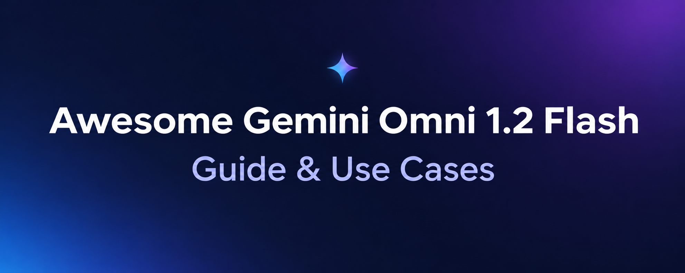</a>

[](LICENSE)
[](https://evolink.ai/gemini-omni-1-2-flash?utm_source=github&utm_medium=badge&utm_campaign=awesome-gemini-omni-guide-api-and-prompt&utm_content=model_try)

[](README.md) [](README_es.md) [](README_pt.md) [](README_ja.md) [](README_ko.md) [](README_de.md) [](README_fr.md) [](README_tr.md) [](README_zh-TW.md) [](README_zh-CN.md) [](README_ru.md)

</div>

# Gemini Omni 1.2 Flash rehberi ve istem kütüphanesi

## 🍌 Giriş
**Gemini Omni ailesine ait istemlerin, düzenleme demolarının, karşılaştırmaların ve topluluk videolarının korunduğu bir kütüphaneyle birlikte Gemini Omni 1.2 Flash rehberi.** Bu rehber, içerik üreticilerinin ve geliştiricilerin bir görev seçmesine ve girdi ile çıktı sınırlarını anlamasına yardımcı olur.

> [!NOTE]
> Önceki istem vakaları, karşılaştırmalar ve topluluk galerisi, Gemini Omni ailesine ait geçmiş materyallerdir. Özgün istemleri, kaynakları ve medya dosyaları korunmuştur; Gemini Omni 1.2 Flash sonuçları veya kıyaslama testleri olarak sunulmazlar.

<a id="omni-1-2-guide"></a>
## 🆕 Gemini Omni 1.2 Flash

Google, **5 Kasım 2026** tarihinde yayımlanan Gemini Omni 1.2 Flash modelini genel kullanıma açık (GA) olarak listeler. 1.1 sürümüne göre başlıca değişiklikler, ilgili yollarda **15 saniyeye** kadar video üretimi ve **bağımsız video çözünürlüğü yükseltmedir**. [Google model özelliklerini](https://docs.cloud.google.com/gemini-enterprise-agent-platform/models/gemini/omni-1-2-flash) ve [EvoLink'in 5 Kasım duyurusunu](https://evolink.ai/changelog?utm_source=github&utm_medium=readme&utm_campaign=awesome-gemini-omni-guide-api-and-prompt&utm_content=release_source#2026-11-05-gemini-omni-1-2-flash) okuyun.

- Metin, görüntü ve video girdileri; eşzamanlı konuşma, müzik ve ses efektleri içeren video çıktısı. Ses dosyası girdisi ve ses düzenleme desteklenmez.
- Yerel **360p / 720p** çıktı; **1080p / 4K, çözünürlük yükseltmeyle elde edilir**, yerel 4K değildir. Belgelenen çıktı 24 fps olup 16:9 veya 9:16 en-boy oranındadır.
- EvoLink’te **15 saniyelik** bir video üretmek için metinden videoya üretimi, tek bir ilk kareyle görüntüden videoya üretimi veya referans görselleri ve en fazla bir referans video kullanan üretimi seçin. İlk ve son kareyi birlikte ya da iki veya üç referans videoyu kullanıyorsanız **3–10 saniye** seçin.
- Video uzatma **3–10 saniye** ekler; bu değer bitmiş videonun toplam süresi değil, eklenen süredir.

### Bir EvoLink görevi seçin

Her görev kendi istek sözleşmesine bağlantı verir. Görev yolunu değiştirmeden önce [tam parametre özetini](https://evolink.ai/docs/en/api-manual/video-series/gemini-omni-1.2-flash/gemini-omni-1.2-flash-overview?utm_source=github&utm_medium=readme&utm_campaign=awesome-gemini-omni-guide-api-and-prompt&utm_content=parameter_overview) okuyun.

| Görev | Ne zaman kullanılır? | Görev yoluna özgü sınırlar |
| :--- | :--- | :--- |
| [Metinden videoya belgelerini okuyun](https://evolink.ai/docs/en/api-manual/video-series/gemini-omni-1.2-flash/gemini-omni-1.2-flash-text-to-video?utm_source=github&utm_medium=readme&utm_campaign=awesome-gemini-omni-guide-api-and-prompt&utm_content=route_text) | Metin isteminden bir çekim oluşturun. | 3–15 saniye. |
| [Görüntüden videoya belgelerini okuyun](https://evolink.ai/docs/en/api-manual/video-series/gemini-omni-1.2-flash/gemini-omni-1.2-flash-image-to-video?utm_source=github&utm_medium=readme&utm_campaign=awesome-gemini-omni-guide-api-and-prompt&utm_content=route_image) | Tek bir ilk kareyi canlandırın veya ilk ve son kareyi birbirine bağlayın. | Bir görüntü: 3–15 saniye; iki görüntü: 3–10 saniye. |
| [Referanslardan videoya belgelerini okuyun](https://evolink.ai/docs/en/api-manual/video-series/gemini-omni-1.2-flash/gemini-omni-1.2-flash-reference-to-video?utm_source=github&utm_medium=readme&utm_campaign=awesome-gemini-omni-guide-api-and-prompt&utm_content=route_reference) | Yeni bir çekimi görüntü veya video referanslarıyla yönlendirin. | En fazla 10 görüntü ve 3 referans video; çıktı süresi 10 saniyeyi aşıyorsa en fazla 1 referans video. |
| [Video düzenleme belgelerini okuyun](https://evolink.ai/docs/en/api-manual/video-series/gemini-omni-1.2-flash/gemini-omni-1.2-flash-video-edit?utm_source=github&utm_medium=readme&utm_campaign=awesome-gemini-omni-guide-api-and-prompt&utm_content=route_edit) | Var olan bir klibi istem kullanarak değiştirin. | En fazla 15 saniyelik tek bir girdi videosu; isteğe bağlı referans görüntüler; kalite varsayılanı `auto`. |
| [Video uzatma belgelerini okuyun](https://evolink.ai/docs/en/api-manual/video-series/gemini-omni-1.2-flash/gemini-omni-1.2-flash-video-extend?utm_source=github&utm_medium=readme&utm_campaign=awesome-gemini-omni-guide-api-and-prompt&utm_content=route_extend) | Bir klibin sonunu devam ettirin. | En fazla 30 saniyelik tek bir girdi videosu; 3–10 saniye eklenir. |
| [Video çözünürlüğü yükseltme belgelerini okuyun](https://evolink.ai/docs/en/api-manual/video-series/gemini-omni-1.2-flash/gemini-omni-1.2-flash-video-upscale?utm_source=github&utm_medium=readme&utm_campaign=awesome-gemini-omni-guide-api-and-prompt&utm_content=route_upscale) | Seçilmiş, tamamlanmış bir klibin çözünürlüğünü artırın. | Desteklenen standart boyutta, en fazla 15 saniyelik girdi; istem gerekmez. Aşağıdaki platform farklarına bakın. |

### Platformlar ve sürümler arasındaki farklar

- **Referanslar:** [AI Studio kullanım rehberi](https://aistudio.google.com/docs/omni) en fazla 6 görüntüye izin verirken Google Cloud ve EvoLink belgelerinde bu sayı 10'dur. Referans video sınırları da çıktı süresine bağlıdır; seçilen platformun sözleşmesini kullanın.
- **Çözünürlük yükseltme:** Google Cloud, 360p→720p/1080p ve 720p→1080p/4K dönüşümlerini belgeler, 1080p→4K dönüşümünü ise kapsam dışında bırakır. EvoLink belgeleri ayrıca 1080p→4K dönüşümünü listeler. Bu ek eşleşmeyi seçtiğiniz platformla doğrulayın; tüm platformlar için ortak bir garanti değildir. [Google'ın çözünürlük yükseltme kısıtlarını](https://docs.cloud.google.com/gemini-enterprise-agent-platform/models/video/upscale-videos) okuyun.
- **Konuşma durumu:** Google'ın Interactions API'si konuşma üzerinden düzenlemeyi destekler. EvoLink'in asenkron video görevleri kendi istek sözleşmesini kullanır; `previous_interaction_id` veya yalnızca Google'a özgü diğer parametreleri bu görevlere aktarmayın.
- **Geçiş:** [Google model sayfası](https://aistudio.google.com/docs/models/gemini-omni-flash), Gemini API'nin kararlı 1.1 kimliğinin 3 Aralık 2026 tarihinde 1.2'ye yönlendirilmesini planlar. Bu, EvoLink'in 1.1 yollarının da taşındığını göstermez. Eski genel kimliği bir takma ad olarak kabul etmek yerine açıkça belirtilen 1.2 görevini seçin.
- **Maliyet:** EvoLink model sayfası token tabanlı fiyatlandırma gösterir; bir token ücreti, saniye veya tamamlanmış klip başına sabit fiyat değildir. Bir işin maliyetini tahmin etmeden önce güncel görev yolunu, çözünürlüğü ve gerçek kullanımı kontrol edin.

Kaynakların kontrol tarihi: **6 Kasım 2026**.

<a id="quick-start"></a>
## ⚡ Hızlı başlangıç

[Gemini Omni 1.2 Flash modelini tarayıcınızda deneyin](https://evolink.ai/gemini-omni-1-2-flash?utm_source=github&utm_medium=quickstart&utm_campaign=awesome-gemini-omni-guide-api-and-prompt&utm_content=browser_try) veya [güncel görev belgelerini okuyun](https://evolink.ai/docs/en/api-manual/video-series/gemini-omni-1.2-flash/gemini-omni-1.2-flash-overview?utm_source=github&utm_medium=quickstart&utm_campaign=awesome-gemini-omni-guide-api-and-prompt&utm_content=task_docs).

Yukarıdaki görev tablosundan metinden videoya, görüntüden videoya, referanslar, düzenleme, uzatma veya çözünürlük yükseltme seçeneğini belirleyin. Girdiler, sınırlar ve sonuç iş akışı için seçtiğiniz görevin güncel belgelerini izleyin.

## 📑 Menü
- [Gemini Omni 1.2 Flash rehberi](#omni-1-2-guide)
- [Hızlı başlangıç](#quick-start)
- [Gemini Omni 1.2 resmî demoları](#omni12-demos)
- [Gemini Omni 1.2 topluluk demoları](#omni12-community-demos)
- [🎯 Prompt Bileşenleri](#-prompt-bileşenleri)
- [✂️ Düzenleme](#️-düzenleme)
  - [🔄 Eleman Değiştirme](#-eleman-değiştirme)
    - [Vaka 1: Kelebekten Arıya](#vaka-1-kelebekten-arıya)
    - [Vaka 2: Arıdan Ateşböceklerine](#vaka-2-arıdan-ateşböceklerine)
    - [Vaka 3-5: Uzay Gemileri ve Astronot Serisi](#vaka-3-5-uzay-gemileri-ve-astronot-serisi)
    - [Vaka 6: Tren 1896 Dönüşümü (@emollick tarafından)](#vaka-6-tren-1896-dönüşümü-emollick-tarafından)
    - [Vaka 7: Videodan Kişi Silme (@arrakis_ai tarafından)](#vaka-7-videodan-kişi-silme-arrakis_ai-tarafından)
    - [Vaka 8: Görünmez Keman](#vaka-8-görünmez-keman)
    - [Vaka 9: Dünya Bilgisi ile Konum Değişimi (@venturetwins tarafından)](#vaka-9-dünya-bilgisi-ile-konum-değişimi-venturetwins-tarafından)
    - [Vaka 10: Animasyondan Gerçek Çekime (@arrakis_ai tarafından)](#vaka-10-animasyondan-gerçek-çekime-arrakis_ai-tarafından)
  - [🎬 Temel Sahne](#-temel-sahne)
    - [Vaka 1: Kemancı Temel Çekim](#vaka-1-kemancı-temel-çekim)
  - [📷 Kamera Yönlendirme](#-kamera-yönlendirme)
    - [Vaka 1: Omuz Üstü Açı](#vaka-1-omuz-üstü-açı)
    - [Vaka 2: Kamera Tilt Ayakkabılardan Orta Çekime](#vaka-2-kamera-tilt-ayakkabılardan-orta-çekime)
    - [Vaka 3: Seyahat Selfie Hyperlapse (@ZaraIrahh tarafından)](#vaka-3-seyahat-selfie-hyperlapse-zarairahh-tarafından)
    - [Vaka 4: Moda Drone Çekimi (@ariaxawan tarafından)](#vaka-4-moda-drone-çekimi-ariaxawan-tarafından)
    - [Vaka 5: Üstten Görünümden 360 Dönüşe (@npaka123 tarafından)](#vaka-5-üstten-görünümden-360-dönüşe-npaka123-tarafından)
    - [Vaka 6: Omnizoom — Bir Fotoğrafa Dalış (@alexanderchen tarafından)](#vaka-6-omnizoom--bir-fotoğrafa-dalış-alexanderchen-tarafından)
  - [🎬 Aksiyon ve Senkronizasyon](#-aksiyon-ve-senkronizasyon)
    - [Vaka 1: Hayvan Oyuncağı Sesi](#vaka-1-hayvan-oyuncağı-sesi)
    - [Vaka 2: Apartman Işıkları Senkronizasyonu](#vaka-2-apartman-ışıkları-senkronizasyonu)
    - [Vaka 3: Bilye Zincirleme Reaksiyon](#vaka-3-bilye-zincirleme-reaksiyon)
    - [Vaka 4: Bina Işıkları](#vaka-4-bina-ışıkları)
    - [Vaka 5: Boks Maçı Gerçekçi (@RuzainaMeer tarafından)](#vaka-5-boks-maçı-gerçekçi-ruzainameer-tarafından)
- [🎨 Gelişmiş Çoklu Modal](#-gelişmiş-çoklu-modal)
  - [🪞 Sanatsal Stil](#-sanatsal-stil)
    - [Vaka 1-3: Ayna Serisi](#vaka-1-3-ayna-serisi)
    - [Vaka 4: Animasyon Reklam Tek Çekim (@DenneyDara tarafından)](#vaka-4-animasyon-reklam-tek-çekim-denneydara-tarafından)
    - [Vaka 5: Çizgi Çizim İzolasyonu (@alexanderchen tarafından)](#vaka-5-çizgi-çizim-i̇zolasyonu-alexanderchen-tarafından)
  - [✨ Görsel Efektler](#-görsel-efektler)
    - [Vaka 1: El Deliği Süper Yakınlaştırma](#vaka-1-el-deliği-süper-yakınlaştırma)
    - [Vaka 2: Kaykay Hareket Efektleri](#vaka-2-kaykay-hareket-efektleri)
    - [Vaka 3: AR HUD Bindirme (@jerrod_lew tarafından)](#vaka-3-ar-hud-bindirme-jerrod_lew-tarafından)
  - [🔗 Çapraz Modal](#-çapraz-modal)
    - [Vaka 1: Yeni Ortama Taşıma](#vaka-1-yeni-ortama-taşıma)
    - [Vaka 2: Sesli Kuş Şekli](#vaka-2-sesli-kuş-şekli)
    - [Vaka 3: Slayttan Harekete (@yoshifujidesign tarafından)](#vaka-3-slayttan-harekete-yoshifujidesign-tarafından)
    - [Vaka 4: Referans Görselli İzometrik Aşçı Karakter (@kumiko_shiraki tarafından)](#vaka-4-referans-görselli-i̇zometrik-aşçı-karakter-kumiko_shiraki-tarafından)
    - [Vaka 5: Girdi Olarak ChatGPT Talimat Görseli (@Majin_AppSheet tarafından)](#vaka-5-girdi-olarak-chatgpt-talimat-görseli-majin_appsheet-tarafından)
    - [Vaka 6: ChatGPT İllüstrasyonundan Omni Animasyonuna (@mmmiyama_D tarafından)](#vaka-6-chatgpt-i̇llüstrasyonundan-omni-animasyonuna-mmmiyama_d-tarafından)
  - [📋 Storyboard](#-storyboard)
    - [Vaka 1: Lüks Kozmetik Reklamı (@aiwithaly tarafından)](#vaka-1-lüks-kozmetik-reklamı-aiwithaly-tarafından)
    - [Vaka 2: Beni Bu Hikayede Göster](#vaka-2-beni-bu-hikayede-göster)
    - [Vaka 3: 3x3 Bölünmüş Ekran (@alexanderchen tarafından)](#vaka-3-3x3-bölünmüş-ekran-alexanderchen-tarafından)
    - [Vaka 4: Farklı Açılardan Aksiyon Tekrarı (@jerrod_lew tarafından)](#vaka-4-farklı-açılardan-aksiyon-tekrarı-jerrod_lew-tarafından)
    - [Vaka 5: Bölünmüş Ekran Video (@jerrod_lew tarafından)](#vaka-5-bölünmüş-ekran-video-jerrod_lew-tarafından)
  - [🔤 Metin Oluşturma](#-metin-oluşturma)
    - [Vaka 1: Alfabe Öğeleri Dizisi](#vaka-1-alfabe-öğeleri-dizisi)
    - [Vaka 2: Kelime Kelime Metin Senkronizasyonu](#vaka-2-kelime-kelime-metin-senkronizasyonu)
    - [Vaka 3: Metin Oluşturma AI Haberleri (@chrisfirst tarafından)](#vaka-3-metin-oluşturma-ai-haberleri-chrisfirst-tarafından)
    - [Vaka 4: Font Moda Defilesi (@HBCoop_ tarafından)](#vaka-4-font-moda-defilesi-hbcoop_-tarafından)
- [⚖️ Karşılaştırma](#️-karşılaştırma)
  - [Vaka 1: Seedance 2.0 vs Gemini Omni Flash (@JSFILMZ0412 tarafından)](#vaka-1-seedance-20-vs-gemini-omni-flash-jsfilmz0412-tarafından)
  - [Vaka 2: Gemini Omni vs Seedance 2.0 Aksiyon Sahneleri (@CuriousRefuge tarafından)](#vaka-2-gemini-omni-vs-seedance-20-aksiyon-sahneleri-curiousrefuge-tarafından)
- [🧪 Değerlendirme](#-değerlendirme)
  - [Vaka 1: Gemini Omni Kalite Değerlendirmesi (@kenichiota0711 tarafından)](#vaka-1-gemini-omni-kalite-değerlendirmesi-kenichiota0711-tarafından)
- [🌐 Topluluk Galerisi](#-topluluk-galerisi)
- [İlgili depolar](#related-repositories)
- [🙏 Teşekkürler](#-teşekkürler)

<a id="omni12-demos"></a>
## 🎬 Gemini Omni 1.2 demoları

Google tarafından **5 Kasım 2026** tarihinde yayımlanan sekiz resmî demo. [Özgün tanıtım yazısını](https://blog.google/innovation-and-ai/technology/developers-tools/introducing-gemini-omni-1-2-flash/) okuyun; Google'ın özgün videosunu izlemek için bir önizleme görselini seçin.

<table>
<tr>
<td width="50%" valign="top">

<a id="omni12-demo-1"></a>
**[15 saniyelik sanal kıyafet denemesi](https://storage.googleapis.com/gweb-uniblog-publish-prod/original_videos/ECom_Try_On_Demo.mp4)**

[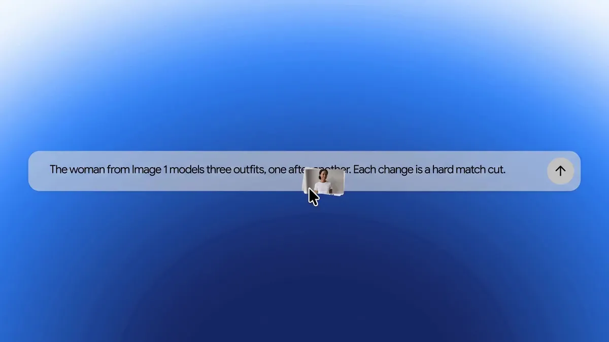](https://storage.googleapis.com/gweb-uniblog-publish-prod/original_videos/ECom_Try_On_Demo.mp4)

Bir model fotoğrafı ve üç kıyafet, 15 saniyelik bir sanal deneme montajına yön verir.

</td>
<td width="50%" valign="top">

<a id="omni12-demo-2"></a>
**[Katmanlı tipografi animasyonu](https://storage.googleapis.com/gweb-uniblog-publish-prod/original_videos/Typographic_Motion_Graphics_Demo.mp4)**

[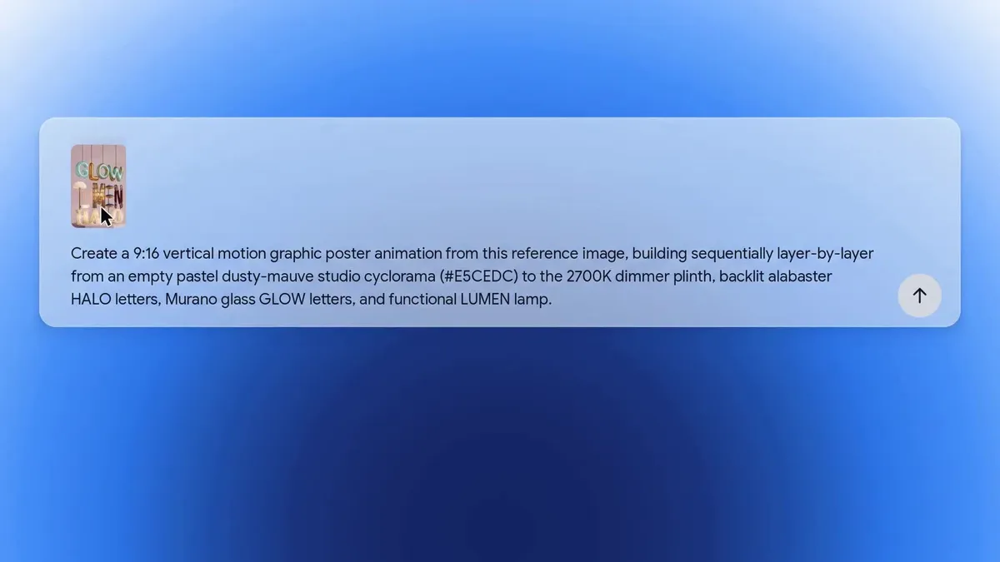](https://storage.googleapis.com/gweb-uniblog-publish-prod/original_videos/Typographic_Motion_Graphics_Demo.mp4)

Animasyonlu bir afiş, malzemeleri ve harfleri bir araya getirir; Google, 1.1 ve 1.2 çıktılarını gösterir.

</td>
</tr>
<tr>
<td width="50%" valign="top">

<a id="omni12-demo-3"></a>
**[Konuşmayla arka plan değiştirme](https://storage.googleapis.com/gweb-uniblog-publish-prod/original_videos/Video_Background_Editing_Demo.mp4)**

[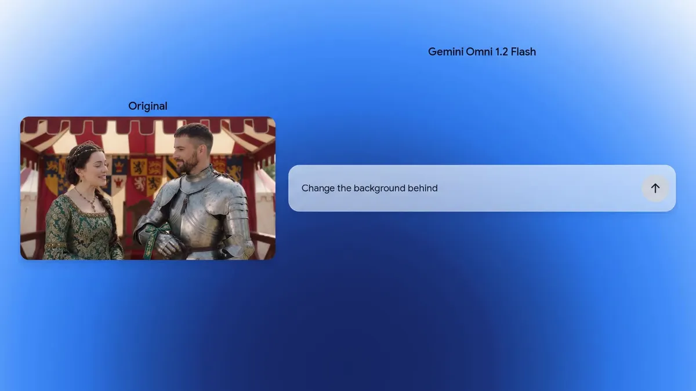](https://storage.googleapis.com/gweb-uniblog-publish-prod/original_videos/Video_Background_Editing_Demo.mp4)

Art arda yapılan konuşmalar, klipteki iki zırhlı karakteri koruyarak arka planı değiştirir.

</td>
<td width="50%" valign="top">

<a id="omni12-demo-4"></a>
**[Pantheon içinde kesintisiz kamera uçuşu](https://storage.googleapis.com/gweb-uniblog-publish-prod/original_videos/Pantheon_Tour_Demo_FuU0KUh.mp4)**

[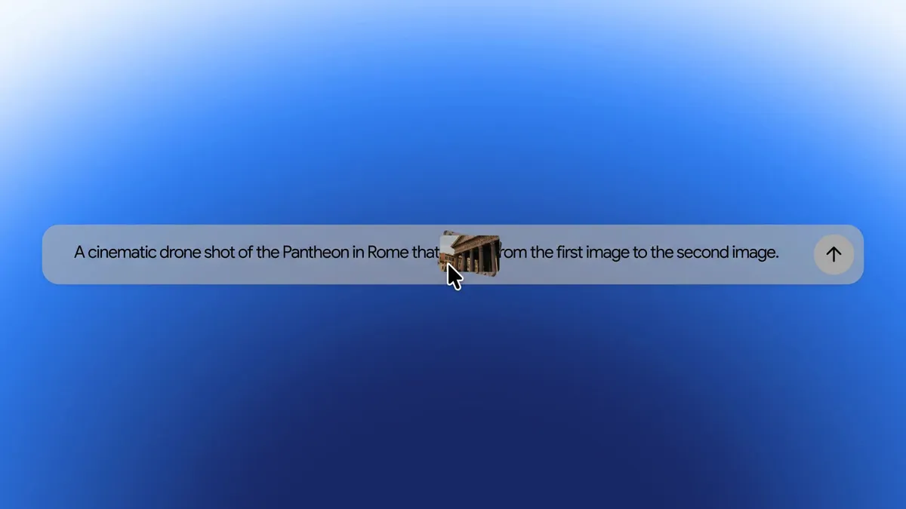](https://storage.googleapis.com/gweb-uniblog-publish-prod/original_videos/Pantheon_Tour_Demo_FuU0KUh.mp4)

İki mimari fotoğraf, Pantheon'un kubbesinden geçen kesintisiz bir kamera uçuşuna yön verir.

</td>
</tr>
<tr>
<td width="50%" valign="top">

<a id="omni12-demo-5"></a>
**[15 saniyelik arı kovanı anlatımı](https://storage.googleapis.com/gweb-uniblog-publish-prod/original_videos/Bee_Hive_Live_Infographic_Demo_ninuxtc.mp4)**

[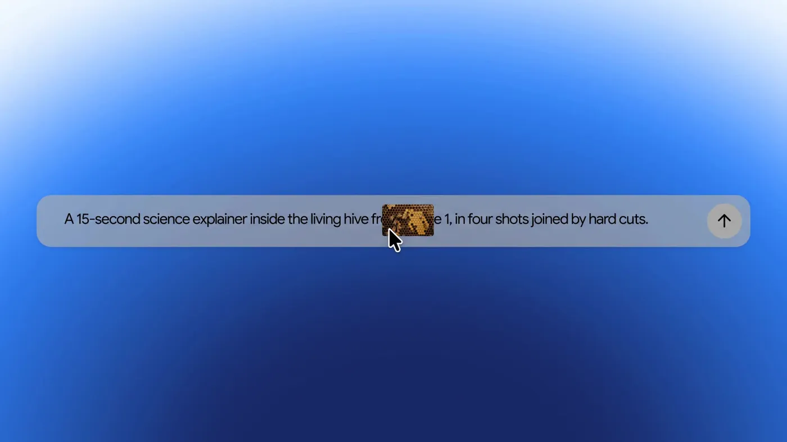](https://storage.googleapis.com/gweb-uniblog-publish-prod/original_videos/Bee_Hive_Live_Infographic_Demo_ninuxtc.mp4)

Tek bir stil referans karesi, dört çekimden oluşan 15 saniyelik resimli bir arı kovanı anlatımına dönüşür.

</td>
<td width="50%" valign="top">

<a id="omni12-demo-6"></a>
**[Ahtapottan dansçıya hareket aktarımı](https://storage.googleapis.com/gweb-uniblog-publish-prod/original_videos/Unexpected_Motion_Tracking_Demo_QRzpS2T.mp4)**

[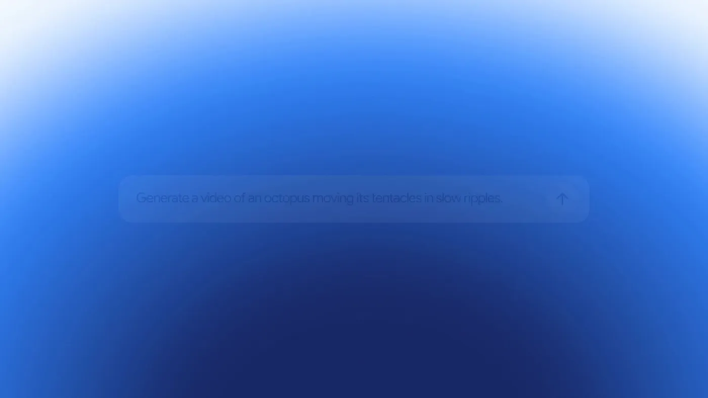](https://storage.googleapis.com/gweb-uniblog-publish-prod/original_videos/Unexpected_Motion_Tracking_Demo_QRzpS2T.mp4)

Sonraki bir düzenleme, bir ahtapotun akıcı hareketini bir dansçının elbisesine aktarır.

</td>
</tr>
<tr>
<td width="50%" valign="top">

<a id="omni12-demo-7"></a>
**[İlk ve son kare arasında ramen dükkânı](https://storage.googleapis.com/gweb-uniblog-publish-prod/original_videos/Ramen_Bar_Demo_jeWGtqx.mp4)**

[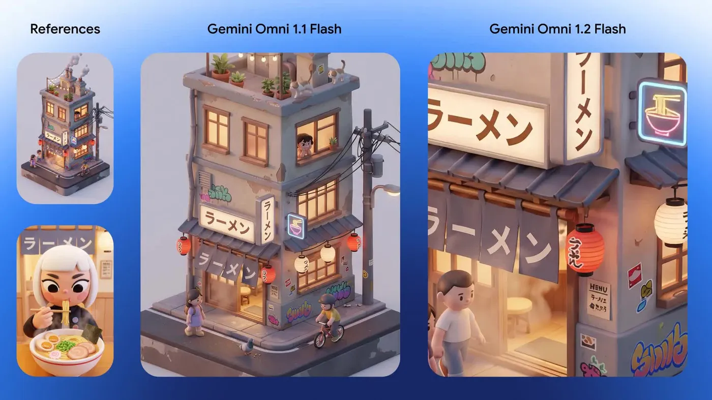](https://storage.googleapis.com/gweb-uniblog-publish-prod/original_videos/Ramen_Bar_Demo_jeWGtqx.mp4)

İlk ve son kare, bir ramen dükkânının dışını ve içini birbirine bağlar; Google'ın karşılaştırmasında görünür tutarsızlıklar vardır.

</td>
<td width="50%" valign="top">

<a id="omni12-demo-8"></a>
**[Adadan kesintisiz uzaklaşan çekim](https://storage.googleapis.com/gweb-uniblog-publish-prod/original_videos/Castaway_Crash_Zoom_Out_Demo.mp4)**

[](https://storage.googleapis.com/gweb-uniblog-publish-prod/original_videos/Castaway_Crash_Zoom_Out_Demo.mp4)

On saniyelik bir çekim, kıyıdaki yakın plandan uzaklaşarak adanın geniş bir görünümüne ulaşır.

</td>
</tr>
</table>

<a id="omni12-community-demos"></a>
## 🎥 Gemini Omni 1.2 topluluk demoları

İçerik üreticilerinin ve araç geliştiren ekiplerin yayımladığı on dört Gemini Omni 1.2 Flash örneği. Özgün videoyu izlemek için bir önizleme görselini seçin. Başlık, içeriği hazırlayan kişinin gönderisine veya yazısına bağlantı verir. İstem paylaşılmışsa onu da orada bulabilirsiniz.

<table>
<tr>
<td width="50%" valign="top">

<a id="omni12-community-1"></a>
**[Alkış ritmine uyan sokak giyimi değişimleri](https://x.com/HarshithLucky3/status/2118401265273360530)** · HarshithLucky3

[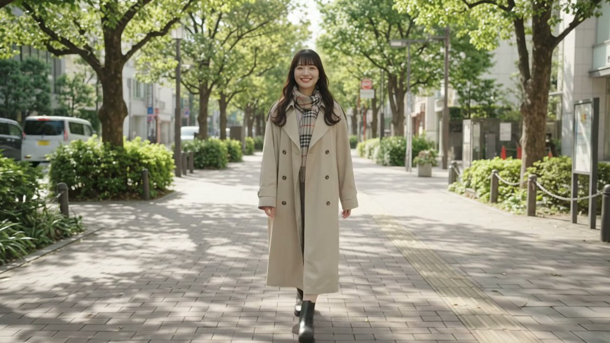](https://video-s.twimg.com/amplify_video/2118400792348770305/vid/avc1/640x360/y-KZwoASoz81lFXx.mp4?tag=29)

Sokak stili yürüyüşünde hızlı kıyafet değişimlerini alkışlar tetikler. İçerik üreticisi istemi paylaşıyor.

</td>
<td width="50%" valign="top">

<a id="omni12-community-2"></a>
**[Farklı tarzların buluştuğu doğum günü partisi](https://x.com/ash_twtz/status/2118393918794707053)** · ash_twtz

[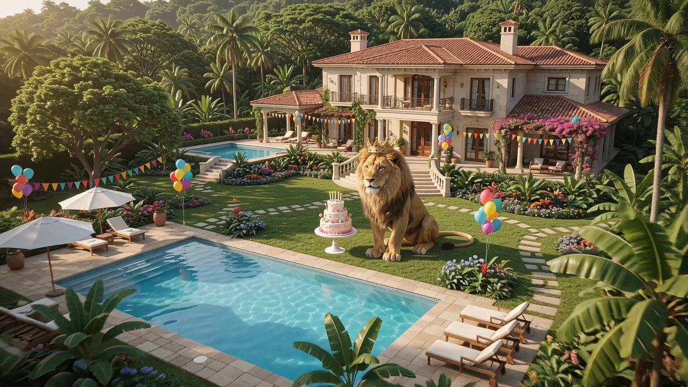](https://video-s.twimg.com/amplify_video/2118393860493905920/vid/avc1/640x360/W2r1uWl7T7aS8Bms.mp4?tag=29)

Stop motion, 3D, çizgi roman ve anime tarzındaki karakterler aynı doğum günü sahnesinde buluşur.

</td>
</tr>
<tr>
<td width="50%" valign="top">

<a id="omni12-community-3"></a>
**[Zaman kodlu su şişesi reklamı](https://weel.co.jp/media/tech/gemini-omni-1-2-flash/)** · WEEL

[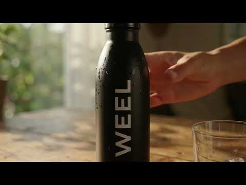](https://www.youtube.com/watch?v=u6P7rxZlSQI)

WEEL, zamanlaması belirlenmiş üç bölümden oluşan 15 saniyelik bir ürün reklamını test ediyor. Yazıda istem de yer alıyor.

</td>
<td width="50%" valign="top">

<a id="omni12-community-4"></a>
**[İki kare arasında parfüm tanıtımı](https://blog.segmind.com/gemini-omni-1-2-flash-is-here-generate-and-edit-15-second-videos/)** · Segmind

[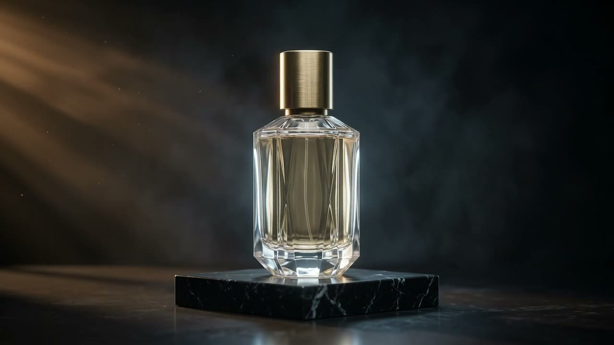](https://segmind-resources.s3.amazonaws.com/blog/gemini-omni-12-flash/i2v-fl10.mp4)

İki referans kare, karanlık bir stüdyodan güneş alan çiçeklere uzanan 10 saniyelik parfüm tanıtımına yön verir. Yazıda istem de yer alıyor.

</td>
</tr>
<tr>
<td width="50%" valign="top">

<a id="omni12-community-5"></a>
**[Seramik sanatçısı ve referans vazo](https://blog.segmind.com/gemini-omni-1-2-flash-is-here-generate-and-edit-15-second-videos/)** · Segmind

[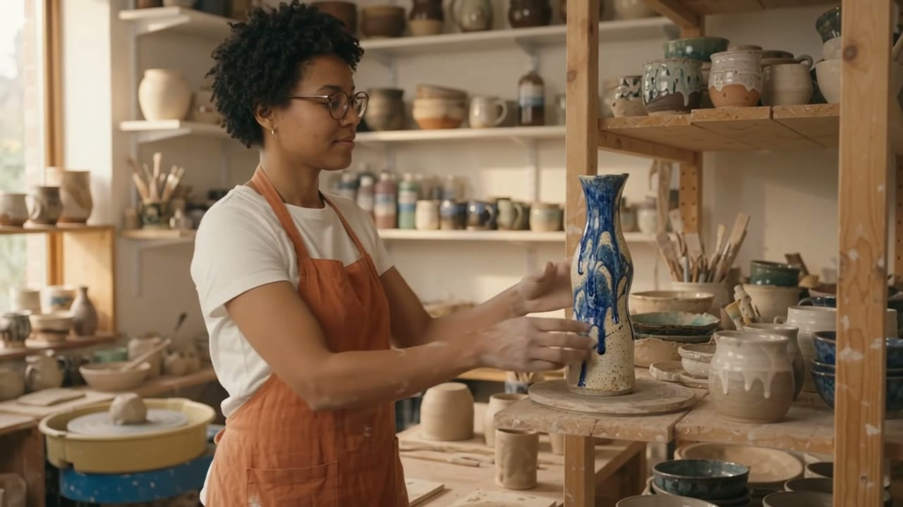](https://segmind-resources.s3.amazonaws.com/blog/gemini-omni-12-flash/ref10.mp4)

Konuşma içeren bir ürün çekiminde sanatçı ve vazo için ayrı referanslar kullanılır. Yazıda istem de yer alıyor.

</td>
<td width="50%" valign="top">

<a id="omni12-community-6"></a>
**[Üç sesli Polonya bayram yemeği sahnesi](https://promptif.fr/gemini-omni-1-2-flash-test/)** · Promptif

[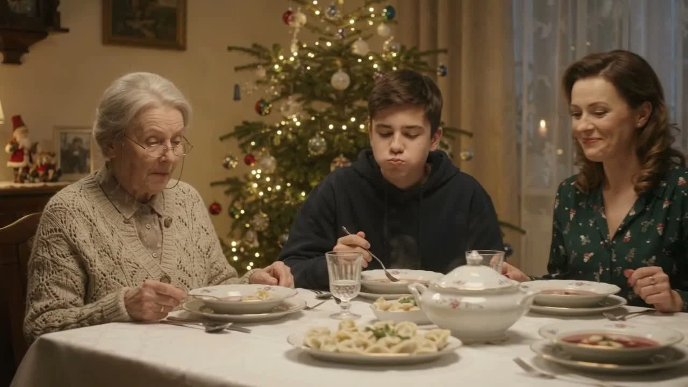](https://promptif.fr/wp-content/uploads/2026/11/omni12-cc251d82201c7f7e2cbd2d57b6e9715b.mp4)

Polonya’daki bir bayram yemeği sahnesi, üç kişinin sırayla konuşmasını ve dudak senkronizasyonunu test eder.

</td>
</tr>
<tr>
<td width="50%" valign="top">

<a id="omni12-community-7"></a>
**[Yüz kameralı oyun görüntüsü](https://x.com/rovvmut_/status/2118752554746270169)** · rovvmut_

[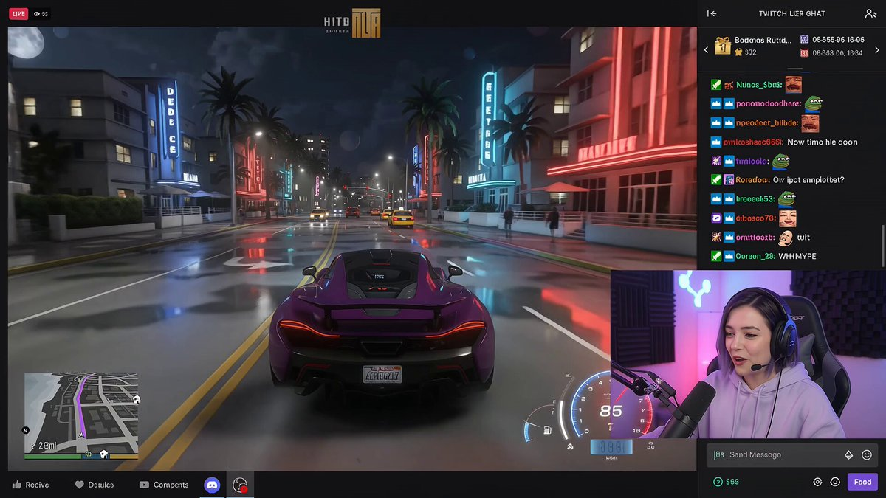](https://video.twimg.com/amplify_video/2118752493798825984/vid/avc1/640x360/ABYvurfZ5k_VXKKA.mp4?tag=29)

İçerik üreticisi, sürüş sahnesi, köşede bir yüz kamerası ve İngilizce yorum içeren bir oyun yayını düzeni istiyor. Gönderide istem de yer alıyor.

</td>
<td width="50%" valign="top">

<a id="omni12-community-8"></a>
**[Sabit kamerayla hızlandırılmış inşaat çekimi](https://x.com/alecwilcock/status/2118716313275142188)** · alecwilcock

[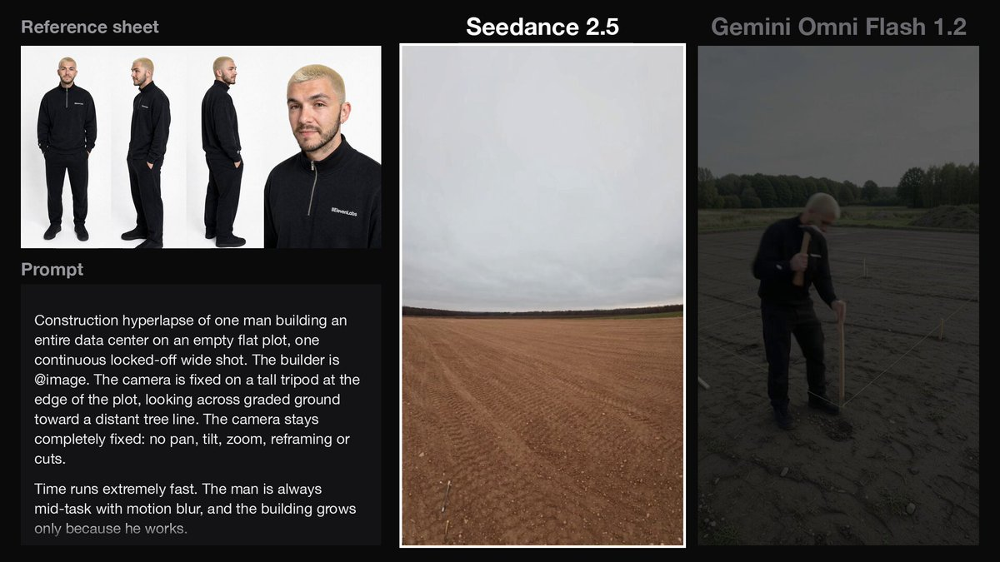](https://video.twimg.com/amplify_video/2118715983812497409/vid/avc1/640x360/rLsfCIZnQmAvu0SI.mp4?tag=29)

İçerik üreticisi, bir veri merkezinin inşasını gösteren hızlandırılmış çekimde Omni 1.2 Flash ile Seedance 2.5’i karşılaştırıyor. Gönderide iki model için kullanılan ortak istem yer alıyor.

</td>
</tr>
<tr>
<td width="50%" valign="top">

<a id="omni12-community-9"></a>
**[Aynı istemle diyalogsuz sahne](https://x.com/husky__create/status/2118637071887953952)** · husky__create

**Omni 1.2 Flash**

[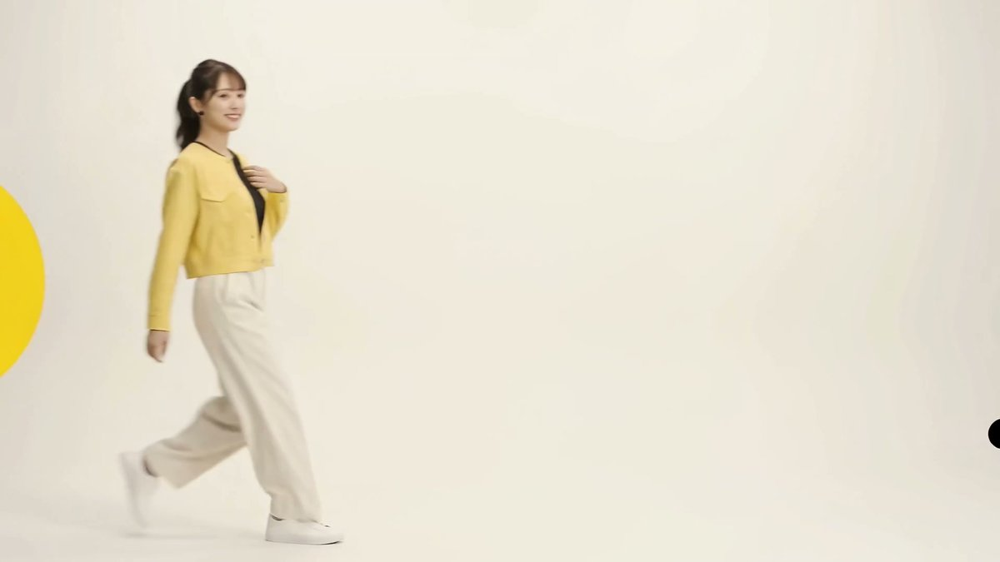](https://video-s.twimg.com/amplify_video/2118637038430015488/vid/avc1/640x360/goYQmD8hpI3NIsS5.mp4?tag=16)

**Omni 1.1 Flash**

[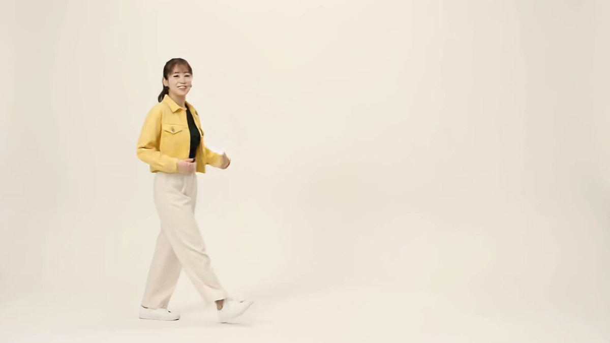](https://video-s.twimg.com/amplify_video/2118637056083787776/vid/avc1/640x360/srtblIdulfmUfOeA.mp4?tag=16)

İçerik üreticisi, diyalog olmamasını isteyen aynı istemle Omni 1.2 Flash ve 1.1 Flash’ı karşılaştırıyor. Her iki çıktı da sunuluyor.

</td>
<td width="50%" valign="top">

<a id="omni12-community-10"></a>
**[Durağan kolaj hareketleniyor](https://x.com/mmmiyama_D/status/2118467997870465516)** · mmmiyama_D

[](https://video-s.twimg.com/amplify_video/2118467980497747968/vid/avc1/480x852/7oxu6hnjA__basp0.mp4?tag=16)

İçerik üreticisi, alıntılanan gönderideki durağan kolajı Omni 1.2 Flash ile hareketlendiriyor.

</td>
</tr>
<tr>
<td width="50%" valign="top">

<a id="omni12-community-11"></a>
**[Uygulama tanıtımında A/B istem karşılaştırması](https://www.segmind.com/@himanshu/gemini-omni-1-2-flash-prompts)** · Himanshu Goel

**Tek cümlelik açıklama**

[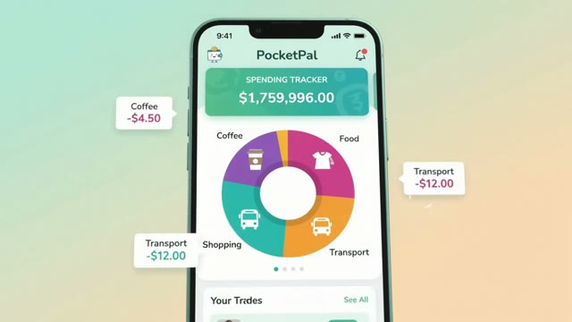](https://segmind-resources.s3.amazonaws.com/blog/gemini-omni-prompts-ex1_vague.mp4)

**Zamanlaması belirtilmiş çekim listesi**

[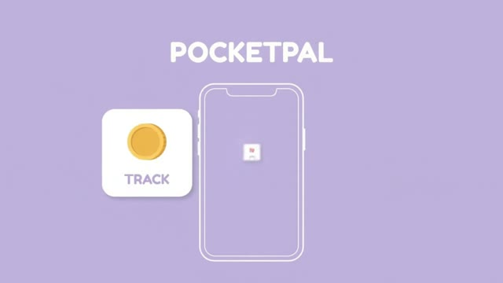](https://segmind-resources.s3.amazonaws.com/blog/gemini-omni-prompts-ex1_structured.mp4)

Goel, bir bütçe uygulaması için iki farklı istemle sekiz saniyelik bir tanıtım hazırlıyor. Modeli, rastgelelik tohumunu, süreyi ve çözünürlüğü sabit tutarak tek cümlelik bir açıklamayı zamanlaması belirtilmiş bir çekim listesiyle karşılaştırıyor.

</td>
<td width="50%" valign="top">

<a id="omni12-community-12"></a>
**[Fırıncı tilkinin klibini uzatma](https://www.segmind.com/@himanshu/gemini-omni-1-2-flash-prompts)** · Himanshu Goel

**8 saniyelik kaynak klip**

[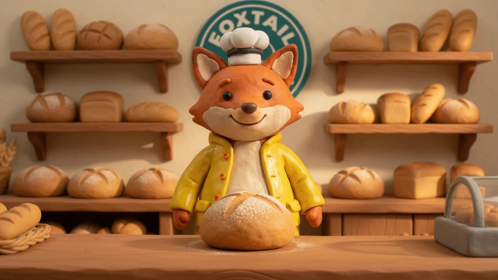](https://segmind-resources.s3.amazonaws.com/blog/gemini-omni-prompts-ex3_ref.mp4)

**13 saniyelik uzatılmış klip**

[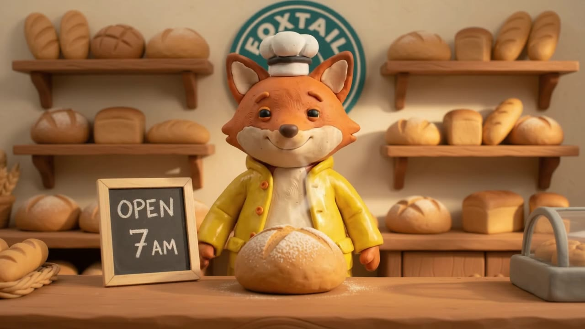](https://segmind-resources.s3.amazonaws.com/blog/gemini-omni-prompts-ex5_extend.mp4)

Goel, kilden bir tilkinin fırınını gösteren sekiz saniyelik klibe beş saniye ekliyor. 13 saniyelik sonuçta dükkânın çalışma saatlerini gösteren bir kara tahta beliriyor. Yazıda referans görseller ve istemler yer alıyor.

</td>
</tr>
<tr>
<td width="50%" valign="top">

<a id="omni12-community-13"></a>
**[Kupa klibini sohbet üzerinden düzenleme](https://www.aiformortals.co/blog/gemini-omni-flash-1-2-tested#gemini-omni-video-editing-three-rounds-of-chat-edits)** · Pat Simmons

**Arka plan düzenlemesinden sonra**

[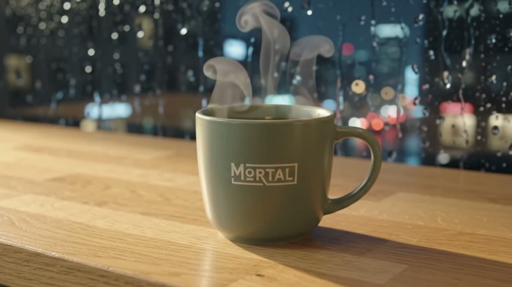](https://uzgqbjufkfadoprvamcs.supabase.co/storage/v1/object/public/daily-img/gemini-omni-flash-1-2-tested/t3-edit1-background.mp4)

**Daha hızlı kamera hareketi isteğinden sonra**

[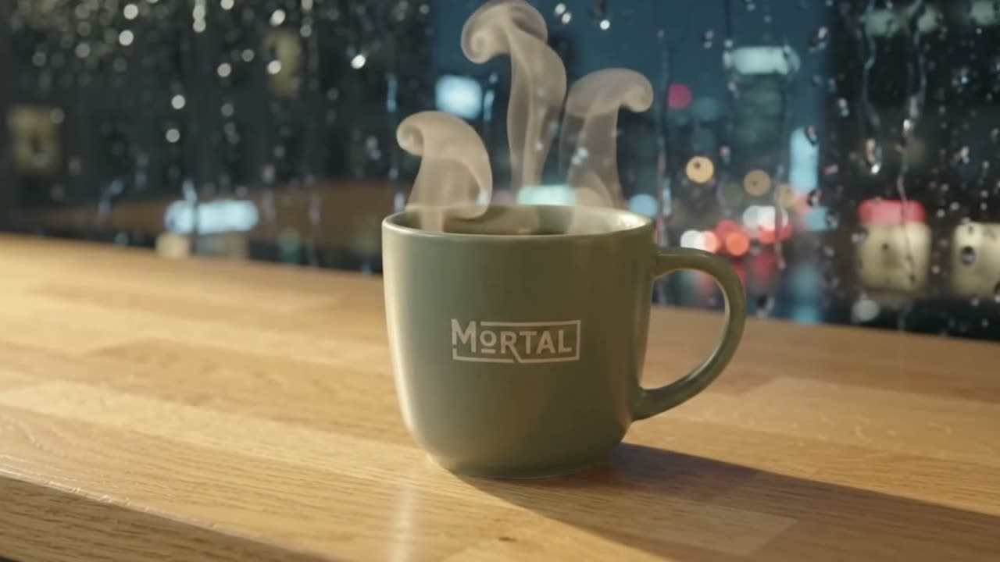](https://uzgqbjufkfadoprvamcs.supabase.co/storage/v1/object/public/daily-img/gemini-omni-flash-1-2-tested/t3-edit3-pacing.mp4)

Simmons’ın Gemini uygulamasıyla yaptığı testte, arka planı yağmurlu bir pencereyle değiştirme isteği sonuç verdi. Yazısına göre sonraki iki istek, yani daha sıcak aydınlatma ve daha hızlı kamera hareketi, görünür bir değişiklik yaratmadı.

</td>
<td width="50%" valign="top">

<a id="omni12-community-14"></a>
**[Flow’da konuşan soya sosu maskotu](https://note.com/pharma_i_cist/n/n227466896971)** · 濱口貴光

[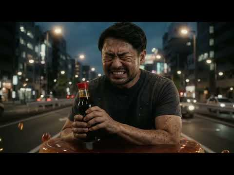](https://www.youtube.com/watch?v=SNDK6KC5atU)

Hamaguchi, karakterin referans görselini yükleyip Japonca özel bir ses ekliyor ve Google Flow’da konuşan maskotu oluşturuyor. Yazı, ayarları ve özgün sonucu gösteriyor.

</td>
</tr>
</table>

## 🎯 Prompt Bileşenleri
Gemini Omni güçlü bir **dünya anlayışına** sahiptir — tarih, bilim ve kültür hakkında gerçek dünya bilgisinden yararlanır. Her detayı aşırı açıklamanıza gerek yoktur. Bunun yerine, yaratıcı niyetinizi doğal dilde ifade edin ve Omni'nin muhakemesinin gerisini doldurmasına izin verin.
Sıfırdan yeni bir video oluştururken, çıktıyı kontrol etmek için bu boyutları karıştırın:
| Boyut | Ne belirtilmeli | Örnek |
| :--- | :--- | :--- |
| **Çekim Kadrajı ve Hareket** | Geniş açı, orta veya yakın çekim. Kamera yörüngesi: yumuşak kayma, ani yaklaşma, sabit kilit, dolly zoom, vb. | `A close-up tracking shot smoothly pushing in` |
| **Stil** | Genel görsel sanat yönetimi | `Vintage monochrome hologram`, `3D voxel art`, `colored crayon aesthetic` |
| **Aydınlatma** | Sahne atmosferi ve ışık düzeni | `Warm champagne lighting`, `dim overhead gym lights` |
| **Konum** | Ortam ve arka plan | `Small underground gym`, `futuristic neon cityscape` |
| **Aksiyon** | Özne davranışı ve hareketi | `The person touches the mirror`, `a marble rolling fast on a chain reaction track` |
> [!TIP]
> **Yinelemeli Düzenleme:** Omni çok turlu konuşma düzenlemesini destekler. İşe yarayanı korur ve yalnızca istediğiniz şeyi değiştirir — her seferinde tüm sahneyi yeniden tanımlamanıza gerek yoktur. Sadece neyi değiştireceğinizi söyleyin.

> [!TIP]
> **[Değişmeyen Alanları Koru](https://x.com/tanabe_fragm/status/2058103447006896406) ([@tanabe_fragm](https://x.com/tanabe_fragm) tarafından):** Video düzenlerken prompt'unuza "Başka hiçbir şeyi değiştirme" veya "Diğer her şeyi aynı tut" gibi ifadeler ekleyin. Bu, değiştirmek istemediğiniz bölümlerdeki istenmeyen değişiklikleri önemli ölçüde azaltır.
>
> https://github.com/user-attachments/assets/285ee7d8-7dfe-4304-a9a4-648026073b80

## ✂️ Düzenleme

### 🔄 Eleman Değiştirme

<a id="vaka-1-kelebekten-arıya"></a>
### Vaka 1: Kelebekten Arıya `🎬 Video→Video`

<table>
<tr>
<td width="300">

**Girdi:**

https://github.com/user-attachments/assets/8feb4d7b-825d-4a4a-bd9d-900754cf5d38

</td>
<td width="300">

**Çıktı:**

https://github.com/user-attachments/assets/60f31f6d-895e-4048-b477-9a46a5d20b90

</td>
</tr>
</table>

**Prompt:**

```
Change the butterfly to a bee.
```

---

<a id="vaka-2-arıdan-ateşböceklerine"></a>
### Vaka 2: Arıdan Ateşböceklerine `🎬 Video→Video`

<table>
<tr>
<td width="300">

**Girdi:**

https://github.com/user-attachments/assets/60f31f6d-895e-4048-b477-9a46a5d20b90

</td>
<td width="300">

**Çıktı:**

https://github.com/user-attachments/assets/76fc8e97-c7d1-40bc-9e79-bd6705aa8267

</td>
</tr>
</table>

**Prompt:**

```
Change the bee into a small swarm of fireflies.
```

---

<a id="vaka-3-5-uzay-gemileri-ve-astronot-serisi"></a>
### Vaka 3-5: Uzay Gemileri ve Astronot Serisi `🎬 Video→Video`

<table>
<tr>
<td colspan="3">

**Girdi:**

https://github.com/user-attachments/assets/26ea7e43-9787-4096-82f9-e10543229bec

</td>
</tr>
<tr>
<td width="300">

https://github.com/user-attachments/assets/dd9ae5b1-0205-45ac-a651-258af1c4f12c

### Vaka 3: Uzay Gemilerini Beyaz Origamiye Dönüştürme

</td>
<td width="300">

https://github.com/user-attachments/assets/78ef5301-b759-4dda-9995-3ee0d259a7b1

### Vaka 4: Astronotu Deniz Anemonuna Dönüştürme

</td>
<td width="300">

https://github.com/user-attachments/assets/0cbadb19-8a5b-4a2c-9093-e3a84f3dd988

### Vaka 5: Küçük Gemileri Vatoz Balıklarına Dönüştürme

</td>
</tr>
</table>

**Promptlar:**

```
Case 3: Change the ships to be made from white origami paper.
```

```
Case 4: Change the astronaut to a sea anemone.
```

```
Case 5: Change the small ships to stingrays.
```

---

<a id="vaka-6-tren-1896-dönüşümü-emollick-tarafından"></a>
### Vaka 6: [Tren 1896 Dönüşümü](https://x.com/emollick/status/2057874739817808223) ([@emollick](https://x.com/emollick) tarafından) `🎬 Video→Video`

https://github.com/user-attachments/assets/275cc90e-adaa-48ff-9ff8-1e96ea29d44f

**Prompt:**

```
I took the famous "train" movie from 1896 & made it a bullet train, LEGO, added a time traveler, a centipede, muppets...
```

---

<a id="vaka-7-videodan-kişi-silme-arrakis_ai-tarafından"></a>
### Vaka 7: [Videodan Kişi Silme](https://x.com/arrakis_ai/status/2057939231755178439) ([@arrakis_ai](https://x.com/arrakis_ai) tarafından) `🎬 Video→Video`

https://github.com/user-attachments/assets/72379fb2-ac30-4d1e-a6b4-143052f8f061

**Prompt:**

```
Remove the person from this video perfectly.
```

---

<a id="vaka-8-görünmez-keman"></a>
### Vaka 8: Görünmez Keman `🎬 Video→Video`

<table>
<tr>
<td width="300">

**Girdi:**

https://github.com/user-attachments/assets/88176743-d17e-48fe-89f3-528fe60df7fd

</td>
<td width="300">

**Çıktı:**

https://github.com/user-attachments/assets/ac6457aa-158c-4a0b-852f-ce1f3367bc3f

</td>
</tr>
</table>

**Prompt:**

```
Make the violin invisible
```

---

<a id="vaka-9-dünya-bilgisi-ile-konum-değişimi-venturetwins-tarafından"></a>
### Vaka 9: [Dünya Bilgisi ile Konum Değişimi](https://x.com/venturetwins/status/2058235415883313361) ([@venturetwins](https://x.com/venturetwins) tarafından) `🎬 Video→Video`

https://github.com/user-attachments/assets/daa90750-fc7b-49ea-b85d-364411159663

**Prompt:**

```
Re-shoot this video in [location] based on the screenshot from Google Maps.
```

> Bir Waymo yolculuğu videosu yüklendi, ardından Omni'den Google Haritalar ekran görüntüleri kullanılarak farklı konumlarda yeniden çekilmesi istendi. Model, ortamları sorunsuz bir şekilde değiştirmek için dünya bilgisinden yararlanır.

---

<a id="vaka-10-animasyondan-gerçek-çekime-arrakis_ai-tarafından"></a>
### Vaka 10: [Animasyondan Gerçek Çekime](https://x.com/arrakis_ai/status/2058488373057302797) ([@arrakis_ai](https://x.com/arrakis_ai) tarafından) `🎬 Video→Video`

https://github.com/user-attachments/assets/3c6be2a9-3e67-4deb-8ccd-fb493b715f65

**Prompt:**

```
Turn this animation into live action.
```

### 🎬 Temel Sahne

<a id="vaka-1-kemancı-temel-çekim"></a>
### Vaka 1: Kemancı Temel Çekim `🔤 Text→Video`

https://github.com/user-attachments/assets/93de5898-88ee-4bfc-a36f-19d8aa99dfc1

**Prompt:**

```
A video of a violinist playing a song.
```

### 📷 Kamera Yönlendirme

<a id="vaka-1-omuz-üstü-açı"></a>
### Vaka 1: Omuz Üstü Açı `🎬 Video→Video`

<table>
<tr>
<td width="300">

**Girdi:**

https://github.com/user-attachments/assets/ac6457aa-158c-4a0b-852f-ce1f3367bc3f

</td>
<td width="300">

**Çıktı:**

https://github.com/user-attachments/assets/71aa1c8d-0287-4591-b239-68322919293d

</td>
</tr>
</table>

**Prompt:**

```
Change the camera angle to be over the violinist's shoulder.
```

---

<a id="vaka-2-kamera-tilt-ayakkabılardan-orta-çekime"></a>
### Vaka 2: Kamera Tilt Ayakkabılardan Orta Çekime `🎬 Video→Video`

<table>
<tr>
<td width="300">

**Girdi:**

https://github.com/user-attachments/assets/19dbc1ae-1e9e-4b7b-9069-e979fffe3651

</td>
<td width="300">

**Çıktı:**

https://github.com/user-attachments/assets/c0ccbda0-4fd0-42be-8620-db7a67a5347d

</td>
</tr>
</table>

**Prompt:**

```
Change the camera angle, a close-up on his shoes, quickly tilting up to medium shot, then widening.
```

---

<a id="vaka-3-seyahat-selfie-hyperlapse-zarairahh-tarafından"></a>
### Vaka 3: [Seyahat Selfie Hyperlapse](https://x.com/ZaraIrahh/status/2057775215749349520) ([@ZaraIrahh](https://x.com/ZaraIrahh) tarafından) `🔤 Text→Video`

https://github.com/user-attachments/assets/31fa5a56-6113-4376-873b-5e40d26803f1

**Prompt:**

```
Create a 10-second cinematic hyper-lapse selfie travel video of the uploaded female character across 20 world-famous destinations in 2026. Hard cuts every 0.5 seconds synced to the beat. Handheld selfie-stick camera, wide-angle lens, close selfie framing, energetic travel-vlogger style, vibrant cinematic colors, realistic lighting, dynamic motion blur, natural crowds, and clear landmarks in every shot.
```

---

<a id="vaka-4-moda-drone-çekimi-ariaxawan-tarafından"></a>
### Vaka 4: [Moda Drone Çekimi](https://x.com/ariaxawan/status/2057794715744084042) ([@ariaxawan](https://x.com/ariaxawan) tarafından) `🔤 Text→Video`

https://github.com/user-attachments/assets/b199a5ab-e008-4a72-aa03-094bc6d573e6

**Prompt:**

```
A 10 second ultra cinematic hyper realistic FPV fashion drone shot filmed in a single continuous take inside a futuristic luxury tunnel. Single continuous take, aggressive FPV motion, ultra smooth cinematic flight path, luxury high-fashion editorial atmosphere.
```

---

<a id="vaka-5-üstten-görünümden-360-dönüşe-npaka123-tarafından"></a>
### Vaka 5: [Üstten Görünümden 360 Dönüşe](https://x.com/npaka123/status/2058033145845575735) ([@npaka123](https://x.com/npaka123) tarafından) `🖼️ Image→Video`

https://github.com/user-attachments/assets/1ad202cb-a485-4b7a-9c8c-d4fea4a3b6d5

**Prompt:**

```
この教室の中央から黒板を見ているファーストパーソンなゲーム視点。360度カメラを回転。教室の黒板右側の窓の外は廊下、黒板左側の窓の外は校庭。
```

---

<a id="vaka-6-omnizoom--bir-fotoğrafa-dalış-alexanderchen-tarafından"></a>
### Vaka 6: [Omnizoom — Bir Fotoğrafa Dalış](https://x.com/alexanderchen/status/2058330610574221672) ([@alexanderchen](https://x.com/alexanderchen) tarafından) `🖼️ Image→Video`

https://github.com/user-attachments/assets/9fd3ad2a-6e4a-4ac0-ab29-48f1c303b95f

**Prompt:**

```
Omnizoom — diving into a photo.
```

### 🎬 Aksiyon ve Senkronizasyon

<a id="vaka-1-hayvan-oyuncağı-sesi"></a>
### Vaka 1: Hayvan Oyuncağı Sesi `🎬 Video→Video`

https://github.com/user-attachments/assets/fbf377d7-1b39-43af-92e6-665792d05de0

**Prompt:**

```
When the finger in <video> touches the animal toy play the sound the animal makes
```

---

<a id="vaka-2-apartman-ışıkları-senkronizasyonu"></a>
### Vaka 2: Apartman Işıkları Senkronizasyonu `🎬+🎵 Video+Audio→Video`

<table>
<tr>
<td width="300">

**Girdi:**

https://github.com/user-attachments/assets/6fa879c3-5ee8-4ff1-bbe9-6648d750277d

</td>
<td width="300">

**Çıktı:**

https://github.com/user-attachments/assets/3f010e2a-a471-4b0d-8782-c4c5547cd2a5

</td>
</tr>
</table>

**Prompt:**

```
The lights of the apartments start turning on in sync with the music.
```

---

<a id="vaka-3-bilye-zincirleme-reaksiyon"></a>
### Vaka 3: Bilye Zincirleme Reaksiyon `🔤 Text→Video`

https://github.com/user-attachments/assets/1ece8df7-f29a-4ebd-ad68-9c910f811590

**Prompt:**

```
A marble rolling fast on a chain reaction style track, continuous smooth shot
```

---

<a id="vaka-4-bina-ışıkları"></a>
### Vaka 4: Bina Işıkları `🎬+🎵 Video+Audio→Video`

<table>
<tr>
<td width="300">

**Girdi:**

https://github.com/user-attachments/assets/efbc0d8d-b64a-4ef9-afe6-fed4a8b66102

</td>
<td width="300">

**Çıktı:**

https://github.com/user-attachments/assets/51727436-1fc2-426b-afaa-86bb63cfba0f

</td>
</tr>
</table>

**Prompt:**

```
The lights of the buildings start turning on in sync with the music.
```

---

<a id="vaka-5-boks-maçı-gerçekçi-ruzainameer-tarafından"></a>
### Vaka 5: [Boks Maçı Gerçekçi](https://x.com/RuzainaMeer/status/2057785474446741728) ([@RuzainaMeer](https://x.com/RuzainaMeer) tarafından) `🔤 Text→Video`

https://github.com/user-attachments/assets/6796bf78-8bad-441c-889d-30621ee62cd7

**Prompt:**

```
Ultra-realistic 10-second boxing fight between two women inside a small underground gym. Both fighters look naturally athletic with realistic skin texture, sweat, bruises, and detailed facial expressions. The fight feels raw and authentic, like real professional sparring footage. The camera moves handheld around the ring at close range, capturing fast punches, defensive movement, realistic footwork, and heavy breathing.
```

## 🎨 Gelişmiş Çoklu Modal

### 🪞 Sanatsal Stil

<a id="vaka-1-3-ayna-serisi"></a>
### Vaka 1-3: Ayna Serisi `🎬 Video→Video`

<table>
<tr>
<td width="300">

https://github.com/user-attachments/assets/747cdc6b-f5fa-4482-b745-2839551e9ba2

### Vaka 1: Ayna Sıvı Metal Dalgalanma

</td>
<td width="300">

https://github.com/user-attachments/assets/36ea02a2-3716-44aa-9bc2-a5cc1480d0bf

### Vaka 2: Ayna Çizgi Sanatı

</td>
<td width="300">

https://github.com/user-attachments/assets/dbca6772-dd7a-4418-a0e6-a39796a91c97

### Vaka 3: Ayna Kukla

</td>
</tr>
</table>

**Promptlar:**

```
Case 1: When the person touches the mirror, make the mirror ripple beautifully like liquid, and the person's arm turns into reflective mirror material
```

```
Case 2: When the person touches the mirror, the person transforms into a detailed monochrome line art drawing
```

```
Case 3: When the person touches the mirror, the person suddenly transforms into a cute felted stuffed puppet version with large googley eyes and glasses
```

---

<a id="vaka-4-animasyon-reklam-tek-çekim-denneydara-tarafından"></a>
### Vaka 4: [Animasyon Reklam Tek Çekim](https://x.com/DenneyDara/status/2057844409639551380) ([@DenneyDara](https://x.com/DenneyDara) tarafından) `🔤 Text→Video`

https://github.com/user-attachments/assets/edacf1c5-94db-4687-8eaa-f87ebf5fabee

**Prompt:**

```
Make a Pixar-style video of an aloe leaf that is walking through the forest that talks about how good nature makes it feel. Have it say, "Organic and healthy ingredients make me feel so good."
```

---

<a id="vaka-5-çizgi-çizim-i̇zolasyonu-alexanderchen-tarafından"></a>
### Vaka 5: [Çizgi Çizim İzolasyonu](https://x.com/alexanderchen/status/2057925025915666673) ([@alexanderchen](https://x.com/alexanderchen) tarafından) `🎬 Video→Video`

https://github.com/user-attachments/assets/787813c0-2e20-4999-8383-fd76a9b21f91

**Prompt:**

```
Extract the key object in this video. Render a video showing that object as a black diagram-style line art drawing on solid 100% white background, nothing else in background. Keep the motion and sound exactly as is.
```

### ✨ Görsel Efektler

<a id="vaka-1-el-deliği-süper-yakınlaştırma"></a>
### Vaka 1: El Deliği Süper Yakınlaştırma `🎬 Video→Video`

https://github.com/user-attachments/assets/06683ef4-16e0-47b0-93ec-c6222560ee13

**Prompt:**

```
Make it look like the weird shape of my hand hole super zooms and magnifies the ground it's looking at in sharper quality.
```

---

<a id="vaka-2-kaykay-hareket-efektleri"></a>
### Vaka 2: Kaykay Hareket Efektleri `🎬 Video→Video`

https://github.com/user-attachments/assets/44c120a2-38a7-43d7-89fa-a23d0842078c

**Prompt:**

```
Edit this keeping everything the same. Add animated motion effects coming out of the skateboard.
```

---

<a id="vaka-3-ar-hud-bindirme-jerrod_lew-tarafından"></a>
### Vaka 3: [AR HUD Bindirme](https://x.com/jerrod_lew/status/2058337271947079977) ([@jerrod_lew](https://x.com/jerrod_lew) tarafından) `🎬 Video→Video`

https://github.com/user-attachments/assets/04b11cd7-d345-4172-b6e5-38301e73bb77

**Prompt:**

```
Create a virtual HUD and UI overlay for this recorded phone video, like an AR glasses experience with secondary screens.
```

### 🔗 Çapraz Modal

<a id="vaka-1-yeni-ortama-taşıma"></a>
### Vaka 1: Yeni Ortama Taşıma `🎬+🖼️ Video+Image→Video`

<table>
<tr>
<td width="300">

**Girdi:**

https://github.com/user-attachments/assets/93de5898-88ee-4bfc-a36f-19d8aa99dfc1

</td>
<td width="300">

**Çıktı:**

https://github.com/user-attachments/assets/88176743-d17e-48fe-89f3-528fe60df7fd

</td>
</tr>
</table>

**Prompt:**

```
Transport the violinist to the image environment
```

---

<a id="vaka-2-sesli-kuş-şekli"></a>
### Vaka 2: Sesli Kuş Şekli `🎬+🖼️+🎵 Multi-Modal`

<table>
<tr>
<td width="300">

**Girdi Video:**

https://github.com/user-attachments/assets/66946870-b366-4981-90b3-c9a35aca69b1

**Girdi Görsel:**

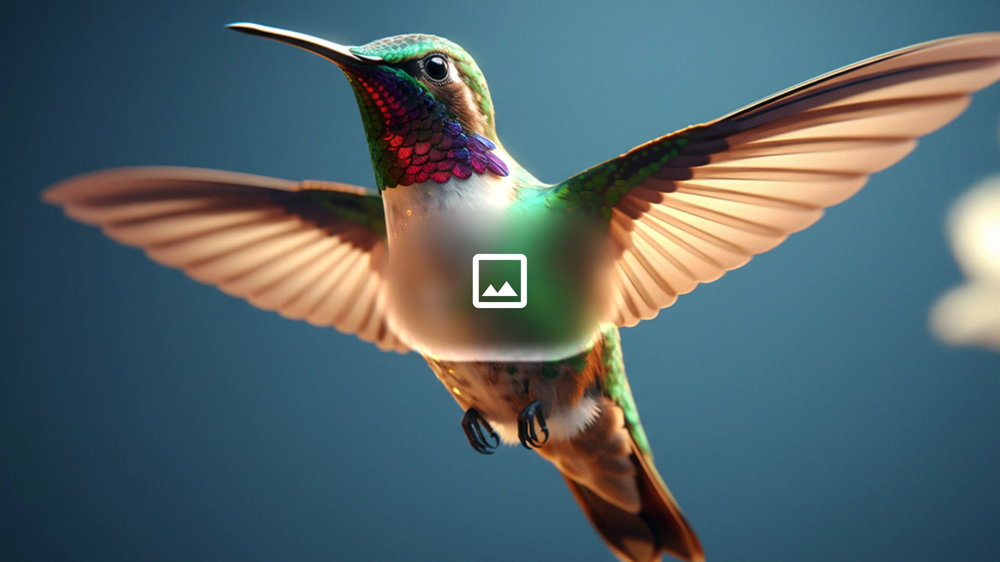

**Girdi Ses:**

https://github.com/user-attachments/assets/6d79cd06-7805-493c-9f27-6985a3da1866

</td>
<td width="300">

**Çıktı:**

https://github.com/user-attachments/assets/a94efea9-14ac-47c2-ab5f-9492400fdc3a

</td>
</tr>
</table>

**Prompt:**

```
The birds from <video> loosely form the imperfect shape of a bird based on <image>. They move to the music from <audio> and dissipate as they fly
```

---

<a id="vaka-3-slayttan-harekete-yoshifujidesign-tarafından"></a>
### Vaka 3: [Slayttan Harekete](https://x.com/yoshifujidesign/status/2058032203175731293) ([@yoshifujidesign](https://x.com/yoshifujidesign) tarafından) `🖼️ Image→Video`

https://github.com/user-attachments/assets/f07a861b-cd0d-4894-8ef1-b74520c7cbd7

**Prompt:**

```
GPT image2でスライド作成 → Gemini Omniでモーション。画面遷移もさせられるし、イラストの動かし方も自然。
```

---

<a id="vaka-4-referans-görselli-i̇zometrik-aşçı-karakter-kumiko_shiraki-tarafından"></a>
### Vaka 4: [Referans Görselli İzometrik Aşçı Karakter](https://x.com/kumiko_shiraki/status/2058337185099546885) ([@kumiko_shiraki](https://x.com/kumiko_shiraki) tarafından) `🖼️ Image→Video`

https://github.com/user-attachments/assets/d5e9b97e-cefa-4cd8-bf70-4e633020f092

**Prompt:**

```
Narrow down reference images and add negative prompts to get closer to your ideal output.
```

> Teknik: Üretilen video vizyonunuzla eşleşmediğinde, (1) referans görselleri daraltın ve (2) istenmeyen öğeleri bastırmak için negatif promptlar ekleyin.

---

<a id="vaka-5-girdi-olarak-chatgpt-talimat-görseli-majin_appsheet-tarafından"></a>
### Vaka 5: [Girdi Olarak ChatGPT Talimat Görseli](https://x.com/Majin_AppSheet/status/2058191091070058846) ([@Majin_AppSheet](https://x.com/Majin_AppSheet) tarafından) `🖼️ Image→Video`

<table>
<tr>
<td width="300">

**Girdi (ChatGPT'den talimat görselleri):**

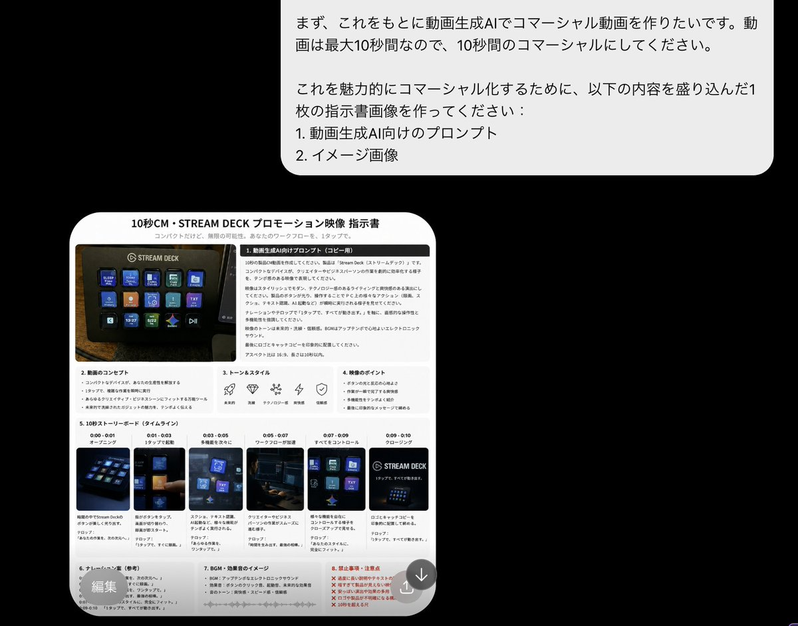

</td>
<td width="300">

**Çıktı:**

https://github.com/user-attachments/assets/578d6968-c6dd-417a-b6fe-100468851f3d

</td>
</tr>
</table>

> İş Akışı: ChatGPT'de talimat/storyboard görselleri oluşturun, ardından bunları görsel prompt olarak doğrudan Gemini Omni'ye besleyin.

---

<a id="vaka-6-chatgpt-i̇llüstrasyonundan-omni-animasyonuna-mmmiyama_d-tarafından"></a>
### Vaka 6: [ChatGPT İllüstrasyonundan Omni Animasyonuna](https://x.com/mmmiyama_D/status/2058654389326516656) ([@mmmiyama_D](https://x.com/mmmiyama_D) tarafından) `🖼️ Image→Video`

<table>
<tr>
<td width="280">

https://github.com/user-attachments/assets/5759f07e-6b2a-4b7d-bb36-52e960a6559e

</td>
<td width="280">

https://github.com/user-attachments/assets/b4fea213-9a0e-46c9-8a6e-9e98b566ffab

</td>
<td width="280">

https://github.com/user-attachments/assets/289e5378-60ad-472b-ba51-da710da81270

</td>
</tr>
</table>

> İş Akışı: ChatGPT görsel üretimi ile illüstrasyon diyagramları oluşturun → bunları Gemini Omni ile animasyonlu hale getirin. Metin bozulmasını bastırmak için belirli promptlar ekleyerek metin oluşturma iyileştirilebilir.

### 📋 Storyboard

<a id="vaka-1-lüks-kozmetik-reklamı-aiwithaly-tarafından"></a>
### Vaka 1: [Lüks Kozmetik Reklamı](https://x.com/aiwithaly/status/2057806821138858314) ([@aiwithaly](https://x.com/aiwithaly) tarafından) `🔤 Text→Video`

https://github.com/user-attachments/assets/6d003859-eb77-4466-9f70-5a76a2269667

**Prompt:**

```
Create a cinematic 10-second ultra-realistic luxury cosmetic commercial in a high-end skincare advertisement style. Use warm champagne lighting, glossy beauty-film aesthetic, shallow depth of field, macro beauty cinematography, smooth cinematic camera movement. 10 scenes from macro serum droplets to final payoff shot.
```

---

<a id="vaka-2-beni-bu-hikayede-göster"></a>
### Vaka 2: Beni Bu Hikayede Göster `🖼️ Image→Video`

<table>
<tr>
<td width="300">

**Girdi:**

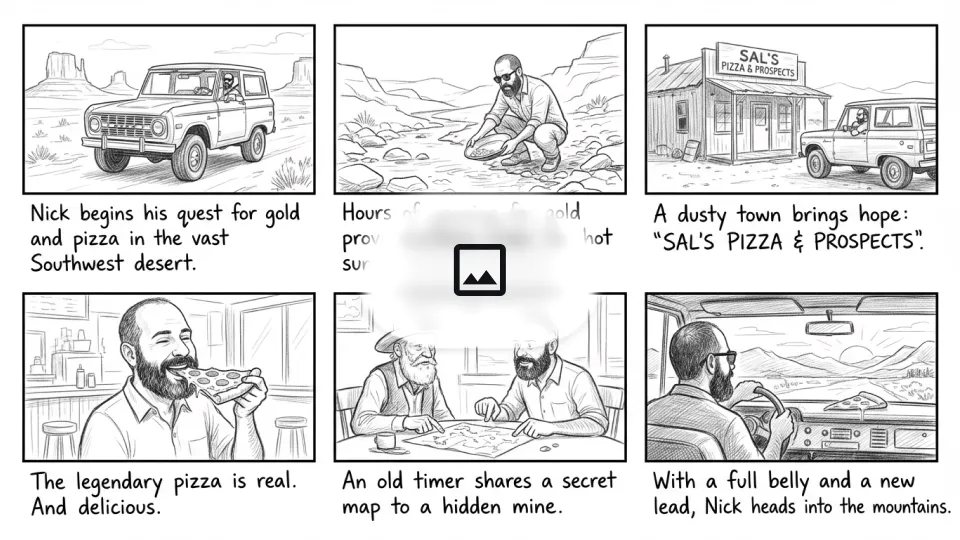
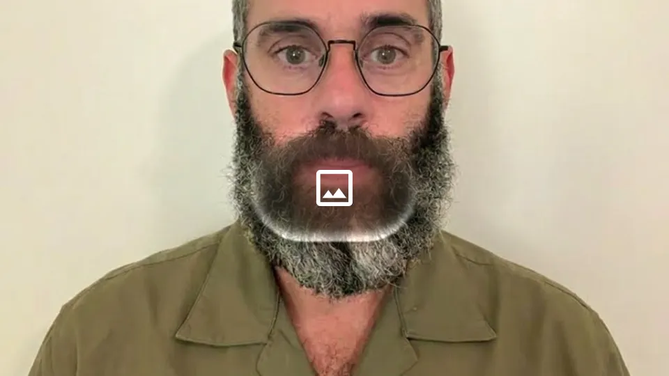

</td>
<td width="300">

**Çıktı:**

https://github.com/user-attachments/assets/8429423d-9b72-4cb6-9e8c-985818f160a7

</td>
</tr>
</table>

**Prompt:**

```
Show me in this story. Follow the story exactly in order starting top left. Entire story in 10 seconds. Cinematic
```

---

<a id="vaka-3-3x3-bölünmüş-ekran-alexanderchen-tarafından"></a>
### Vaka 3: [3x3 Bölünmüş Ekran](https://x.com/alexanderchen/status/2057861567396368841) ([@alexanderchen](https://x.com/alexanderchen) tarafından) `🎬 Video→Video`

https://github.com/user-attachments/assets/587fc95e-526f-4d8d-94c8-feefe34edba9

**Prompt:**

```
Generate a 3x3 split screen video based on different details you see here. Make each cell different, varying the perspective, composition, zoom, angle, camera movement (some static, some moving). Make some of the cells extreme close-ups with detailed textures. Keep it photorealistic, handheld, raw. Only natural sounds.
```

---

<a id="vaka-4-farklı-açılardan-aksiyon-tekrarı-jerrod_lew-tarafından"></a>
### Vaka 4: [Farklı Açılardan Aksiyon Tekrarı](https://x.com/jerrod_lew/status/2057838324140953773) ([@jerrod_lew](https://x.com/jerrod_lew) tarafından) `🎬 Video→Video`

https://github.com/user-attachments/assets/a1179492-74bd-488c-b594-6bc023269c10

**Prompt:**

```
Gemini Omni can create action replays from different angles. I referenced a video clip with agent instructions to generate replays.
```

---

<a id="vaka-5-bölünmüş-ekran-video-jerrod_lew-tarafından"></a>
### Vaka 5: [Bölünmüş Ekran Video](https://x.com/jerrod_lew/status/2057944349846249975) ([@jerrod_lew](https://x.com/jerrod_lew) tarafından) `🎬 Video→Video`

https://github.com/user-attachments/assets/8755d95d-a9b2-4f7c-a56d-bfbbcc47f80e

**Prompt:**

```
Use a reference video and ask the agent for a split screen video.
```

### 🔤 Metin Oluşturma

<a id="vaka-1-alfabe-öğeleri-dizisi"></a>
### Vaka 1: Alfabe Öğeleri Dizisi `🔤 Text→Video`

https://github.com/user-attachments/assets/f7693ec2-ac70-4ac8-813f-8fcb46d90d3d

**Prompt:**

```
The video shows items of the alphabet. An unusual item starting with each letter is shown sitting on a table. All 26 letters must be represented by 26 items with matching lower thirds displaying the letter. Only one item and lower third at a time. Rapid fire, roughly 9 frames per item at 24FPS. Last frame is a slip of paper "THE END".
```

---

<a id="vaka-2-kelime-kelime-metin-senkronizasyonu"></a>
### Vaka 2: Kelime Kelime Metin Senkronizasyonu `🔤 Text→Video`

https://github.com/user-attachments/assets/03620abc-bcb2-4011-a52b-ce13409853c4

**Prompt:**

```
word by word, one word on the screen at a time: did, you, know, that, this, model, can, do, pretty, good, text!? each word appears with a different animated style, perfect pacing to a rhythm, sizzle reel.
```

---

<a id="vaka-3-metin-oluşturma-ai-haberleri-chrisfirst-tarafından"></a>
### Vaka 3: [Metin Oluşturma AI Haberleri](https://x.com/chrisfirst/status/2057863432469361098) ([@chrisfirst](https://x.com/chrisfirst) tarafından) `🔤 Text→Video`

https://github.com/user-attachments/assets/e7d23502-1ca0-4f47-be76-47ff05390508

**Prompt:**

```
Static shot we see them turn the page 3 times. Every flip we see content on both left and right side of book pages. Each contains a big news story around AI for the year of 2025. Include images and crystal clear text.
```

---

<a id="vaka-4-font-moda-defilesi-hbcoop_-tarafından"></a>
### Vaka 4: [Font Moda Defilesi](https://x.com/HBCoop_/status/2057856570558452142) ([@HBCoop_](https://x.com/HBCoop_) tarafından) `🔤 Text→Video`

https://github.com/user-attachments/assets/395d767c-7d8e-4367-941b-0190da9a0284

**Prompt:**

```
Create a 10-second avant-garde fashion editorial where every outfit is inspired by a specific Google Font personality. Each second introduces a new model styled around fonts like Playfair Display, Bebas Neue, Orbitron, Pacifico, Rubik Mono One, and Cormorant Garamond. Font names appear integrated into the environment using their exact typography style. High-fashion runway cinematography with bold lighting, mirrored sets, and surreal motion.
```

## ⚖️ Karşılaştırma

<a id="vaka-1-seedance-20-vs-gemini-omni-flash-jsfilmz0412-tarafından"></a>
### Vaka 1: [Seedance 2.0 vs Gemini Omni Flash](https://x.com/JSFILMZ0412/status/2057926749598736635) ([@JSFILMZ0412](https://x.com/JSFILMZ0412) tarafından) `⚖️ Comparison`

https://github.com/user-attachments/assets/a03e70b5-99c0-4ad8-b26b-9aed6e037f02

> Seedance 2.0 Fast vs Gemini Omni Flash — stil transferi, hareket kalitesi ve sansür karşılaştırması.

---

<a id="vaka-2-gemini-omni-vs-seedance-20-aksiyon-sahneleri-curiousrefuge-tarafından"></a>
### Vaka 2: [Gemini Omni vs Seedance 2.0 Aksiyon Sahneleri](https://x.com/CuriousRefuge/status/2057929340562907451) ([@CuriousRefuge](https://x.com/CuriousRefuge) tarafından) `⚖️ Comparison`

https://github.com/user-attachments/assets/33e09b7d-2357-481d-8536-dab39e75524b

> Gemini Omni video düzenleme modeli vs Seedance 2.0 — büyük aksiyon sahneleri karşılaştırması.

## 🧪 Değerlendirme

<a id="vaka-1-gemini-omni-kalite-değerlendirmesi-kenichiota0711-tarafından"></a>
### Vaka 1: [Gemini Omni Kalite Değerlendirmesi](https://x.com/kenichiota0711/status/2057820346850660769) ([@kenichiota0711](https://x.com/kenichiota0711) tarafından) `🧪 Evaluation`

https://github.com/user-attachments/assets/a9adf476-fac9-4ea2-b5ea-90a50192ccfb

> ほぼ理想的なアウトプットで感動。わずかに揺れる花と髪、まばたきの表現、ノートに書く動作の滑らかさ。

## 🌐 Topluluk Galerisi

Topluluktan yaratıcı deneyler ve vitrinler. Bu vakalar, Gemini Omni ile nelerin mümkün olduğunun genişliğini göstermektedir.

<table>
<tr>
<td width="50%" valign="top">

**[Konsept Odaklı Eğitim Videosu](https://x.com/VORTEX_Promos/status/2058083405204459621)** — [@VORTEX_Promos](https://x.com/VORTEX_Promos) tarafından

https://github.com/user-attachments/assets/ca450aec-a6c8-455f-973d-087bfb3da742

</td>
<td width="50%" valign="top">

**[Showcase](https://x.com/paji_a/status/2058070248436445600)** — [@paji_a](https://x.com/paji_a) tarafından

https://github.com/user-attachments/assets/8ecfe4b0-6de7-47f0-9b83-3dc736512e54

</td>
</tr>
<tr>
<td width="50%" valign="top">

**[Video için Nano Banana — Tutarlılık Testi](https://x.com/WolfRiccardo/status/2058296266270945483)** — [@WolfRiccardo](https://x.com/WolfRiccardo) tarafından

https://github.com/user-attachments/assets/0cabc195-8a2b-47e6-a649-d95b15003964

</td>
<td width="50%" valign="top">

**[Sunum Yapan İzometrik Karakter](https://x.com/kumiko_shiraki/status/2058699566938194382)** — [@kumiko_shiraki](https://x.com/kumiko_shiraki) tarafından

https://github.com/user-attachments/assets/d38627cd-6f23-4ea3-8a95-7cd831229364

</td>
</tr>
<tr>
<td width="50%" valign="top">

**[Tek Cümlelik Sinematik Zen](https://x.com/Dheepanratnam/status/2058372209681342806)** — [@Dheepanratnam](https://x.com/Dheepanratnam) tarafından

https://github.com/user-attachments/assets/d33d9c9d-a68f-4e01-bf1e-c4c8ee60c8ee

</td>
<td width="50%" valign="top">

**[Karakter Dönüşümü — Gösterişliden Günlüğe](https://x.com/HBCoop_/status/2058221428780970398)** — [@HBCoop_](https://x.com/HBCoop_) tarafından

https://github.com/user-attachments/assets/239ca343-cb71-4254-8478-d8947d6c33aa

</td>
</tr>
<tr>
<td width="50%" valign="top">

**[Waymo ile Hindistan'a](https://x.com/iHarnoorSingh/status/2058352557819621617)** — [@iHarnoorSingh](https://x.com/iHarnoorSingh) tarafından

https://github.com/user-attachments/assets/7d23ad1f-63bf-4a3c-ab94-09e8f26c570e

</td>
<td width="50%" valign="top">

**[Gönderilmeyen Mektup — Kısa Film](https://x.com/Strength04_X/status/2058367252299452851)** — [@Strength04_X](https://x.com/Strength04_X) tarafından

https://github.com/user-attachments/assets/df8dcb7c-c918-4fc2-b952-0cb2bcdddfee

</td>
</tr>
</table>

<a id="related-repositories"></a>
## 🔗 İlgili depolar

- [EvoLink video modelleri API rehberini inceleyin](https://github.com/EvoLinkAI/awesome-ai-video-models-api-guide).
- [EvoLink Media MCP deposunu kullanın](https://github.com/EvoLinkAI/evolink-media-mcp).
- [EvoLink'te Seedance 2.5 modelini inceleyin](https://evolink.ai/launch/seedance-2-5?utm_source=github&utm_medium=readme&utm_campaign=awesome-gemini-omni-guide-api-and-prompt&utm_content=related_seedance).

## 🙏 Teşekkürler

Bu depo, mükemmel açık prompt koleksiyonlarından ve topluluk tarafından paylaşılan örneklerden ilham almıştır.

Bu vaka çalışmalarını mümkün kılan resmi Gemini Omni demolarını ve prompt rehberlerini yayınladığı için Google DeepMind'a teşekkür ederiz.

**Topluluk Katkıda Bulunanlar:**

[@emollick](https://x.com/emollick), [@jerrod_lew](https://x.com/jerrod_lew), [@arrakis_ai](https://x.com/arrakis_ai), [@npaka123](https://x.com/npaka123), [@yoshifujidesign](https://x.com/yoshifujidesign), [@chrisfirst](https://x.com/chrisfirst), [@DenneyDara](https://x.com/DenneyDara), [@ZaraIrahh](https://x.com/ZaraIrahh), [@alexanderchen](https://x.com/alexanderchen), [@ariaxawan](https://x.com/ariaxawan), [@RuzainaMeer](https://x.com/RuzainaMeer), [@aiwithaly](https://x.com/aiwithaly), [@HBCoop_](https://x.com/HBCoop_), [@JSFILMZ0412](https://x.com/JSFILMZ0412), [@CuriousRefuge](https://x.com/CuriousRefuge), [@kenichiota0711](https://x.com/kenichiota0711), [@tanabe_fragm](https://x.com/tanabe_fragm), [@venturetwins](https://x.com/venturetwins), [@kumiko_shiraki](https://x.com/kumiko_shiraki), [@Majin_AppSheet](https://x.com/Majin_AppSheet), [@mmmiyama_D](https://x.com/mmmiyama_D), [@VORTEX_Promos](https://x.com/VORTEX_Promos), [@paji_a](https://x.com/paji_a), [@WolfRiccardo](https://x.com/WolfRiccardo), [@Dheepanratnam](https://x.com/Dheepanratnam), [@iHarnoorSingh](https://x.com/iHarnoorSingh), [@Strength04_X](https://x.com/Strength04_X)

*Düzeltilmesi gereken bir şey varsa, lütfen bizimle iletişime geçin ve güncelleyelim.*

Paylaşacak daha ilginç prompt vakalarınız varsa, Evolink prompt kütüphanesini genişletmemize yardımcı olmak için bize ulaşmaktan çekinmeyin.

[](https://www.star-history.com/#EvoLinkAI/awesome-gemini-omni-guide-api-and-prompt&Date)
