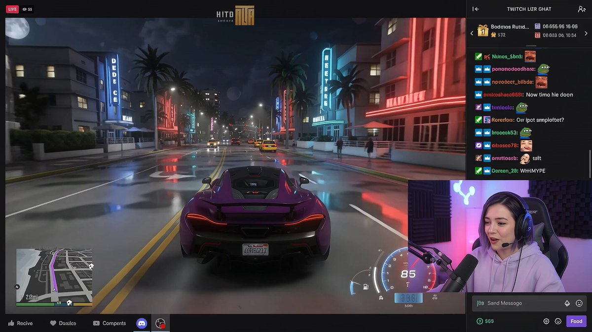
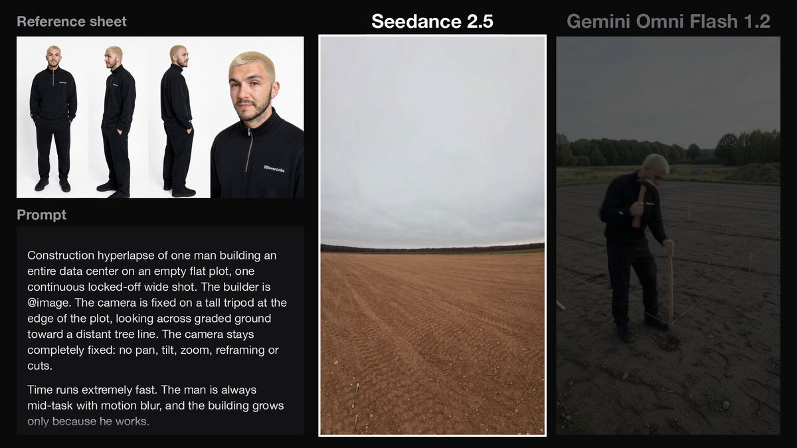
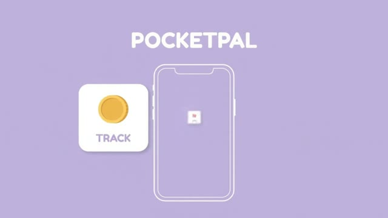
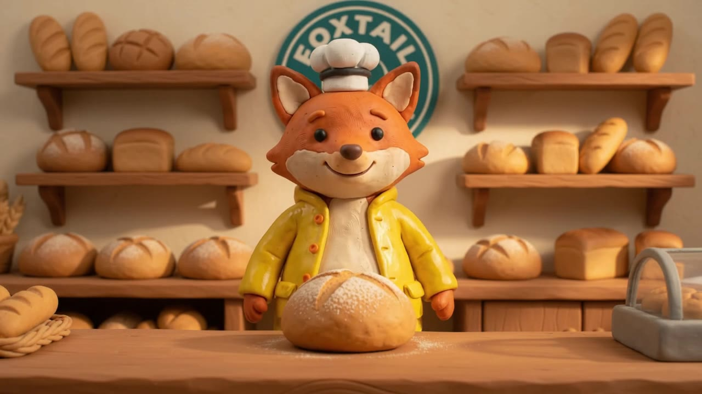
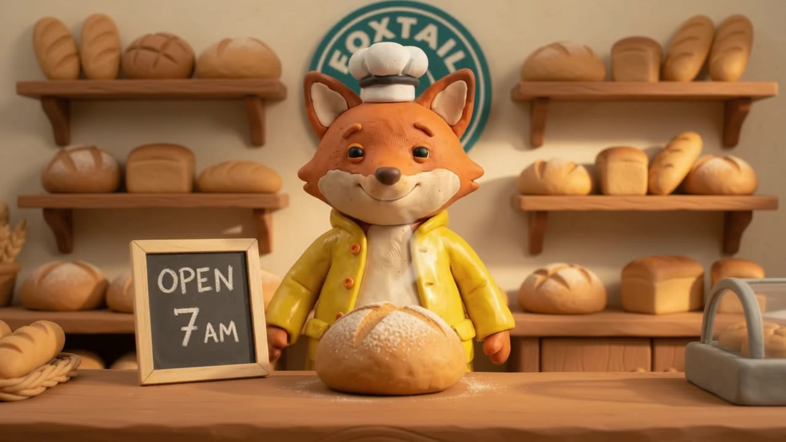

<div align="center">

<a href="https://evolink.ai/gemini-omni?utm_source=github&utm_medium=banner&utm_campaign=awesome-gemini-omni-guide-api-and-prompt&utm_content=readme_banner"></a>

[](LICENSE)
[](https://evolink.ai/gemini-omni-1-2-flash?utm_source=github&utm_medium=badge&utm_campaign=awesome-gemini-omni-guide-api-and-prompt&utm_content=model_try)

[](README.md) [](README_es.md) [](README_pt.md) [](README_ja.md) [](README_ko.md) [](README_de.md) [](README_fr.md) [](README_tr.md) [](README_zh-TW.md) [](README_zh-CN.md) [](README_ru.md)

</div>

# Gemini Omni 1.2 Flash 指南与提示词库

## 🍌 简介
**Gemini Omni 1.2 Flash 使用指南，同时保留 Gemini Omni 家族的提示词、编辑演示、对比和社区视频。** 帮助创作者与开发者选择任务，了解各项输入和输出限制。

> [!NOTE]
> 原有提示词案例、对比和社区画廊属于 Gemini Omni 家族的历史资料。原有提示词、来源与媒体均予保留，不将其作为 Gemini Omni 1.2 Flash 的生成结果或基准测试。

<a id="omni-1-2-guide"></a>
## 🆕 Gemini Omni 1.2 Flash

Google 将 Gemini Omni 1.2 Flash 列为 GA，发布日期为 **2026年11月5日**。相比 1.1，主要变化是适用路由最长可生成 **15秒**视频，以及新增**独立视频超分**。阅读 [Google 模型规格](https://docs.cloud.google.com/gemini-enterprise-agent-platform/models/gemini/omni-1-2-flash)及 [EvoLink 11月5日公告](https://evolink.ai/changelog?utm_source=github&utm_medium=readme&utm_campaign=awesome-gemini-omni-guide-api-and-prompt&utm_content=release_source#2026-11-05-gemini-omni-1-2-flash)。

- 接收文本、图片和视频输入，输出带同步语音、音乐与音效的视频。不支持音频文件输入或声音编辑。
- 原生输出为 **360p / 720p**；**1080p / 4K 通过超分获得**，并非原生 4K。文档标明输出为 24 fps，画幅为 16:9 或 9:16。
- 在 EvoLink 生成 **15 秒**视频时，可选纯文生视频、单张首帧图生视频，或用参考图加最多 1 段参考视频。使用首尾帧组合或 2–3 段参考视频时，时长设为 **3–10 秒**。
- 视频续写每次新增 **3–10秒**；这个值指新增时长，而非最终成片的总时长。

### 选择 EvoLink 任务

各任务均链接至相应请求规范。切换路由前，请先[阅读完整参数文档](https://evolink.ai/docs/en/api-manual/video-series/gemini-omni-1.2-flash/gemini-omni-1.2-flash-overview?utm_source=github&utm_medium=readme&utm_campaign=awesome-gemini-omni-guide-api-and-prompt&utm_content=parameter_overview)。

| 任务 | 适用场景 | 路由限制 |
| :--- | :--- | :--- |
| [阅读文生视频文档](https://evolink.ai/docs/en/api-manual/video-series/gemini-omni-1.2-flash/gemini-omni-1.2-flash-text-to-video?utm_source=github&utm_medium=readme&utm_campaign=awesome-gemini-omni-guide-api-and-prompt&utm_content=route_text) | 根据文本提示词生成镜头。 | 3–15秒。 |
| [阅读图生视频文档](https://evolink.ai/docs/en/api-manual/video-series/gemini-omni-1.2-flash/gemini-omni-1.2-flash-image-to-video?utm_source=github&utm_medium=readme&utm_campaign=awesome-gemini-omni-guide-api-and-prompt&utm_content=route_image) | 让一张首帧图片动起来，或连接首帧与尾帧。 | 单张图片：3–15秒；两张图片：3–10秒。 |
| [阅读参考生视频文档](https://evolink.ai/docs/en/api-manual/video-series/gemini-omni-1.2-flash/gemini-omni-1.2-flash-reference-to-video?utm_source=github&utm_medium=readme&utm_campaign=awesome-gemini-omni-guide-api-and-prompt&utm_content=route_reference) | 用图片或视频参考素材引导新镜头。 | 最多10张图片和3段参考视频；输出超过10秒时，最多1段参考视频。 |
| [阅读视频编辑文档](https://evolink.ai/docs/en/api-manual/video-series/gemini-omni-1.2-flash/gemini-omni-1.2-flash-video-edit?utm_source=github&utm_medium=readme&utm_campaign=awesome-gemini-omni-guide-api-and-prompt&utm_content=route_edit) | 用提示词修改现有片段。 | 一段最长15秒的输入视频；可选参考图片；画质默认值为 `auto`。 |
| [阅读视频续写文档](https://evolink.ai/docs/en/api-manual/video-series/gemini-omni-1.2-flash/gemini-omni-1.2-flash-video-extend?utm_source=github&utm_medium=readme&utm_campaign=awesome-gemini-omni-guide-api-and-prompt&utm_content=route_extend) | 从现有片段末尾继续生成。 | 一段最长30秒的输入视频；新增3–10秒。 |
| [阅读视频超分文档](https://evolink.ai/docs/en/api-manual/video-series/gemini-omni-1.2-flash/gemini-omni-1.2-flash-video-upscale?utm_source=github&utm_medium=readme&utm_campaign=awesome-gemini-omni-guide-api-and-prompt&utm_content=route_upscale) | 提高选定成片的分辨率。 | 输入最长15秒，须为支持的标准尺寸；无需提示词。请同时查看下方的平台差异。 |

### 平台与版本差异

- **参考素材：** [AI Studio 使用指南](https://aistudio.google.com/docs/omni)允许最多6张图片，Google Cloud 与 EvoLink 文档则列出最多10张。参考视频限制也随输出时长变化，应以所选平台的请求规范为准。
- **超分：** Google Cloud 列出 360p→720p/1080p 和 720p→1080p/4K，并明确排除 1080p→4K。EvoLink 文档另列有 1080p→4K。这一额外组合需要向所选平台确认，不能视为跨平台的共同保证。阅读 [Google 超分限制](https://docs.cloud.google.com/gemini-enterprise-agent-platform/models/video/upscale-videos)。
- **会话状态：** Google 的 Interactions API 支持对话式编辑。EvoLink 异步视频任务使用独立请求规范，不要直接传入 `previous_interaction_id` 或其他 Google 专用参数。
- **迁移：** [Google 模型页](https://aistudio.google.com/docs/models/gemini-omni-flash)计划于2026年12月3日将 Gemini API 的 1.1 stable ID 转向 1.2。这不代表 EvoLink 的 1.1 路由也会迁移。应明确选择 1.2 任务，不要将旧通用 ID 当作别名。
- **费用：** EvoLink 模型页展示按 token 计费的价格。token 单价不等于每秒或每条成片的固定费用。估算任务费用前，应核对当前路由、分辨率和实际用量。

来源核对日期：**2026年11月6日**。

<a id="quick-start"></a>
## ⚡ 快速开始

[在浏览器中试用 Gemini Omni 1.2 Flash](https://evolink.ai/gemini-omni-1-2-flash?utm_source=github&utm_medium=quickstart&utm_campaign=awesome-gemini-omni-guide-api-and-prompt&utm_content=browser_try)，或[阅读最新任务文档](https://evolink.ai/docs/en/api-manual/video-series/gemini-omni-1.2-flash/gemini-omni-1.2-flash-overview?utm_source=github&utm_medium=quickstart&utm_campaign=awesome-gemini-omni-guide-api-and-prompt&utm_content=task_docs)。

从上方任务表中选择文生视频、图生视频、参考生成、编辑、续写或超分。各项输入、限制及结果处理流程，请以所选任务的最新文档为准。

## 📑 目录
- [Gemini Omni 1.2 Flash 指南](#omni-1-2-guide)
- [快速开始](#quick-start)
- [Gemini Omni 1.2 官方演示](#omni12-demos)
- [Gemini Omni 1.2 社区演示墙](#omni12-community-demos)
- [🎯 提示词要素](#-提示词要素)
- [✂️ 编辑](#️-编辑)
  - [🔄 元素替换](#-元素替换)
    - [案例 1：蝴蝶变蜜蜂](#案例-1蝴蝶变蜜蜂)
    - [案例 2：蜜蜂变萤火虫](#案例-2蜜蜂变萤火虫)
    - [案例 3-5：飞船与宇航员系列](#案例-3-5飞船与宇航员系列)
    - [案例 6：1896年火车变换（作者 @emollick）](#案例-61896年火车变换作者-emollick)
    - [案例 7：从视频中移除人物（作者 @arrakis_ai）](#案例-7从视频中移除人物作者-arrakis_ai)
    - [案例 8：隐形小提琴](#案例-8隐形小提琴)
    - [案例 9：利用世界知识更换地点（作者 @venturetwins）](#案例-9利用世界知识更换地点作者-venturetwins)
    - [案例 10：动画转真人实拍（作者 @arrakis_ai）](#案例-10动画转真人实拍作者-arrakis_ai)
  - [🎬 基础场景](#-基础场景)
    - [案例 1：小提琴手基础镜头](#案例-1小提琴手基础镜头)
  - [📷 镜头调度](#-镜头调度)
    - [案例 1：过肩角度](#案例-1过肩角度)
    - [案例 2：镜头从鞋子上摇到中景](#案例-2镜头从鞋子上摇到中景)
    - [案例 3：旅行自拍延时摄影（作者 @ZaraIrahh）](#案例-3旅行自拍延时摄影作者-zarairahh)
    - [案例 4：时尚无人机镜头（作者 @ariaxawan）](#案例-4时尚无人机镜头作者-ariaxawan)
    - [案例 5：俯视图到360度旋转（作者 @npaka123）](#案例-5俯视图到360度旋转作者-npaka123)
    - [案例 6：Omnizoom — 潜入照片（作者 @alexanderchen）](#案例-6omnizoom--潜入照片作者-alexanderchen)
  - [🎬 动作与同步](#-动作与同步)
    - [案例 1：动物玩具声音](#案例-1动物玩具声音)
    - [案例 2：公寓灯光同步](#案例-2公寓灯光同步)
    - [案例 3：弹珠链式反应](#案例-3弹珠链式反应)
    - [案例 4：建筑灯光](#案例-4建筑灯光)
    - [案例 5：拳击对战写实风格（作者 @RuzainaMeer）](#案例-5拳击对战写实风格作者-ruzainameer)
- [🎨 高级多模态](#-高级多模态)
  - [🪞 艺术风格](#-艺术风格)
    - [案例 1-3：镜子系列](#案例-1-3镜子系列)
    - [案例 4：动画广告一镜到底（作者 @DenneyDara）](#案例-4动画广告一镜到底作者-denneydara)
    - [案例 5：线条画提取（作者 @alexanderchen）](#案例-5线条画提取作者-alexanderchen)
  - [✨ 视觉特效](#-视觉特效)
    - [案例 1：手洞超级变焦](#案例-1手洞超级变焦)
    - [案例 2：滑板运动特效](#案例-2滑板运动特效)
    - [案例 3：AR HUD 叠加（作者 @jerrod_lew）](#案例-3ar-hud-叠加作者-jerrod_lew)
  - [🔗 跨模态](#-跨模态)
    - [案例 1：转移到新环境](#案例-1转移到新环境)
    - [案例 2：鸟群形状配合音频](#案例-2鸟群形状配合音频)
    - [案例 3：幻灯片转动态（作者 @yoshifujidesign）](#案例-3幻灯片转动态作者-yoshifujidesign)
    - [案例 4：料理担当等距人物（配合参照图）（作者 @kumiko_shiraki）](#案例-4料理担当等距人物配合参照图作者-kumiko_shiraki)
    - [案例 5：ChatGPT 指示书图像作为输入（作者 @Majin_AppSheet）](#案例-5chatgpt-指示书图像作为输入作者-majin_appsheet)
    - [案例 6：ChatGPT 插图转 Omni 动画（作者 @mmmiyama_D）](#案例-6chatgpt-插图转-omni-动画作者-mmmiyama_d)
  - [📋 分镜](#-分镜)
    - [案例 1：奢华化妆品广告（作者 @aiwithaly）](#案例-1奢华化妆品广告作者-aiwithaly)
    - [案例 2：让我出现在这个故事中](#案例-2让我出现在这个故事中)
    - [案例 3：3x3 分屏（作者 @alexanderchen）](#案例-33x3-分屏作者-alexanderchen)
    - [案例 4：不同角度的动作回放（作者 @jerrod_lew）](#案例-4不同角度的动作回放作者-jerrod_lew)
    - [案例 5：分屏视频（作者 @jerrod_lew）](#案例-5分屏视频作者-jerrod_lew)
  - [🔤 文字渲染](#-文字渲染)
    - [案例 1：字母表物品序列](#案例-1字母表物品序列)
    - [案例 2：逐字文字同步](#案例-2逐字文字同步)
    - [案例 3：文字渲染 AI 新闻（作者 @chrisfirst）](#案例-3文字渲染-ai-新闻作者-chrisfirst)
    - [案例 4：字体时装秀（作者 @HBCoop_）](#案例-4字体时装秀作者-hbcoop_)
- [⚖️ 对比](#️-对比)
  - [案例 1：Seedance 2.0 vs Gemini Omni Flash（作者 @JSFILMZ0412）](#案例-1seedance-20-vs-gemini-omni-flash作者-jsfilmz0412)
  - [案例 2：Gemini Omni vs Seedance 2.0 动作场景（作者 @CuriousRefuge）](#案例-2gemini-omni-vs-seedance-20-动作场景作者-curiousrefuge)
- [🧪 评估](#-评估)
  - [案例 1：Gemini Omni 质量评估（作者 @kenichiota0711）](#案例-1gemini-omni-质量评估作者-kenichiota0711)
- [🌐 社区画廊](#-社区画廊)
- [相关仓库](#related-repositories)
- [🙏 致谢](#-致谢)

<a id="omni12-demos"></a>
## 🎬 Gemini Omni 1.2 演示

Google 于 **2026年11月5日**发布的八组官方演示。阅读[原始发布文章](https://blog.google/innovation-and-ai/technology/developers-tools/introducing-gemini-omni-1-2-flash/)；点击预览图观看 Google 原始视频。

<table>
<tr>
<td width="50%" valign="top">

<a id="omni12-demo-1"></a>
**[15 秒虚拟试衣](https://storage.googleapis.com/gweb-uniblog-publish-prod/original_videos/ECom_Try_On_Demo.mp4)**

[](https://storage.googleapis.com/gweb-uniblog-publish-prod/original_videos/ECom_Try_On_Demo.mp4)

一张模特照片与三套服装引导生成一段 15 秒的虚拟试衣蒙太奇。

</td>
<td width="50%" valign="top">

<a id="omni12-demo-2"></a>
**[分层文字排版动画](https://storage.googleapis.com/gweb-uniblog-publish-prod/original_videos/Typographic_Motion_Graphics_Demo.mp4)**

[](https://storage.googleapis.com/gweb-uniblog-publish-prod/original_videos/Typographic_Motion_Graphics_Demo.mp4)

动画海报组合材质与文字；Google 同时展示 1.1 和 1.2 的输出。

</td>
</tr>
<tr>
<td width="50%" valign="top">

<a id="omni12-demo-3"></a>
**[对话式背景替换](https://storage.googleapis.com/gweb-uniblog-publish-prod/original_videos/Video_Background_Editing_Demo.mp4)**

[](https://storage.googleapis.com/gweb-uniblog-publish-prod/original_videos/Video_Background_Editing_Demo.mp4)

通过连续对话替换片段背景，同时保留两名身穿盔甲的角色。

</td>
<td width="50%" valign="top">

<a id="omni12-demo-4"></a>
**[万神殿连续穿越镜头](https://storage.googleapis.com/gweb-uniblog-publish-prod/original_videos/Pantheon_Tour_Demo_FuU0KUh.mp4)**

[](https://storage.googleapis.com/gweb-uniblog-publish-prod/original_videos/Pantheon_Tour_Demo_FuU0KUh.mp4)

两张建筑照片引导镜头连续飞行，穿过万神殿的穹顶。

</td>
</tr>
<tr>
<td width="50%" valign="top">

<a id="omni12-demo-5"></a>
**[15 秒蜂巢解说](https://storage.googleapis.com/gweb-uniblog-publish-prod/original_videos/Bee_Hive_Live_Infographic_Demo_ninuxtc.mp4)**

[](https://storage.googleapis.com/gweb-uniblog-publish-prod/original_videos/Bee_Hive_Live_Infographic_Demo_ninuxtc.mp4)

一张风格帧转化为由四个镜头组成的 15 秒蜂巢插画解说。

</td>
<td width="50%" valign="top">

<a id="omni12-demo-6"></a>
**[从章鱼到舞者的动作迁移](https://storage.googleapis.com/gweb-uniblog-publish-prod/original_videos/Unexpected_Motion_Tracking_Demo_QRzpS2T.mp4)**

[](https://storage.googleapis.com/gweb-uniblog-publish-prod/original_videos/Unexpected_Motion_Tracking_Demo_QRzpS2T.mp4)

后续编辑将章鱼流畅的动作迁移到舞者的裙装上。

</td>
</tr>
<tr>
<td width="50%" valign="top">

<a id="omni12-demo-7"></a>
**[拉面店首尾帧连接](https://storage.googleapis.com/gweb-uniblog-publish-prod/original_videos/Ramen_Bar_Demo_jeWGtqx.mp4)**

[](https://storage.googleapis.com/gweb-uniblog-publish-prod/original_videos/Ramen_Bar_Demo_jeWGtqx.mp4)

通过首帧与尾帧连接拉面店外景和内景；Google 的对比中包含可见的不一致。

</td>
<td width="50%" valign="top">

<a id="omni12-demo-8"></a>
**[海岛连续拉远镜头](https://storage.googleapis.com/gweb-uniblog-publish-prod/original_videos/Castaway_Crash_Zoom_Out_Demo.mp4)**

[](https://storage.googleapis.com/gweb-uniblog-publish-prod/original_videos/Castaway_Crash_Zoom_Out_Demo.mp4)

一个 10 秒镜头从海岸特写连续拉远到海岛广角景观。

</td>
</tr>
</table>

<a id="omni12-community-demos"></a>
## 🎥 Gemini Omni 1.2 社区演示墙

收录创作者和工具团队发布的 14 个 Gemini Omni 1.2 Flash 示例。点击预览即可观看原片。标题链接至作者的帖子或文章，作者公开的提示词可在来源中查看。

<table>
<tr>
<td width="50%" valign="top">

<a id="omni12-community-1"></a>
**[跟着节拍切换街头穿搭](https://x.com/HarshithLucky3/status/2118401265273360530)** · HarshithLucky3

[](https://video-s.twimg.com/amplify_video/2118400792348770305/vid/avc1/640x360/y-KZwoASoz81lFXx.mp4?tag=29)

街头走秀以拍手声为切换信号，快速更换服装。创作者公开了提示词。

</td>
<td width="50%" valign="top">

<a id="omni12-community-2"></a>
**[多种风格同台的生日派对](https://x.com/ash_twtz/status/2118393918794707053)** · ash_twtz

[](https://video-s.twimg.com/amplify_video/2118393860493905920/vid/avc1/640x360/W2r1uWl7T7aS8Bms.mp4?tag=29)

定格动画、3D、漫画和动漫风格的角色出现在同一个生日派对场景中。

</td>
</tr>
<tr>
<td width="50%" valign="top">

<a id="omni12-community-3"></a>
**[按时间码编排的水瓶广告](https://weel.co.jp/media/tech/gemini-omni-1-2-flash/)** · WEEL

[](https://www.youtube.com/watch?v=u6P7rxZlSQI)

WEEL 测试了一条 15 秒的产品广告，为三段演出指定了时间节点。文章附有提示词。

</td>
<td width="50%" valign="top">

<a id="omni12-community-4"></a>
**[用首尾帧呈现香水亮相](https://blog.segmind.com/gemini-omni-1-2-flash-is-here-generate-and-edit-15-second-videos/)** · Segmind

[](https://segmind-resources.s3.amazonaws.com/blog/gemini-omni-12-flash/i2v-fl10.mp4)

两张参考帧引导 10 秒的香水展示从昏暗的摄影棚过渡到阳光下的花丛。文章附有提示词。

</td>
</tr>
<tr>
<td width="50%" valign="top">

<a id="omni12-community-5"></a>
**[陶艺师与参考图中的花瓶](https://blog.segmind.com/gemini-omni-1-2-flash-is-here-generate-and-edit-15-second-videos/)** · Segmind

[](https://segmind-resources.s3.amazonaws.com/blog/gemini-omni-12-flash/ref10.mp4)

分别为陶艺师和花瓶提供参考素材，生成带口播的产品镜头。文章附有提示词。

</td>
<td width="50%" valign="top">

<a id="omni12-community-6"></a>
**[波兰节日晚餐的三人对话](https://promptif.fr/gemini-omni-1-2-flash-test/)** · Promptif

[](https://promptif.fr/wp-content/uploads/2026/11/omni12-cc251d82201c7f7e2cbd2d57b6e9715b.mp4)

以波兰节日晚餐为背景，测试三人轮流说话时的衔接和口型同步。

</td>
</tr>
<tr>
<td width="50%" valign="top">

<a id="omni12-community-7"></a>
**[带主播小窗的游戏画面](https://x.com/rovvmut_/status/2118752554746270169)** · rovvmut_

[](https://video.twimg.com/amplify_video/2118752493798825984/vid/avc1/640x360/ABYvurfZ5k_VXKKA.mp4?tag=29)

创作者用提示词设计游戏直播画面，包含驾驶场景、画面角落的主播小窗和英文解说。原帖公开了提示词。

</td>
<td width="50%" valign="top">

<a id="omni12-community-8"></a>
**[固定视角的施工延时视频](https://x.com/alecwilcock/status/2118716313275142188)** · alecwilcock

[](https://video.twimg.com/amplify_video/2118715983812497409/vid/avc1/640x360/rLsfCIZnQmAvu0SI.mp4?tag=29)

创作者用数据中心施工延时视频对比 Omni 1.2 Flash 和 Seedance 2.5。原帖公开了两个模型共用的提示词。

</td>
</tr>
<tr>
<td width="50%" valign="top">

<a id="omni12-community-9"></a>
**[同一提示词下的无对白对比](https://x.com/husky__create/status/2118637071887953952)** · husky__create

**Omni 1.2 Flash**

[](https://video-s.twimg.com/amplify_video/2118637038430015488/vid/avc1/640x360/goYQmD8hpI3NIsS5.mp4?tag=16)

**Omni 1.1 Flash**

[](https://video-s.twimg.com/amplify_video/2118637056083787776/vid/avc1/640x360/srtblIdulfmUfOeA.mp4?tag=16)

创作者在同一提示词中要求不加对白，对比 Omni 1.2 Flash 和 1.1 Flash。两段输出均可观看。

</td>
<td width="50%" valign="top">

<a id="omni12-community-10"></a>
**[让静态拼贴动起来](https://x.com/mmmiyama_D/status/2118467997870465516)** · mmmiyama_D

[](https://video-s.twimg.com/amplify_video/2118467980497747968/vid/avc1/480x852/7oxu6hnjA__basp0.mp4?tag=16)

创作者用 Omni 1.2 Flash 为引用帖中的静态拼贴添加了动态效果。

</td>
</tr>
<tr>
<td width="50%" valign="top">

<a id="omni12-community-11"></a>
**[应用介绍视频的提示词对比](https://www.segmind.com/@himanshu/gemini-omni-1-2-flash-prompts)** · Himanshu Goel

**一句话指令**

[](https://segmind-resources.s3.amazonaws.com/blog/gemini-omni-prompts-ex1_vague.mp4)

**标明时间的分镜清单**

[](https://segmind-resources.s3.amazonaws.com/blog/gemini-omni-prompts-ex1_structured.mp4)

Goel 用两种提示词制作了 8 秒的预算管理应用介绍视频。他固定模型、随机种子、时长和分辨率，对比一句话指令与标明时间的分镜清单。

</td>
<td width="50%" valign="top">

<a id="omni12-community-12"></a>
**[狐狸面包师视频续写](https://www.segmind.com/@himanshu/gemini-omni-1-2-flash-prompts)** · Himanshu Goel

**8 秒原片**

[](https://segmind-resources.s3.amazonaws.com/blog/gemini-omni-prompts-ex3_ref.mp4)

**续写后的 13 秒视频**

[](https://segmind-resources.s3.amazonaws.com/blog/gemini-omni-prompts-ex5_extend.mp4)

Goel 将一段 8 秒的黏土狐狸面包店视频续写了 5 秒。续写后的 13 秒视频多出一块写有营业时间的黑板。文章展示了参考图片和提示词。

</td>
</tr>
<tr>
<td width="50%" valign="top">

<a id="omni12-community-13"></a>
**[通过对话编辑马克杯视频](https://www.aiformortals.co/blog/gemini-omni-flash-1-2-tested#gemini-omni-video-editing-three-rounds-of-chat-edits)** · Pat Simmons

**修改背景后**

[](https://uzgqbjufkfadoprvamcs.supabase.co/storage/v1/object/public/daily-img/gemini-omni-flash-1-2-tested/t3-edit1-background.mp4)

**提出加快运镜的请求后**

[](https://uzgqbjufkfadoprvamcs.supabase.co/storage/v1/object/public/daily-img/gemini-omni-flash-1-2-tested/t3-edit3-pacing.mp4)

Simmons 在 Gemini 应用中成功将背景改成了下雨的窗边。据他记录，之后要求把灯光调暖、加快运镜的两次编辑，均未出现肉眼可见的变化。

</td>
<td width="50%" valign="top">

<a id="omni12-community-14"></a>
**[在 Flow 中生成会说话的酱油吉祥物](https://note.com/pharma_i_cist/n/n227466896971)** · 濱口貴光

[](https://www.youtube.com/watch?v=SNDK6KC5atU)

滨口上传了角色参考图并添加自定义日语配音，在 Google Flow 中生成了会说话的吉祥物。文章展示了设置步骤和原始生成结果。

</td>
</tr>
</table>

## 🎯 提示词要素
Gemini Omni 具有强大的**世界理解能力**——它能调用历史、科学和文化方面的真实世界知识。你不需要过度解释每个细节，只需用自然语言表达你的创意意图，让 Omni 的推理能力来补充其余部分。
从零开始创建新视频时，可以混合以下维度来控制输出：
| 维度 | 需要指定的内容 | 示例 |
| :--- | :--- | :--- |
| **构图与运动** | 广角、中景或特写。镜头轨迹：缓慢滑动、突然推进、静态锁定、推拉变焦等。 | `A close-up tracking shot smoothly pushing in` |
| **风格** | 整体视觉艺术方向 | `Vintage monochrome hologram`, `3D voxel art`, `colored crayon aesthetic` |
| **光线** | 场景氛围和灯光设置 | `Warm champagne lighting`, `dim overhead gym lights` |
| **场景** | 环境和背景 | `Small underground gym`, `futuristic neon cityscape` |
| **动作** | 主体行为和运动 | `The person touches the mirror`, `a marble rolling fast on a chain reaction track` |
> [!TIP]
> **迭代编辑：** Omni 支持多轮对话编辑。它会保留有效的部分，只修改你要求更改的内容——无需每次重新描述整个场景。只需说出下一步要改什么。

> [!TIP]
> **[保持画面稳定](https://x.com/tanabe_fragm/status/2058103447006896406)（作者 [@tanabe_fragm](https://x.com/tanabe_fragm)）：** 编辑视频时，在 prompt 里加上"不要改变其他部分"或"保持其他地方不变"等表述，可以显著减少非指定区域被意外修改的情况。
>
> https://github.com/user-attachments/assets/285ee7d8-7dfe-4304-a9a4-648026073b80

## ✂️ 编辑

### 🔄 元素替换

<a id="案例-1蝴蝶变蜜蜂"></a>
### 案例 1：蝴蝶变蜜蜂 `🎬 Video→Video`

<table>
<tr>
<td width="300">

**输入：**

https://github.com/user-attachments/assets/8feb4d7b-825d-4a4a-bd9d-900754cf5d38

</td>
<td width="300">

**输出：**

https://github.com/user-attachments/assets/60f31f6d-895e-4048-b477-9a46a5d20b90

</td>
</tr>
</table>

**提示词：**

```
Change the butterfly to a bee.
```

---

<a id="案例-2蜜蜂变萤火虫"></a>
### 案例 2：蜜蜂变萤火虫 `🎬 Video→Video`

<table>
<tr>
<td width="300">

**输入：**

https://github.com/user-attachments/assets/60f31f6d-895e-4048-b477-9a46a5d20b90

</td>
<td width="300">

**输出：**

https://github.com/user-attachments/assets/76fc8e97-c7d1-40bc-9e79-bd6705aa8267

</td>
</tr>
</table>

**提示词：**

```
Change the bee into a small swarm of fireflies.
```

---

<a id="案例-3-5飞船与宇航员系列"></a>
### 案例 3-5：飞船与宇航员系列 `🎬 Video→Video`

<table>
<tr>
<td colspan="3">

**输入：**

https://github.com/user-attachments/assets/26ea7e43-9787-4096-82f9-e10543229bec

</td>
</tr>
<tr>
<td width="300">

https://github.com/user-attachments/assets/dd9ae5b1-0205-45ac-a651-258af1c4f12c

### 案例 3：飞船变白色折纸

</td>
<td width="300">

https://github.com/user-attachments/assets/78ef5301-b759-4dda-9995-3ee0d259a7b1

### 案例 4：宇航员变海葵

</td>
<td width="300">

https://github.com/user-attachments/assets/0cbadb19-8a5b-4a2c-9093-e3a84f3dd988

### 案例 5：小飞船变魔鬼鱼

</td>
</tr>
</table>

**提示词：**

```
Case 3: Change the ships to be made from white origami paper.
```

```
Case 4: Change the astronaut to a sea anemone.
```

```
Case 5: Change the small ships to stingrays.
```

---

<a id="案例-61896年火车变换作者-emollick"></a>
### 案例 6：[1896年火车变换](https://x.com/emollick/status/2057874739817808223)（作者 [@emollick](https://x.com/emollick)） `🎬 Video→Video`

https://github.com/user-attachments/assets/275cc90e-adaa-48ff-9ff8-1e96ea29d44f

**提示词：**

```
I took the famous "train" movie from 1896 & made it a bullet train, LEGO, added a time traveler, a centipede, muppets...
```

---

<a id="案例-7从视频中移除人物作者-arrakis_ai"></a>
### 案例 7：[从视频中移除人物](https://x.com/arrakis_ai/status/2057939231755178439)（作者 [@arrakis_ai](https://x.com/arrakis_ai)） `🎬 Video→Video`

https://github.com/user-attachments/assets/72379fb2-ac30-4d1e-a6b4-143052f8f061

**提示词：**

```
Remove the person from this video perfectly.
```

---

<a id="案例-8隐形小提琴"></a>
### 案例 8：隐形小提琴 `🎬 Video→Video`

<table>
<tr>
<td width="300">

**输入：**

https://github.com/user-attachments/assets/88176743-d17e-48fe-89f3-528fe60df7fd

</td>
<td width="300">

**输出：**

https://github.com/user-attachments/assets/ac6457aa-158c-4a0b-852f-ce1f3367bc3f

</td>
</tr>
</table>

**提示词：**

```
Make the violin invisible
```

---

<a id="案例-9利用世界知识更换地点作者-venturetwins"></a>
### 案例 9：[利用世界知识更换地点](https://x.com/venturetwins/status/2058235415883313361)（作者 [@venturetwins](https://x.com/venturetwins)） `🎬 Video→Video`

https://github.com/user-attachments/assets/daa90750-fc7b-49ea-b85d-364411159663

**提示词：**

```
Re-shoot this video in [location] based on the screenshot from Google Maps.
```

> 上传 Waymo 乘车视频后，根据 Google Maps 截图让 Omni 在不同地点重新拍摄。模型利用其世界知识无缝切换环境。

---

<a id="案例-10动画转真人实拍作者-arrakis_ai"></a>
### 案例 10：[动画转真人实拍](https://x.com/arrakis_ai/status/2058488373057302797)（作者 [@arrakis_ai](https://x.com/arrakis_ai)） `🎬 Video→Video`

https://github.com/user-attachments/assets/3c6be2a9-3e67-4deb-8ccd-fb493b715f65

**提示词：**

```
Turn this animation into live action.
```

### 🎬 基础场景

<a id="案例-1小提琴手基础镜头"></a>
### 案例 1：小提琴手基础镜头 `🔤 Text→Video`

https://github.com/user-attachments/assets/93de5898-88ee-4bfc-a36f-19d8aa99dfc1

**提示词：**

```
A video of a violinist playing a song.
```

### 📷 镜头调度

<a id="案例-1过肩角度"></a>
### 案例 1：过肩角度 `🎬 Video→Video`

<table>
<tr>
<td width="300">

**输入：**

https://github.com/user-attachments/assets/ac6457aa-158c-4a0b-852f-ce1f3367bc3f

</td>
<td width="300">

**输出：**

https://github.com/user-attachments/assets/71aa1c8d-0287-4591-b239-68322919293d

</td>
</tr>
</table>

**提示词：**

```
Change the camera angle to be over the violinist's shoulder.
```

---

<a id="案例-2镜头从鞋子上摇到中景"></a>
### 案例 2：镜头从鞋子上摇到中景 `🎬 Video→Video`

<table>
<tr>
<td width="300">

**输入：**

https://github.com/user-attachments/assets/19dbc1ae-1e9e-4b7b-9069-e979fffe3651

</td>
<td width="300">

**输出：**

https://github.com/user-attachments/assets/c0ccbda0-4fd0-42be-8620-db7a67a5347d

</td>
</tr>
</table>

**提示词：**

```
Change the camera angle, a close-up on his shoes, quickly tilting up to medium shot, then widening.
```

---

<a id="案例-3旅行自拍延时摄影作者-zarairahh"></a>
### 案例 3：[旅行自拍延时摄影](https://x.com/ZaraIrahh/status/2057775215749349520)（作者 [@ZaraIrahh](https://x.com/ZaraIrahh)） `🔤 Text→Video`

https://github.com/user-attachments/assets/31fa5a56-6113-4376-873b-5e40d26803f1

**提示词：**

```
Create a 10-second cinematic hyper-lapse selfie travel video of the uploaded female character across 20 world-famous destinations in 2026. Hard cuts every 0.5 seconds synced to the beat. Handheld selfie-stick camera, wide-angle lens, close selfie framing, energetic travel-vlogger style, vibrant cinematic colors, realistic lighting, dynamic motion blur, natural crowds, and clear landmarks in every shot.
```

---

<a id="案例-4时尚无人机镜头作者-ariaxawan"></a>
### 案例 4：[时尚无人机镜头](https://x.com/ariaxawan/status/2057794715744084042)（作者 [@ariaxawan](https://x.com/ariaxawan)） `🔤 Text→Video`

https://github.com/user-attachments/assets/b199a5ab-e008-4a72-aa03-094bc6d573e6

**提示词：**

```
A 10 second ultra cinematic hyper realistic FPV fashion drone shot filmed in a single continuous take inside a futuristic luxury tunnel. Single continuous take, aggressive FPV motion, ultra smooth cinematic flight path, luxury high-fashion editorial atmosphere.
```

---

<a id="案例-5俯视图到360度旋转作者-npaka123"></a>
### 案例 5：[俯视图到360度旋转](https://x.com/npaka123/status/2058033145845575735)（作者 [@npaka123](https://x.com/npaka123)） `🖼️ Image→Video`

https://github.com/user-attachments/assets/1ad202cb-a485-4b7a-9c8c-d4fea4a3b6d5

**提示词：**

```
この教室の中央から黒板を見ているファーストパーソンなゲーム視点。360度カメラを回転。教室の黒板右側の窓の外は廊下、黒板左側の窓の外は校庭。
```

---

<a id="案例-6omnizoom--潜入照片作者-alexanderchen"></a>
### 案例 6：[Omnizoom — 潜入照片](https://x.com/alexanderchen/status/2058330610574221672)（作者 [@alexanderchen](https://x.com/alexanderchen)） `🖼️ Image→Video`

https://github.com/user-attachments/assets/9fd3ad2a-6e4a-4ac0-ab29-48f1c303b95f

**提示词：**

```
Omnizoom — diving into a photo.
```

### 🎬 动作与同步

<a id="案例-1动物玩具声音"></a>
### 案例 1：动物玩具声音 `🎬 Video→Video`

https://github.com/user-attachments/assets/fbf377d7-1b39-43af-92e6-665792d05de0

**提示词：**

```
When the finger in <video> touches the animal toy play the sound the animal makes
```

---

<a id="案例-2公寓灯光同步"></a>
### 案例 2：公寓灯光同步 `🎬+🎵 Video+Audio→Video`

<table>
<tr>
<td width="300">

**输入：**

https://github.com/user-attachments/assets/6fa879c3-5ee8-4ff1-bbe9-6648d750277d

</td>
<td width="300">

**输出：**

https://github.com/user-attachments/assets/3f010e2a-a471-4b0d-8782-c4c5547cd2a5

</td>
</tr>
</table>

**提示词：**

```
The lights of the apartments start turning on in sync with the music.
```

---

<a id="案例-3弹珠链式反应"></a>
### 案例 3：弹珠链式反应 `🔤 Text→Video`

https://github.com/user-attachments/assets/1ece8df7-f29a-4ebd-ad68-9c910f811590

**提示词：**

```
A marble rolling fast on a chain reaction style track, continuous smooth shot
```

---

<a id="案例-4建筑灯光"></a>
### 案例 4：建筑灯光 `🎬+🎵 Video+Audio→Video`

<table>
<tr>
<td width="300">

**输入：**

https://github.com/user-attachments/assets/efbc0d8d-b64a-4ef9-afe6-fed4a8b66102

</td>
<td width="300">

**输出：**

https://github.com/user-attachments/assets/51727436-1fc2-426b-afaa-86bb63cfba0f

</td>
</tr>
</table>

**提示词：**

```
The lights of the buildings start turning on in sync with the music.
```

---

<a id="案例-5拳击对战写实风格作者-ruzainameer"></a>
### 案例 5：[拳击对战写实风格](https://x.com/RuzainaMeer/status/2057785474446741728)（作者 [@RuzainaMeer](https://x.com/RuzainaMeer)） `🔤 Text→Video`

https://github.com/user-attachments/assets/6796bf78-8bad-441c-889d-30621ee62cd7

**提示词：**

```
Ultra-realistic 10-second boxing fight between two women inside a small underground gym. Both fighters look naturally athletic with realistic skin texture, sweat, bruises, and detailed facial expressions. The fight feels raw and authentic, like real professional sparring footage. The camera moves handheld around the ring at close range, capturing fast punches, defensive movement, realistic footwork, and heavy breathing.
```

## 🎨 高级多模态

### 🪞 艺术风格

<a id="案例-1-3镜子系列"></a>
### 案例 1-3：镜子系列 `🎬 Video→Video`

<table>
<tr>
<td width="300">

https://github.com/user-attachments/assets/747cdc6b-f5fa-4482-b745-2839551e9ba2

### 案例 1：镜面液态金属波纹

</td>
<td width="300">

https://github.com/user-attachments/assets/36ea02a2-3716-44aa-9bc2-a5cc1480d0bf

### 案例 2：镜面线条画

</td>
<td width="300">

https://github.com/user-attachments/assets/dbca6772-dd7a-4418-a0e6-a39796a91c97

### 案例 3：镜面布偶

</td>
</tr>
</table>

**提示词：**

```
Case 1: When the person touches the mirror, make the mirror ripple beautifully like liquid, and the person's arm turns into reflective mirror material
```

```
Case 2: When the person touches the mirror, the person transforms into a detailed monochrome line art drawing
```

```
Case 3: When the person touches the mirror, the person suddenly transforms into a cute felted stuffed puppet version with large googley eyes and glasses
```

---

<a id="案例-4动画广告一镜到底作者-denneydara"></a>
### 案例 4：[动画广告一镜到底](https://x.com/DenneyDara/status/2057844409639551380)（作者 [@DenneyDara](https://x.com/DenneyDara)） `🔤 Text→Video`

https://github.com/user-attachments/assets/edacf1c5-94db-4687-8eaa-f87ebf5fabee

**提示词：**

```
Make a Pixar-style video of an aloe leaf that is walking through the forest that talks about how good nature makes it feel. Have it say, "Organic and healthy ingredients make me feel so good."
```

---

<a id="案例-5线条画提取作者-alexanderchen"></a>
### 案例 5：[线条画提取](https://x.com/alexanderchen/status/2057925025915666673)（作者 [@alexanderchen](https://x.com/alexanderchen)） `🎬 Video→Video`

https://github.com/user-attachments/assets/787813c0-2e20-4999-8383-fd76a9b21f91

**提示词：**

```
Extract the key object in this video. Render a video showing that object as a black diagram-style line art drawing on solid 100% white background, nothing else in background. Keep the motion and sound exactly as is.
```

---

### ✨ 视觉特效

<a id="案例-1手洞超级变焦"></a>
### 案例 1：手洞超级变焦 `🎬 Video→Video`

https://github.com/user-attachments/assets/06683ef4-16e0-47b0-93ec-c6222560ee13

**提示词：**

```
Make it look like the weird shape of my hand hole super zooms and magnifies the ground it's looking at in sharper quality.
```

---

<a id="案例-2滑板运动特效"></a>
### 案例 2：滑板运动特效 `🎬 Video→Video`

https://github.com/user-attachments/assets/44c120a2-38a7-43d7-89fa-a23d0842078c

**提示词：**

```
Edit this keeping everything the same. Add animated motion effects coming out of the skateboard.
```

---

<a id="案例-3ar-hud-叠加作者-jerrod_lew"></a>
### 案例 3：[AR HUD 叠加](https://x.com/jerrod_lew/status/2058337271947079977)（作者 [@jerrod_lew](https://x.com/jerrod_lew)） `🎬 Video→Video`

https://github.com/user-attachments/assets/04b11cd7-d345-4172-b6e5-38301e73bb77

**提示词：**

```
Create a virtual HUD and UI overlay for this recorded phone video, like an AR glasses experience with secondary screens.
```

### 🔗 跨模态

<a id="案例-1转移到新环境"></a>
### 案例 1：转移到新环境 `🎬+🖼️ Video+Image→Video`

<table>
<tr>
<td width="300">

**输入：**

https://github.com/user-attachments/assets/93de5898-88ee-4bfc-a36f-19d8aa99dfc1

</td>
<td width="300">

**输出：**

https://github.com/user-attachments/assets/88176743-d17e-48fe-89f3-528fe60df7fd

</td>
</tr>
</table>

**提示词：**

```
Transport the violinist to the image environment
```

---

<a id="案例-2鸟群形状配合音频"></a>
### 案例 2：鸟群形状配合音频 `🎬+🖼️+🎵 Multi-Modal`

<table>
<tr>
<td width="300">

**输入视频：**

https://github.com/user-attachments/assets/66946870-b366-4981-90b3-c9a35aca69b1

**输入图片：**


**输入音频：**

https://github.com/user-attachments/assets/6d79cd06-7805-493c-9f27-6985a3da1866

</td>
<td width="300">

**输出：**

https://github.com/user-attachments/assets/a94efea9-14ac-47c2-ab5f-9492400fdc3a

</td>
</tr>
</table>

**提示词：**

```
The birds from <video> loosely form the imperfect shape of a bird based on <image>. They move to the music from <audio> and dissipate as they fly
```

---

<a id="案例-3幻灯片转动态作者-yoshifujidesign"></a>
### 案例 3：[幻灯片转动态](https://x.com/yoshifujidesign/status/2058032203175731293)（作者 [@yoshifujidesign](https://x.com/yoshifujidesign)） `🖼️ Image→Video`

https://github.com/user-attachments/assets/f07a861b-cd0d-4894-8ef1-b74520c7cbd7

**提示词：**

```
GPT image2でスライド作成 → Gemini Omniでモーション。画面遷移もさせられるし、イラストの動かし方も自然。
```

---

<a id="案例-4料理担当等距人物配合参照图作者-kumiko_shiraki"></a>
### 案例 4：[料理担当等距人物（配合参照图）](https://x.com/kumiko_shiraki/status/2058337185099546885)（作者 [@kumiko_shiraki](https://x.com/kumiko_shiraki)） `🖼️ Image→Video`

https://github.com/user-attachments/assets/d5e9b97e-cefa-4cd8-bf70-4e633020f092

**提示词：**

```
Narrow down reference images and add negative prompts to get closer to your ideal output.
```

> 技巧：当生成的视频与预期不符时，(1) 缩小参考图范围，(2) 增加 negative prompt 抑制不希望出现的元素。

---

<a id="案例-5chatgpt-指示书图像作为输入作者-majin_appsheet"></a>
### 案例 5：[ChatGPT 指示书图像作为输入](https://x.com/Majin_AppSheet/status/2058191091070058846)（作者 [@Majin_AppSheet](https://x.com/Majin_AppSheet)） `🖼️ Image→Video`

<table>
<tr>
<td width="300">

**输入（来自 ChatGPT 的指示书图像）：**


</td>
<td width="300">

**输出：**

https://github.com/user-attachments/assets/578d6968-c6dd-417a-b6fe-100468851f3d

</td>
</tr>
</table>

> 工作流：在 ChatGPT 中生成指示书/分镜图，然后直接喂给 Gemini Omni 作为视觉 prompt。

---

<a id="案例-6chatgpt-插图转-omni-动画作者-mmmiyama_d"></a>
### 案例 6：[ChatGPT 插图转 Omni 动画](https://x.com/mmmiyama_D/status/2058654389326516656)（作者 [@mmmiyama_D](https://x.com/mmmiyama_D)） `🖼️ Image→Video`

<table>
<tr>
<td width="280">

https://github.com/user-attachments/assets/5759f07e-6b2a-4b7d-bb36-52e960a6559e

</td>
<td width="280">

https://github.com/user-attachments/assets/b4fea213-9a0e-46c9-8a6e-9e98b566ffab

</td>
<td width="280">

https://github.com/user-attachments/assets/289e5378-60ad-472b-ba51-da710da81270

</td>
</tr>
</table>

> 工作流：用 ChatGPT 图像生成绘制示意图 → 用 Gemini Omni 制作动画。通过特定 prompt 可以抑制文字渲染崩坏的问题。

### 📋 分镜

<a id="案例-1奢华化妆品广告作者-aiwithaly"></a>
### 案例 1：[奢华化妆品广告](https://x.com/aiwithaly/status/2057806821138858314)（作者 [@aiwithaly](https://x.com/aiwithaly)） `🔤 Text→Video`

https://github.com/user-attachments/assets/6d003859-eb77-4466-9f70-5a76a2269667

**提示词：**

```
Create a cinematic 10-second ultra-realistic luxury cosmetic commercial in a high-end skincare advertisement style. Use warm champagne lighting, glossy beauty-film aesthetic, shallow depth of field, macro beauty cinematography, smooth cinematic camera movement. 10 scenes from macro serum droplets to final payoff shot.
```

---

<a id="案例-2让我出现在这个故事中"></a>
### 案例 2：让我出现在这个故事中 `🖼️ Image→Video`

<table>
<tr>
<td width="300">

**输入：**


</td>
<td width="300">

**输出：**

https://github.com/user-attachments/assets/8429423d-9b72-4cb6-9e8c-985818f160a7

</td>
</tr>
</table>

**提示词：**

```
Show me in this story. Follow the story exactly in order starting top left. Entire story in 10 seconds. Cinematic
```

---

<a id="案例-33x3-分屏作者-alexanderchen"></a>
### 案例 3：[3x3 分屏](https://x.com/alexanderchen/status/2057861567396368841)（作者 [@alexanderchen](https://x.com/alexanderchen)） `🎬 Video→Video`

https://github.com/user-attachments/assets/587fc95e-526f-4d8d-94c8-feefe34edba9

**提示词：**

```
Generate a 3x3 split screen video based on different details you see here. Make each cell different, varying the perspective, composition, zoom, angle, camera movement (some static, some moving). Make some of the cells extreme close-ups with detailed textures. Keep it photorealistic, handheld, raw. Only natural sounds.
```

---

<a id="案例-4不同角度的动作回放作者-jerrod_lew"></a>
### 案例 4：[不同角度的动作回放](https://x.com/jerrod_lew/status/2057838324140953773)（作者 [@jerrod_lew](https://x.com/jerrod_lew)） `🎬 Video→Video`

https://github.com/user-attachments/assets/a1179492-74bd-488c-b594-6bc023269c10

**提示词：**

```
Gemini Omni can create action replays from different angles. I referenced a video clip with agent instructions to generate replays.
```

---

<a id="案例-5分屏视频作者-jerrod_lew"></a>
### 案例 5：[分屏视频](https://x.com/jerrod_lew/status/2057944349846249975)（作者 [@jerrod_lew](https://x.com/jerrod_lew)） `🎬 Video→Video`

https://github.com/user-attachments/assets/8755d95d-a9b2-4f7c-a56d-bfbbcc47f80e

**提示词：**

```
Use a reference video and ask the agent for a split screen video.
```

---

### 🔤 文字渲染

<a id="案例-1字母表物品序列"></a>
### 案例 1：字母表物品序列 `🔤 Text→Video`

https://github.com/user-attachments/assets/f7693ec2-ac70-4ac8-813f-8fcb46d90d3d

**提示词：**

```
The video shows items of the alphabet. An unusual item starting with each letter is shown sitting on a table. All 26 letters must be represented by 26 items with matching lower thirds displaying the letter. Only one item and lower third at a time. Rapid fire, roughly 9 frames per item at 24FPS. Last frame is a slip of paper "THE END".
```

---

<a id="案例-2逐字文字同步"></a>
### 案例 2：逐字文字同步 `🔤 Text→Video`

https://github.com/user-attachments/assets/03620abc-bcb2-4011-a52b-ce13409853c4

**提示词：**

```
word by word, one word on the screen at a time: did, you, know, that, this, model, can, do, pretty, good, text!? each word appears with a different animated style, perfect pacing to a rhythm, sizzle reel.
```

---

<a id="案例-3文字渲染-ai-新闻作者-chrisfirst"></a>
### 案例 3：[文字渲染 AI 新闻](https://x.com/chrisfirst/status/2057863432469361098)（作者 [@chrisfirst](https://x.com/chrisfirst)） `🔤 Text→Video`

https://github.com/user-attachments/assets/e7d23502-1ca0-4f47-be76-47ff05390508

**提示词：**

```
Static shot we see them turn the page 3 times. Every flip we see content on both left and right side of book pages. Each contains a big news story around AI for the year of 2025. Include images and crystal clear text.
```

---

<a id="案例-4字体时装秀作者-hbcoop_"></a>
### 案例 4：[字体时装秀](https://x.com/HBCoop_/status/2057856570558452142)（作者 [@HBCoop_](https://x.com/HBCoop_)） `🔤 Text→Video`

https://github.com/user-attachments/assets/395d767c-7d8e-4367-941b-0190da9a0284

**提示词：**

```
Create a 10-second avant-garde fashion editorial where every outfit is inspired by a specific Google Font personality. Each second introduces a new model styled around fonts like Playfair Display, Bebas Neue, Orbitron, Pacifico, Rubik Mono One, and Cormorant Garamond. Font names appear integrated into the environment using their exact typography style. High-fashion runway cinematography with bold lighting, mirrored sets, and surreal motion.
```

## ⚖️ 对比

<a id="案例-1seedance-20-vs-gemini-omni-flash作者-jsfilmz0412"></a>
### 案例 1：[Seedance 2.0 vs Gemini Omni Flash](https://x.com/JSFILMZ0412/status/2057926749598736635)（作者 [@JSFILMZ0412](https://x.com/JSFILMZ0412)） `⚖️ Comparison`

https://github.com/user-attachments/assets/a03e70b5-99c0-4ad8-b26b-9aed6e037f02

> Seedance 2.0 Fast 与 Gemini Omni Flash——风格迁移、运动质量和审查对比。

---

<a id="案例-2gemini-omni-vs-seedance-20-动作场景作者-curiousrefuge"></a>
### 案例 2：[Gemini Omni vs Seedance 2.0 动作场景](https://x.com/CuriousRefuge/status/2057929340562907451)（作者 [@CuriousRefuge](https://x.com/CuriousRefuge)） `⚖️ Comparison`

https://github.com/user-attachments/assets/33e09b7d-2357-481d-8536-dab39e75524b

> Gemini Omni 视频编辑模型 vs Seedance 2.0——大型动作场景对比。

---

## 🧪 评估

<a id="案例-1gemini-omni-质量评估作者-kenichiota0711"></a>
### 案例 1：[Gemini Omni 质量评估](https://x.com/kenichiota0711/status/2057820346850660769)（作者 [@kenichiota0711](https://x.com/kenichiota0711)） `🧪 Evaluation`

https://github.com/user-attachments/assets/a9adf476-fac9-4ea2-b5ea-90a50192ccfb

> ほぼ理想的なアウトプットで感動。わずかに揺れる花と髪、まばたきの表現、ノートに書く動作の滑らかさ。

## 🌐 社区画廊

来自社区的创意实验和展示，这些案例展现了 Gemini Omni 的能力广度。

<table>
<tr>
<td width="50%" valign="top">

**[概念驱动的教学视频](https://x.com/VORTEX_Promos/status/2058083405204459621)** — 作者 [@VORTEX_Promos](https://x.com/VORTEX_Promos)

https://github.com/user-attachments/assets/ca450aec-a6c8-455f-973d-087bfb3da742

</td>
<td width="50%" valign="top">

**[案例展示](https://x.com/paji_a/status/2058070248436445600)** — 作者 [@paji_a](https://x.com/paji_a)

https://github.com/user-attachments/assets/8ecfe4b0-6de7-47f0-9b83-3dc736512e54

</td>
</tr>
<tr>
<td width="50%" valign="top">

**[视频版 Nano Banana — 一致性测试](https://x.com/WolfRiccardo/status/2058296266270945483)** — 作者 [@WolfRiccardo](https://x.com/WolfRiccardo)

https://github.com/user-attachments/assets/0cabc195-8a2b-47e6-a649-d95b15003964

</td>
<td width="50%" valign="top">

**[演讲的等距角色](https://x.com/kumiko_shiraki/status/2058699566938194382)** — 作者 [@kumiko_shiraki](https://x.com/kumiko_shiraki)

https://github.com/user-attachments/assets/d38627cd-6f23-4ea3-8a95-7cd831229364

</td>
</tr>
<tr>
<td width="50%" valign="top">

**[一句话生成禅意视频](https://x.com/Dheepanratnam/status/2058372209681342806)** — 作者 [@Dheepanratnam](https://x.com/Dheepanratnam)

https://github.com/user-attachments/assets/d33d9c9d-a68f-4e01-bf1e-c4c8ee60c8ee

</td>
<td width="50%" valign="top">

**[角色变换 — 从华丽到日常](https://x.com/HBCoop_/status/2058221428780970398)** — 作者 [@HBCoop_](https://x.com/HBCoop_)

https://github.com/user-attachments/assets/239ca343-cb71-4254-8478-d8947d6c33aa

</td>
</tr>
<tr>
<td width="50%" valign="top">

**[Waymo 到印度](https://x.com/iHarnoorSingh/status/2058352557819621617)** — 作者 [@iHarnoorSingh](https://x.com/iHarnoorSingh)

https://github.com/user-attachments/assets/7d23ad1f-63bf-4a3c-ab94-09e8f26c570e

</td>
<td width="50%" valign="top">

**[未寄出的信 — 短片](https://x.com/Strength04_X/status/2058367252299452851)** — 作者 [@Strength04_X](https://x.com/Strength04_X)

https://github.com/user-attachments/assets/df8dcb7c-c918-4fc2-b952-0cb2bcdddfee

</td>
</tr>
</table>

<a id="related-repositories"></a>
## 🔗 相关仓库

- [查看 EvoLink 视频模型 API 指南](https://github.com/EvoLinkAI/awesome-ai-video-models-api-guide)。
- [使用 EvoLink Media MCP 仓库](https://github.com/EvoLinkAI/evolink-media-mcp)。
- [在 EvoLink 上了解 Seedance 2.5](https://evolink.ai/launch/seedance-2-5?utm_source=github&utm_medium=readme&utm_campaign=awesome-gemini-omni-guide-api-and-prompt&utm_content=related_seedance)。

## 🙏 致谢

本仓库的灵感来源于优秀的开放提示词合集和社区分享的示例。

感谢 Google DeepMind 发布的官方 Gemini Omni 演示和提示词指南，使这些案例研究成为可能。

**社区贡献者：**

[@emollick](https://x.com/emollick), [@jerrod_lew](https://x.com/jerrod_lew), [@arrakis_ai](https://x.com/arrakis_ai), [@npaka123](https://x.com/npaka123), [@yoshifujidesign](https://x.com/yoshifujidesign), [@chrisfirst](https://x.com/chrisfirst), [@DenneyDara](https://x.com/DenneyDara), [@ZaraIrahh](https://x.com/ZaraIrahh), [@alexanderchen](https://x.com/alexanderchen), [@ariaxawan](https://x.com/ariaxawan), [@RuzainaMeer](https://x.com/RuzainaMeer), [@aiwithaly](https://x.com/aiwithaly), [@HBCoop_](https://x.com/HBCoop_), [@JSFILMZ0412](https://x.com/JSFILMZ0412), [@CuriousRefuge](https://x.com/CuriousRefuge), [@kenichiota0711](https://x.com/kenichiota0711), [@tanabe_fragm](https://x.com/tanabe_fragm), [@venturetwins](https://x.com/venturetwins), [@kumiko_shiraki](https://x.com/kumiko_shiraki), [@Majin_AppSheet](https://x.com/Majin_AppSheet), [@mmmiyama_D](https://x.com/mmmiyama_D), [@VORTEX_Promos](https://x.com/VORTEX_Promos), [@paji_a](https://x.com/paji_a), [@WolfRiccardo](https://x.com/WolfRiccardo), [@Dheepanratnam](https://x.com/Dheepanratnam), [@iHarnoorSingh](https://x.com/iHarnoorSingh), [@Strength04_X](https://x.com/Strength04_X)

*如有任何需要更正的内容，请联系我们，我们会及时更新。*

如果你有更多有趣的提示词案例想要分享，欢迎联系我们，帮助我们扩展 Evolink 提示词库。

[](https://www.star-history.com/#EvoLinkAI/awesome-gemini-omni-guide-api-and-prompt&Date)
